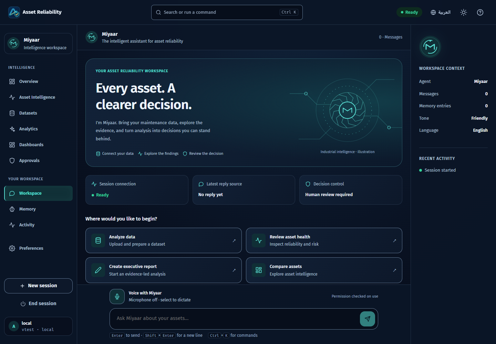
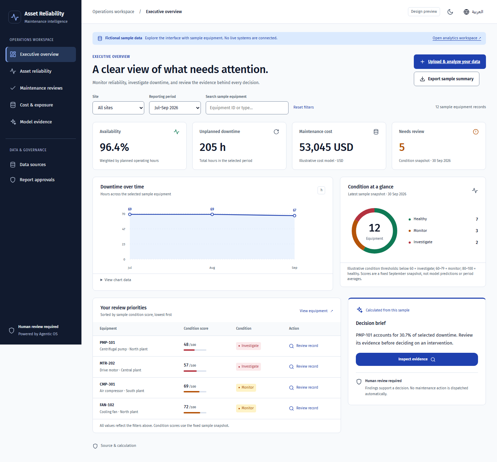
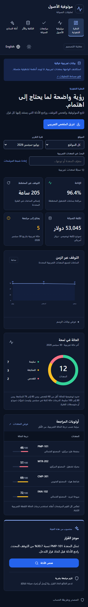

# Asset Reliability · موثوقية الأصول

**Turn maintenance data into findings, inspect the evidence, and review the next decision.**

AI-Driven Predictive Maintenance and Asset Reliability Decision-Support System
SaaS Project combines a bilingual workspace with governed analytics. **Miyaar / معيار**
is the assistant, **Hermes** coordinates the specialists, and **Agentic OS** is the engine.

Python · FastAPI · React · TypeScript · English / العربية

[Get started](#get-started) · [Product tour](#product-tour) · [Capabilities](#capabilities) ·
[Project guide](#project-guide) · [Testing](#testing)

*Product screenshots below are actual interface renders with labelled synthetic data.
[Image provenance](docs/REPOSITORY_GUIDE.md#visual-assets).*

## What this workspace helps you do

- **Consult reviewed method references.** The [MBA analytics reference](knowledge/mba-analytics/README.md) contains original source-cited summaries and validation guidance, with [partial coverage](knowledge/mba-analytics/COVERAGE.md). Existing source lookup includes it by default; model-context forwarding remains disabled. Reference availability is not evidence that an analytical agent has used it.

- **Find what needs attention.** Explore downtime, maintenance cost and asset observations within a defined dataset and period.
- **Understand the finding.** Follow the analysis, inspect calculations, compare models with baselines, and read the limitations.
- **Make the decision.** Review the exact report before approving publication; preserve its evidence for the next conversation.
- **Inspect RMD evidence.** Import private reference documents and workbooks,
  reconcile source records, inspect cited findings and review proposed actions.
  [Capability and acceptance notes](docs/RMD_EVIDENCE.md).

**Ask → Select data → Follow the analysis → Inspect evidence → Review → Approve → Publish**

The product is under active development. Prediction quality, operational savings
and hosted service readiness require their own evidence. Current scope and
acceptance gates are recorded in the [project charter](docs/PROJECT_CHARTER.md)
and [known limitations](docs/KNOWN_LIMITATIONS.md).

## Current status and runtime

The repository implements real data upload, governed analysis, evidence review
and approval-bound publication. Hosted activation and independent maintenance
acceptance remain separate from source-code completion.

- **Local workspace:** a single local owner with persistent local state and no
  sign-in; appropriate for authorized work on a trusted computer.
- **Public demo:** shared read-only identity and fictional data, not a live
  maintenance service or durable customer workspace.
- **Managed hosted operation:** provider-verified identity, server-side roles,
  owner-scoped storage and worker foundations exist in source. The intended
  provider, schema, recovery and complete authenticated journey must be
  verified before calling a deployment operational.

A Vercel page or green build is not that acceptance. The code supports PKCE
email onboarding/recovery and conditional Google/Apple sign-in. These methods
are shown only after matching callback/provider configuration; an email request
is not a verified login, and new accounts do not gain workspace permissions
automatically. [Setup, identity and release boundaries](docs/REPOSITORY_GUIDE.md).

## Product tour

### Miyaar: a workspace for the question and its context



*Actual Chromium render with a synthetic test session. Model replies, dictation
and read-aloud depend on the configured runtime and browser support.*

<details>
<summary><strong>Explore the maintenance overview and Arabic phone layout</strong></summary>

### Maintenance executive overview



*Interactive design preview using fictional equipment, costs and conditions.
These figures are not results from an uploaded dataset or a live telemetry feed.*

### Arabic, right to left, on a phone

<p align="center">
  
</p>

*Actual preview render with fictional fixtures. See the
[maintenance UI specification](docs/design/MAINTENANCE_UI_SPEC.md) and
[Miyaar handoff](docs/design/MIYAAR_UI_HANDOFF.md) for interactions and evidence.*

</details>

## Get started

Use Python 3.10+ and a compatible Node.js release; see
[system requirements](#system-requirements). Clone into a short folder name.
Repository access and application sign-in are separate. See
[the runtime guide](docs/REPOSITORY_GUIDE.md#three-runtime-modes).

```bash
git clone https://github.com/ahmadzayan-hub/AI-Driven-Predictive-Maintenance-and-Asset-Reliability-Decision-Support-System-Project.git asset-reliability
cd asset-reliability
python -m venv .venv

# Linux / macOS
source .venv/bin/activate
# Windows PowerShell: .\.venv\Scripts\Activate.ps1

python -m pip install --require-hashes -r requirements.txt
npm --prefix frontend ci
npm --prefix frontend run build
python scripts/serve.py            # this computer only; add --lan for a phone on the same Wi-Fi
```

Open **<http://127.0.0.1:8000>**. The server hosts the interface and API.
This default is a single local-owner workspace with local persistence and no
sign-in, not a hosted multi-user account. Keep it on loopback for private work.
The deterministic analysis path needs no model-provider credentials.

| Your goal | Start here |
| --- | --- |
| Analyze a file | Open `http://127.0.0.1:8000/#/runs?source=upload`; review columns, mapping and the business question before starting. |
| Inspect private RMD evidence | Open http://127.0.0.1:8000/#/rmd; create a pack, import sources, confirm mappings, then inspect and review its calculated snapshot. |
| Explore the fictional maintenance preview | Open `http://127.0.0.1:8000/?design=maintenance`; its sample review marks are local and do not dispatch work. |
| Use local chat and optional voice | Follow the bilingual [local AI setup](docs/LOCAL_AI_SETUP.md); microphone text becomes an editable draft. |
| Continue analysis after closing the browser | Run the [background worker](#background-worker-optional) with the same configuration; it still stops for approval. |

For file formats, workbook sheets, limits and the complete analysis journey,
use the [dataset guide](docs/DATASET_ANALYTICS.md). Uploading a file does not
establish that its data supports a prediction or a causal conclusion.

## Capabilities

| Area | Available in the repository | Where to go deeper |
| --- | --- | --- |
| Data preparation | Tabular uploads, stored datasets, column roles, explicit joins and cleaned-data access | [Dataset guide](docs/DATASET_ANALYTICS.md) |
| Governed analysis | Specialist stages, observed progress, pause/recovery, calculations and validation | [Agent catalog](docs/AGENT_CATALOG.md) |
| Maintenance and models | Domain contracts, diagnostics and model evaluation against baselines | [Product scope](docs/PROJECT_CHARTER.md) |
| Decisions and reports | Filtered dashboards, asset evidence, report review and approval-bound publication | [Executive workspace](docs/design/EXECUTIVE_DASHBOARD_HANDOFF.md) |
| Conversation | Miyaar, memory, preferences and optional local models or voice | [Workspace handoff](docs/design/MIYAAR_UI_HANDOFF.md) |
| Language and access | English/Arabic RTL, light/dark themes and responsive browser/PWA surfaces | [User guide](user_guide.md) |

## Evidence before action


*Original AI-generated editorial image: a measurement and a person's review.
It does not document a real asset, sensor connection or customer installation.*

Figures come from server calculations. Models must be assessed against suitable
baselines, and weak or unavailable results stay visible. Source records do not
go to a language model; optional narration uses verified findings.

Review the exact report and its limitations before approving publication.
Exporting a brief, marking a preview record reviewed, and approving a report
are distinct actions. The interface does not establish savings, failure
probabilities or commercial readiness by displaying a score.

## Project guide

| Read this | For |
| --- | --- |
| [Project charter and roadmap](docs/PROJECT_CHARTER.md) | Product decisions, current capabilities and acceptance gates |
| [Dataset analytics](docs/DATASET_ANALYTICS.md) | Real uploads, mapping, joins and background execution |
| [User guide](user_guide.md) | Everyday workspace and command-line use |
| [Local AI setup](docs/LOCAL_AI_SETUP.md) | Optional local models, voice and runtime checks |
| [Architecture](#architecture) and [developer reference](#developer-reference) | Engine, API, configuration and operational commands |
| [Testing](#testing) and [GitHub checks](https://github.com/ahmadzayan-hub/AI-Driven-Predictive-Maintenance-and-Asset-Reliability-Decision-Support-System-Project/actions) | Dated verification results and current workflow status |
| [Known limitations](docs/KNOWN_LIMITATIONS.md) | Remaining domain, device, privacy and hosted-operation work |
| [Runtime and release guide](docs/REPOSITORY_GUIDE.md) | Local, demo and hosted modes; identity, persistence and acceptance |
| [Contributing](CONTRIBUTING.md) | Collaboration, setup and repository rules |

<div dir="rtl" lang="ar">

## البدء بالعربية

**موثوقية الأصول** مساحة عمل لتحليل بيانات الصيانة ومراجعة الأدلة قبل اتخاذ القرار.
المساعد **معيار** يربط السؤال بالبيانات، وينسّق **هيرميس** مراحل التحليل.
يمكنك رفع ملفك، ومراجعة الأعمدة والنتائج والقيود، ثم الموافقة على نشر التقرير المحدد.
واجهة الصيانة التجريبية تستخدم بيانات خيالية، ولا تمثّل مراقبة مباشرة للمعدات.
التشغيل المحلي يعمل لمستخدم واحد دون تسجيل دخول؛ التشغيل المستضاف يحتاج تحققًا
فعليًا من الهوية والصلاحيات وقاعدة البيانات والاستعادة، وليس مجرد صفحة منشورة.

[دليل رفع البيانات والتحليل](docs/DATASET_ANALYTICS.md#البدء-بالعربية) ·
[إعداد الذكاء الاصطناعي المحلي](docs/LOCAL_AI_SETUP.md) ·
[دليل الاستخدام](user_guide.md)

</div>


## Developer reference

<details>
<summary><strong>Capabilities, architecture, installation and local runtime</strong></summary>

## Main Features

- **Governed analysis workspace** — grouped specialist progress, findings and evidence,
  an exact-report approval inbox, server-confirmed publishing, addressable runs,
  recovered text drafts and installable PWA guidance for Windows, Android and iOS
- **Web workspace** — a responsive React application with a greeting hero,
  conversation view, centered command search and palette (Ctrl/⌘+K),
  activity timeline with session health, onboarding, and a token-based
  design system with dark, light, and system themes
- **Overview and Datasets** — the Overview shows the key figures, the
  latest findings in their report's language, what waits for approval and
  the newest analyses; the Datasets view lists every stored dataset and
  analyses one again by reference, without uploading it twice. The
  interface is planned in `docs/UI_PLAN.md` and its design system is
  generated with the vendored `ui-ux-pro-max` skill (ADR 0023)
- **Datasets in the formats business data comes in** — CSV and TSV, Excel
  workbooks, JSON and JSON Lines, up to 4 MB as uploaded, 50,000 rows
  and 10 MB once converted to CSV, read with the standard library into one canonical table (`POST /api/datasets`,
  ADR 0024). Excel dates, error cells and formulas are handled and
  reported; hostile workbooks (entity and decompression bombs, paths
  outside the archive) are refused; the same data in any format is stored
  once
- **Column mapping** — the owner says once what each column of a dataset
  is (measure, dimension, date or ignored), how dates are written and
  what to sum them by. The server suggests a role for each column with a
  reason, checks a mapping against every row, and explains a refusal
  field by field in English or Arabic. Runs follow the mapping and keep
  a copy of it; unmapped data is analysed exactly as before (ADR 0025)
- **Several datasets in one run** — up to four stored lookups joined onto
  the main dataset on declared keys, with a preview of the merge. A
  lookup whose key repeats is refused, a left join never changes a
  total, an inner join says what it left out, and every join reports how
  many rows found a match; the Validation Expert recounts the rows
  itself (ADR 0030)
- **The cleaned table, downloadable and queryable** — a run's cleaned
  and merged table downloads as CSV that is safe to open in a
  spreadsheet (`GET /api/runs/{id}/data.csv`), and can be described,
  totalled by group under filters, and read row by row
  (`/fields`, `/query`, `/records`). Rates are ratios of sums, and
  another owner's run is a 404 (ADR 0031)
- **Dashboards** — six pages over a run's cleaned table (overview,
  breakdown, trend, distribution, relationship, records) with filters
  that apply everywhere, totals or per-record reading, and a way from
  every group to the rows behind it. The page and filters live in the
  address, every chart has its numbers as a table, and axe checks every
  page in both languages (ADR 0032)
- **Consistent performance colors** — red for bad, blue for okay and green
  for good, with visible English/Arabic status words in dashboards and business
  reports. Shared outlined status badges and a five-state legend also cover
  overview, asset and operations metrics; counts without targets remain neutral.
  Per-analysis targets support higher/lower-is-better and nested
  ranges with a source reference, optimistic saves and durable history.
  Unassessed or unavailable measurements stay neutral; target edits do not
  approve or publish. See the [operating guide](docs/design/EXECUTIVE_DASHBOARD_HANDOFF.md)
  and [decision](docs/adr/2026-10-20-semantic-performance-colors.md).
- **Executive business reports** — prepare a scoped evidence brief, download
  standalone HTML or an editable Word `.docx`, or use **Print / Save as PDF**
  in the browser. English and Arabic RTL reports retain KPI definitions,
  missing readings, limitations and calculation references. A timestamp and
  content revision reject changed evidence until the brief is refreshed;
  exporting does not approve or publish a run (ADR 0059).
- **Models, each against a plain guess** — a run on the `models` profile
  adds a regression, a tree ensemble, a classification, a clustering
  and a seasonal forecast as governed stages. Each is tested on held-out data against
  the obvious baseline (the average, the most common class, last
  season), reports a weak model as weak, and shows a model card with the
  verdict first (ADR 0033)
- **Maintenance, under its own contract** — a run on the `maintenance`
  profile adds the governed diagnostics (what this dataset can and
  cannot support, as evidence that cites its own calculation) and the
  risk models, whose inputs are curated by the contract's record timing
  so an outcome column cannot flatter a score. Each target names the
  decision it supports and must beat an informative baseline by 5% and
  reach 0.55 in absolute terms to count as useful (ADRs 0039, 0040,
  0041). Both are opt-in: the default profile adds neither
- **Live data** — a live source is a saved `https://` address that
  snapshots into a dataset, now or every 15 minutes to a week. New
  content is analysed and stops at the approval gate; the same content
  starts nothing. Fetching is fenced against server-side request forgery
  (public addresses only, the checked address pinned, no redirects). Open
  pages follow `GET /api/events`, a server-sent event stream that resumes
  where it stopped, with a Live, Reconnecting or Offline badge (ADR 0034)
- **Command-line interface** — the original `python main.py` experience,
  fully preserved and dependency-free
- **One brain, two faces** — both interfaces drive the same tested Python
  `Agent` class; no logic is duplicated in the frontend
- **All four business-analytics types, one agent each** — Descriptive
  (*what happened?*), Diagnostic (*why?*), Predictive (*what will
  happen?*), Prescriptive (*what should I do?*), running as a maturity
  ladder where each consumes the one below it. **Each produces its own
  report**, plus a comprehensive report embedding all four. Every type
  opens with a headline in plain business language — "Revenue is up 45%
  over the period", not "the mean increased by 2.3 standard deviations" —
  and statistical jargon in a claim or headline **fails validation**
- **Association is never reported as cause** — a dedicated Experiment and
  Causal Inference agent decides whether the data is *entitled* to a
  causal claim. Where rows record assignment to a control and a treatment
  group it compares them, reports each difference as a **range** rather
  than a falsely precise number, widens that range when several groups are
  compared, and flags a split too lopsided to have been random. Where they
  do not — which is most business data — it refuses the causal claim and
  computes the experiment that would settle it: how many observations per
  group, and the smallest change the data already in hand could detect
- **A result that survives being looked at twice** — the range carrying
  the verdict is an *always-valid* one, so checking a running test on
  Tuesday and again on Thursday, and stopping when it looks good, does
  not break it. Simulated, an ordinary range checked that way calls a
  difference real in **31.5% of experiments where nothing is happening**;
  the always-valid range does it in 1.0%, while still finding a genuine
  effect every time. It is ~1.55× wider, the report says why, and the
  narrower reading is printed beside it for anyone who really did fix
  their sample size in advance (ADR 0016)
- **Every figure says what it measures and who owns that definition** —
  a metric glossary (`metrics.json`) gives each metric a definition, an
  owner, and optionally the arithmetic it must satisfy. The glossary
  decides which column a run analyses; where it says nothing, the run
  states plainly that its measure is undefined, and **validation fails a
  run that stays quiet about it**. Where a definition is arithmetic over
  columns present in the data — `revenue = unit_price × units` — every
  row is checked against it and the ones that disagree are named
- **Twenty-one governed specialists, orchestrated by Hermes** — planning,
  ingestion, data contract, profiling, quality scoring, privacy scanning,
  cleaning, metric governance, preparation, segment concentration, the
  four analytics agents, causal inference, anomaly detection, sensitivity
  testing, visualization, provenance, independent validation, and
  reporting, then an approval-gated publish. **Hermes sequences them and holds the gate; it
  analyses nothing itself**, which is what keeps "no stage approves its
  own work" structural. Every stage computes something no other stage
  computes (ADR 0009–0011). Runs are durable, bounded tasks: pause,
  cancel, restart recovery, truthful SVG charts, and a report where
  **every claim links to a calculation**. Forecast accuracy is measured by backtesting, and a
  forecast that could not be tested says so
- **Approval-gated publishing** — reports publish into an
  **Obsidian-compatible vault** (`vault/`) with provenance frontmatter and
  run-log backlinks, only after explicit approval bound to the exact
  artifact hash
- **Provider-neutral model gateway** — deterministic by default (tests and
  CI never need credentials); optional narration by a **local Ollama
  model**, **Claude**, or **Groq**, configured server-side. Local is
  preferred when set because nothing leaves the machine. The model only
  phrases already-verified facts: it never sees the dataset and never
  produces a number, and the report names which narrator wrote the summary
- **Pluggable model routing** — that priority order is a default, not a
  verdict. An optional router picks the narrator **per report** and the
  report prints **why that one** (ADR 0017). The contract is one method
  wide, so any [LLMRouter](https://github.com/ulab-uiuc/LLMRouter) router
  works, or four lines of your own. A choice this deployment cannot reach
  is refused and said to be refused, never quietly swapped
- **A chat that understands and acts** — “remember that the Q4 review is
  on Monday”, “what do you remember about coffee?”, “analyse the sample
  sales data”, “is it done?”, “why did revenue move?”, “be concise”,
  “reply in Arabic” — each becomes one of ten typed actions, by rules
  that work with no model, in English or Arabic. A configured model
  widens what is understood, never what can be done: it picks from the
  same actions, only its chat phrasing is shown, every confirmation is
  the agent's own true sentence, deletion is confirmed first, and it
  never sees a row or writes a number (ADR 0019). A run started from
  the chat opens in Runs and passes the same approval gate
- **Custom agents as plugins** — a domain stage is a file: a class with a
  role, a title, a place in the pipeline and a `run(ctx)`, registered by
  dotted path like the router. It runs on a copy of the context, before
  provenance, validation and reporting — there is no placement after
  them — so its claims are audited by the same validator, its figures
  appear in the same provenance chain, and its section in the same report
  the approval gate binds to. Profiles choose which stages a run includes
  (ADR 0020). `examples/stages/target_attainment.py` is a complete one
- **Frameworks on your terms** — the core is framework-free by decision,
  and three seams let you bring one: an optional *agent runtime* behind
  the chat (LangGraph and Pydantic AI examples, each a screen of code)
  that may call several tools for one sentence but never widen what a
  caller may do; an MCP server in the standard library, so any editor's
  agent can start a run and read its report; and a custom stage built as
  a LangGraph graph, audited like every other (ADR 0021)
- **Arabic and English** — the whole interface in either language,
  switched from the header in one click; right-to-left layout in Arabic
  through logical CSS properties rather than a second stylesheet; the
  agent's own replies, welcome message and command list follow the
  chosen language; the same WCAG 2.2 AA bar in both (ADR 0018)
- **Reports in Arabic or English** — a run is written in the language it
  was started in: headlines, claims, section reports and the full report.
  English stays the audited record and calculations are untouched; the
  validator rejects an Arabic claim that cites different figures from its
  English twin, so a translation cannot publish a number nobody
  calculated (ADR 0022)
- **Installable PWA** — manifest, icons, and a service worker make the
  mobile-first app installable on Android via "Add to Home screen"
- **Session restore** — refreshing the browser reconnects to the same
  conversation (sessions expire when the server restarts; saved memory
  does not)
- **Memory belongs to its owner** — in hosted mode each tenant's memory
  is scoped to them in the database, and the tests are written from the
  attacker's side of that boundary: a second authenticated user must not
  read, overwrite, or delete the first one's. Until ADR 0014 they could
  do all three
- **Persistent memory** in `data/memory.json` that survives restarts, with
  **categories and timestamps**, search, category filters, add, **in-place
  edit**, delete, and delete-all controls — destructive actions always
  require confirmation (old plain-text memory files load transparently)
- **Data controls** — export everything (memory, preferences, history,
  transcript) as JSON, clear history, or delete all memory from one place
- **Preferences** (tone, your name, language — English or Arabic — and
  history recording) applied to
  responses immediately, plus interface settings (theme, reduced motion)
- **Responsive by design** — sidebar navigation on desktop, a bottom tab
  bar on phones and tablets, verified from 320 px up
- **Production-quality states** — skeleton loading, empty, success, error,
  offline, and retry paths for every workflow, plus a filterable activity
  timeline (System / Memory / Preferences / Errors)
- **Continuous integration** — a GitHub Actions workflow runs the entire
  Python, unit, build, and end-to-end suite on every push
- **Accessibility** — WCAG 2.2 AA verified by automated axe scans plus
  keyboard review; full keyboard operation, focus-trapped dialogs,
  reduced-motion support (system setting and in-app switch)
- **Measured performance** — Lighthouse 13.4 against the self-hosted
  server, 16 October 2026: mobile emulation scored Performance 99,
  Accessibility 100, Best Practices 100 and SEO 100 in each of three runs
  (LCP 2.0 s, CLS 0, TBT 0–10 ms); desktop scored 100 in all four. The
  server compresses the interface and caches its hashed assets for a year,
  as Vercel does in production (ADR 0023, amendment)

## Architecture

```
Browser (React + TypeScript + Vite SPA — frontend/)
   │  JSON over HTTP (typed contracts, timeouts, central error handling)
   ▼
FastAPI adapter (server/app.py) — sessions, validation, safe errors,
CORS, static hosting of the built frontend
   │  direct in-process calls
   ▼
Agent class (agent.py) + utils.py + config.json + data/memory.json
   ▲
   └── Command-line interface (main.py) uses the same Agent directly
```

The adapter contains no business logic: every web operation maps onto the
Agent's tested command surface (`/remember`, `/forget`, `/set`, `/clear`)
and returns fresh state snapshots.

## Directory Structure

```text
├── main.py                # CLI entry point
├── agent.py               # The Agent class (commands, memory, preferences)
├── utils.py               # Config loading, JSON persistence, validation
├── server/                # FastAPI adapter, run engine, storage, auth,
│                          # backup/restore
├── scripts/               # serve.py · backup.py · restore.py · worker.py
│                          # · sbom.py · erase.py
├── config.json            # User-editable settings
├── metrics.example.json   # Metric glossary template (copy to metrics.json)
├── data/memory.json       # Persistent memory (starts empty)
├── tests/                 # Python unittest suite (agent, utils, API,
│                          # runs, analytics, metric glossary, auth,
│                          # quotas, backups, worker, failure injection,
│                          # tenancy, erasure, supply chain, model
│                          # gateway, launcher, docs)
├── frontend/
│   ├── src/
│   │   ├── app/           # Shell, store, theme
│   │   ├── features/      # chat, commands, memory, preferences,
│   │   │                  # activity, onboarding
│   │   ├── shared/        # api client, types, components, styles (tokens)
│   │   └── tests/         # Vitest unit tests
│   └── e2e/               # Playwright end-to-end + accessibility tests
├── docs/
│   ├── UI_UX_AUDIT.md     # Audit, plan, and acceptance criteria
│   ├── PLAYBOOK.md        # How the repository is operated
│   ├── adr/               # Decision records (database, auth, analytics…)
│   └── screenshots/       # Final interface captures
├── brain/                 # Second brain: linked notes, start at Home.md
├── .claude/               # Claude Code hooks, skills, commands, agents
├── CLAUDE.md · Memory.md · project-progress.md · session-logs.md
├── README.md · user_guide.md · requirements.txt · .env.example
```

## System Requirements

- Python 3.10+ (CLI alone needs only the standard library)
- Node.js 20.19+ or 22+ and npm (web interface only)
- Built-in local calculations need no API key or external model service. Hosted
  identity and durable storage require their separately configured services.
  Optional narration can use local Ollama (`OLLAMA_MODEL=qwen3:4b`, no key),
  Claude (`ANTHROPIC_API_KEY`), OpenAI (`OPENAI_API_KEY` + `OPENAI_MODEL`) or
  Groq (`GROQ_API_KEY`), all server-side; see `.env.example`.
  Provider access, pricing, quotas and model lifecycle must be verified for the
  chosen account. Cross-provider failover is off by default and requires an
  explicit directional configuration; quota, retired-model and credential errors
  never trigger another provider. See [model failure boundaries](docs/adr/2026-10-23-model-failure-boundaries.md).

## Installation

```bash
# The repository's name is long; give the clone a short folder on Windows.
git clone https://github.com/ahmadzayan-hub/AI-Driven-Predictive-Maintenance-and-Asset-Reliability-Decision-Support-System-Project.git agentic-os
cd agentic-os

# Web interface dependencies
pip install --require-hashes -r requirements.txt
cd frontend && npm ci && npm run build && cd ..
```

`requirements.in` declares Python dependency ranges; `requirements.txt` locks
the full server dependency tree with platform markers and artifact hashes.
Use the generation command at its top for reviewed updates. Optional agent
and voice integrations remain separate. See the
[dependency decision](docs/adr/2026-10-20-python-dependencies-are-locked.md).

## Running the Application

**Web interface (recommended):**

```bash
python scripts/serve.py
```

Then open <http://localhost:8000>. The server hosts both the API and the
built frontend. The launcher also prints an address for **a phone on the
same Wi-Fi** (`http://192.168.x.x:8000`) — with the consequence stated,
because binding to the network is a real decision: local mode has no
login, so anyone on that network can read and change the saved memory.
The server binds to this computer alone unless you add `--lan`; use `--port 9000` if
8000 is taken.

"Add to Home screen" needs HTTPS on most phones, so the *installable* app
comes from a deployment rather than from a laptop on the local network;
over plain HTTP the app still runs fine in the phone's browser.

`python -m uvicorn server.app:app --port 8000` remains equivalent — the
launcher only adds the address detection and the warning.

**Development mode** (hot reload, two terminals):

```bash
python scripts/serve.py --reload                        # terminal 1
cd frontend && npm run dev                              # terminal 2 → http://localhost:5173
```

**Command-line interface:**

```bash
python main.py
```

## Local AI runtime / تشغيل الذكاء الاصطناعي محليًا

The optional local profile adds Ollama chat and multilingual Whisper dictation.
On Windows, with the project virtual environment already created:

```powershell
.\.venv\Scripts\python.exe scripts/local_runtime.py install --voice --agents
.\.venv\Scripts\python.exe scripts/local_runtime.py doctor
.\.venv\Scripts\python.exe scripts/local_runtime.py start --worker
```

Open `http://localhost:8000`. The profile uses the local Qwen3 4B Instruct 2507 model and
Whisper small, preserves the existing governed workflows, and needs no cloud
key. Microphone text stays an editable draft. See the bilingual
[setup guide](docs/LOCAL_AI_SETUP.md) for prerequisites, installed skills,
hardware expectations, hosted configuration and acceptance limits.

</details>

## Testing

### RMD navigation selector repair - 26 October 2026

Hosted main CI, the interface budget and application-platform journeys passed
for `5abe922`. The separate RMD workflow failed with `No tests found`: its stale
title filter still searched for `sidebar groups`, while the retained navigation
case is now named `four work stages preserve routes, history and secondary tools`.
The workflow now runs the entire existing desktop overview specification, without
changing assertions, application code or permissions. Local verification passed
**5 tests**, with **1 existing phone-only skip** in that desktop selection.
The corrected head still requires successful hosted checks before merge.

### Local resource lifecycle — 26 October 2026

On the clean integration branch, the focused regression set reproduced 3 failures
and 21 cleanup errors across 62 tests. After explicit SQLite connection closure
and retaining SystemRoot in isolated test-child environments, all 66 checks passed
(including four new transaction/environment regressions). No assertions or model
guards were relaxed. Full-suite and browser acceptance remain separate gates.

### Approved palette and source workspace - 26 October 2026

Clean-main follow-up verification: **2,304 Python tests reported, 248 skipped,
zero failures/errors**; **505 component tests** and **5 native tests passed**.
TypeScript, strict brain checks, production build and unchanged byte budgets
passed. Existing nonfatal resource warnings remain in the Python log.

Browser coverage was reconciled by project/file/test identity: **203 passed,
23 skipped**, plus **12 separate Miyaar checks passed**. This is combined executed
coverage, not one uninterrupted green run. The broad run reached its 1,500-second
bound with 196 passes, six diagnosed failures, 22 skips and two unfinished cases.
After fixing the external fixture path and the font-failure assertion, the whole
affected specifications and remaining workspace cases passed (36 passes, 20
existing viewport-duplicate skips). No test was disabled to obtain a pass.
Corrected contrast and short-desktop chart cases also passed their focused checks.

The clean integration build measures first-load JS 99,236 bytes, total JS
252,393, total CSS 33,306 and fonts 139,928. Representative English/Arabic
desktop/phone synthetic layouts were inspected locally; no screenshots were
uploaded. This does not establish live activation or hosted CI. The clean public
branch must not replace local-only report features without preserving and
revalidating them.

The isolated palette/layout candidate passed 168 frontend component tests,
TypeScript checking, and 12 browser tests against disposable local storage.
The browser checks exercise all 12 existing routes in English and Arabic at
1440 x 900 and 375 x 812, asserting the rendered palette, meaningful loaded
content and absence of outer-page overflow. Existing source upload, rejection,
mapping/analysis and accessibility checks remain. This is functional/layout
verification, not a screenshot-based claim of reference fidelity.

Production build and unchanged byte budgets passed: first-load JS 99,311 bytes,
total JS 252,928, largest JS chunk 18,180, first-load CSS 10,076, total CSS 33,494,
fonts 139,928. No dependency, backend, model configuration, data or remote
deployment changed. The candidate is not activated; no screenshots were captured
or uploaded for sharing. Full hosted CI is a separate integration gate.

Hermes publication candidate (24 October 2026): after incorporating main
`a647e74e` and retaining both sides of a session-log append conflict, the same
bounded package/MCP suite passed **16 tests, zero failures/errors/skips, in
4.618 seconds**. Network audit guards observed zero attempts in the parent and
three stdio children; synthetic scratch was empty. Free RAM was 2.618 GiB before
and 2.172 GiB afterward. Reviewed runtime/test files and upstream UI files are
unchanged. Exact-head hosted checks remain separate from this local result.

Hermes narrowed-package verification (24 October 2026):
`tests.test_hermes_package` and `tests.test_mcp.DispatchTestCase` passed
**16 tests, zero failures/errors/skips, in 3.371 seconds** on Python 3.12.14.
A task-local standard-library supervisor ran only these suites with `-I -S -B
-X utf8`, cleared application/provider settings, fixed temporary storage to
task scratch, and guarded network audit events in the parent and all three
stdio children. It observed **zero network attempts**; scratch was empty after
cleanup. Free physical memory was 2.423 GiB before and 2.363 GiB afterward.
The child wrapper executed the real launcher with its original script arguments;
no MCP response was mocked. Checks covered initialize/help, refused tools,
rejected opt-ins, configured memory reads and SQLite schema/WAL effects.
Configured capabilities remain limited to `help`, `run_status`, `explain_report`.
The owner authorized branch publication and a draft PR only. Installation and
activation remain unapproved. Live Hermes command
resolution/handshake, full web/CI and real-data/model acceptance remain untested.
The task-local command was `python -I -S -B -X utf8 <task-scratch>/verify_revised.py`;
its selected unittest modules are listed above. No dependencies were installed.

Earlier Hermes package preparation (24 October 2026): the bounded standard-library
run of `tests.test_hermes_package`, `tests.test_mcp.DispatchTestCase` and
`tests.test_docs` passed **26 tests**, using Python 3.12.14 and temporary
synthetic storage. The first
attempt encountered Windows sandbox temp-folder permissions; rerunning with
TEMP/TMP and `tempfile.tempdir` set to the writable task scratch directory
passed. The installed Hermes portable parser accepted the manifest, skill and
MCP entry with no diagnostics in an isolated scratch profile. Brain strict
validation passed (one pre-existing stale-note warning). An optional SDK-client
probe produced no result and was interrupted; no SDK pass is claimed. This is
not Desktop activation or full web/pipeline acceptance. See
[Hermes setup and approval scope](docs/HERMES_DESKTOP.md).

```bash
python -B -m unittest tests.test_hermes_package tests.test_mcp.DispatchTestCase tests.test_docs -v
```


Phase 1 source checkpoint (24 October 2026): the compact governed-KPI opening,
comparison/review layout, navigation disclosures and focus/wrapping corrections
are prepared but not yet built or visually accepted on the laptop. The guarded
focused-unit command deferred before launch for insufficient physical memory;
no test pass is claimed for this revision. The previous local build remains live.

For the preceding `cdc379c6` candidate, hosted run `40127108162` confirms Python
and frontend units plus typecheck/build succeeded, but end-to-end/accessibility
failed and the later bilingual step was skipped. The follow-up updates the
reported stale heading/disclosure assertions without removing their evidence,
export or approval checks. Exact new-head execution remains required.

Local follow-up acceptance (24 October 2026): after incorporating reviewed
knowledge/analytics commit `392d95cb`, the focused period-coverage, knowledge,
access and documentation command passed **67 tests**. The frontend tree was
unchanged and reused its matching build. A fresh actual project CSV run with the
same cost/site/month mapping completed **21 stages**, passed every recorded
validation check and stopped at `awaiting_approval`. The counter-direction claim
now cites `c_contrib_6` and its recorded value. English/Arabic HTML and genuine
DOCX exports were retrieved and checked locally. No approval or publication was
performed. UI Budget Fast passed on the prior UI head `ca68c24e`; combined-head
hosted CI and persistence-after-restart remain separate checks at this checkpoint.

Executive workspace candidate (24 October 2026): final isolated frontend checks
passed 34 executive-overview tests, 20 performance/contrast tests, and 21 routing
and view tests. An earlier combined run also passed 27 overview tests; it was not
a clean full-suite run (worker startup and contention failures occurred before
the bounded isolated retries). TypeScript, Vite production build and existing
interface budgets pass with no new dependency. Existing installed Vite 8.2.1 and
Vitest 4.1.11 differ from the declared minimum versions; this is not locked-
dependency hosted acceptance. The focused Python analytics/coverage run passed
120 tests. Actual local browser checks covered the English desktop dashboard,
Arabic 320-pixel layout, keyboard chart disclosure and saved reduced motion.
The locally uploaded project CSV was processed with cost/site/month mapping:
forecast refusal and conditional scenarios were correct, but `cl_decline` cited
only overall change for a category outside the cited contributors. Numerical
validation withheld its report. No validator bypass, publication, model inference,
native PPTX/PDF generation or full-suite/production acceptance is claimed.


Reviewed MBA reference candidate (24 October 2026, base `e2200274`):
`python -m unittest tests.test_mba_knowledge tests.test_knowledge tests.test_knowledge_access tests.test_docs`
passes **57 tests**, including default API lookup, Arabic/English citations,
exclusive root overrides, private-access isolation, collection-ID collisions
and model-context exclusion. Brain strict check passes with **47 notes** and
no broken links, stale notes, duplicate candidates, unlinked mentions or orphans.

The full local verifier **did not pass**: Python discovery ran **2,254 tests**
with **248 skipped, 3 failures and 21 errors**; a repeat with complete diagnostics
reproduced those counts. Errors were Windows `WinError 32` cleanup failures on
temporary motion SQLite files; failures were fresh-process `WinError 10106`
imports of `_overlapped`. These remain unresolved full-suite failures, not
passing acceptance. Server dependency checks and native run logic passed.
Frontend typecheck, unit tests and production build could not run successfully
because this isolated checkout has no installed `tsc`/`vitest`; the interface
budget did not run after the build failure. No dependencies were installed.
PostgreSQL and browser end-to-end acceptance are not established locally;
exact-head hosted CI and review remain required. See [the decision](docs/adr/2026-10-24-reviewed-mba-reference-collection.md).

Period-coverage evidence candidate (24 October 2026): on main `674260dc` plus
the reviewed local patch, the focused analytics/mapping/report/worker command
ran 308 tests successfully (28 skipped). `python3 -m unittest discover tests`
ran 2,250 tests with 258 skips, one failure and two errors: all three were due
to this cloud environment lacking `psycopg2-binary` (SBOM and hosted-store
constructor checks). This is not a full-suite pass. No dependencies were installed.
A private original-file acceptance used the actual FastAPI upload, mapping,
run, KPI and reload endpoints with disposable SQLite and outbound connections
blocked. It reached `awaiting_approval`, retained its report identically after
reopening, and made no outbound connection attempts. This is deterministic
application execution, not an LLM, hosted PostgreSQL, browser or Power BI test.
The patch was subsequently fast-forwarded onto main `e2200274`. The expanded
post-refresh focused command (including documentation tests) passed 319 tests
with 28 skips. Exact-head hosted CI remains separate verification.
No source data or generated private report is included in this repository.


Local-only KPI review-context candidate (24 October 2026, base `99ca49ab`): the focused executive/i18n run passes **72 tests**, and the full frontend run passes **487 tests in 48 files**. Typecheck and production frontend build pass. Existing interface caps remain unchanged; total JavaScript is **252,951 bytes of 253,000**, leaving only **49 bytes** of headroom. Python/brain verification and hosted acceptance were not run for this frontend-only materialization. Browser verification is **blocked before navigation** by the execution sandbox, including the attempted escalation; no rendered screenshot, contrast, mobile-browser or production acceptance is claimed. See [the decision](docs/adr/2026-10-24-kpi-review-context.md).

**23 October 2026 · platform and application delivery.** Final source
`c8d2ccf1` preserves incoming main through `ca71c14f`, including workbook
sheet discovery, reviewer/evaluation improvements and optional Motion Studio.
The [application handoff](docs/implementation/PLATFORM_RELEASE.md) maps the
implemented APIs, components, applications and remaining release gates.

- [Final scoped acceptance](https://github.com/ahmadzayan-hub/AI-Driven-Predictive-Maintenance-and-Asset-Reliability-Decision-Support-System-Project/actions/runs/39941181897)
  passes: **196 backend tests (9 conditional skips)**, **380 component tests**,
  **10 actual-API RMD desktop/phone journeys**, **1 sidebar contract** and
  **12 Miyaar checks**. The scoped job omits PostgreSQL (8 skips) and its host
  lacks LibreOffice (1 skip). TypeScript, production build and budget pass.
- [Final platform journeys](https://github.com/ahmadzayan-hub/AI-Driven-Predictive-Maintenance-and-Asset-Reliability-Decision-Support-System-Project/actions/runs/39941181957)
  pass **10 checks each** in Edge on Windows and WebKit on macOS, including
  actual APIs, retry/reload recovery, Arabic phone layouts, keyboard approval,
  accessibility and both model-card languages. These are browser-engine checks,
  not physical installation or assistive-technology acceptance.
- [Complete regression](https://github.com/ahmadzayan-hub/AI-Driven-Predictive-Maintenance-and-Asset-Reliability-Decision-Support-System-Project/actions/runs/39938901174)
  is green on `37840b3c`: **1,912 Python tests (26 conditional skips)** with
  PostgreSQL, **380 component tests**, **149 browser passes (5 declared skips)**,
  **12 Miyaar checks**, TypeScript/build and budget. The later
  [aggregate rerun on `c8d2ccf1`](https://github.com/ahmadzayan-hub/AI-Driven-Predictive-Maintenance-and-Asset-Reliability-Decision-Support-System-Project/actions/runs/39941182033)
  has passed Python/PostgreSQL, components and build and is still running its
  broad browser suite at this delivery checkpoint; no completed result is inferred.
- [Final budget](https://github.com/ahmadzayan-hub/AI-Driven-Predictive-Maintenance-and-Asset-Reliability-Decision-Support-System-Project/actions/runs/39941181958)
  passes: gzip **JS first load 99.2/100 KB**, **JS total 245.9/248 KB**,
  largest chunk **17.7/30 KB**, CSS first **10.0/10.5 KB**, CSS total
  **32.8/33.5 KB**, fonts **119.4/120 KB**.

[Android build](https://github.com/ahmadzayan-hub/AI-Driven-Predictive-Maintenance-and-Asset-Reliability-Decision-Support-System-Project/actions/runs/39935735248)
passes on the unchanged native source at `073f5d2b`: **21 JVM/app tests,
0 skipped**, Compose compilation, lint, debug assembly, required package
entries and actual APK v2 signature verification.
[Download the debug APK artifact](https://github.com/ahmadzayan-hub/AI-Driven-Predictive-Maintenance-and-Asset-Reliability-Decision-Support-System-Project/actions/runs/39935735248/artifacts/12493119185)
(retained until 6 November 2026). APK SHA-256:
`4a2741e5821e296f4465fe376dfbe07f2f57c098c841f515c08cbd83b2a1b6c5`.
Windows and iOS use the installable PWA. Native device, secure credential
storage, release signing and store acceptance remain separate.

Local checks pass **46 backend/document/identity/storyboard tests**,
**115 incoming-team deterministic dataset/evaluation/reviewer tests**, and
**19 final HTTP/publication tests**, including English/Arabic refusal of
changed content; these scopes overlap and are not an additional summed total.
The strict brain check passes. The deterministic scope excludes the unavailable
local canonical XLSX fixture, which the hosted full checkout exercises. Local
Node dependencies, Chromium and legacy TestClient execution remain sandbox
restricted, so hosted jobs use the normal application.

Earlier incomplete local attempts reported **92 tests, 28 missing-fixture
errors**, then **115 tests, 1 missing skill-file error** on each of two attempts;
restoring exact canonical text blobs enabled the final bounded pass. An earlier
[combined run on `8222e8d0`](https://github.com/ahmadzayan-hub/AI-Driven-Predictive-Maintenance-and-Asset-Reliability-Decision-Support-System-Project/actions/runs/39937058531)
reported **1,907 Python tests (26 skips)** and **378 component passes**, then
**148 browser passes, 1 failure, 5 skips** when model-card setup lost its socket.
That run is not green. Final setup uses one exact-request idempotency key and
one connection-reset retry; stage advances and human decisions are not retried.
No blanket browser retry was added.

The original RMD inputs remain omitted at the owner's instruction. Synthetic
verification does not establish their actual totals, applicability or findings.
Production deployment, device/store acceptance, manual manager comprehension
and workload Web Vitals remain outside these measured software checks.


**23 October 2026 · final main integration.** The
[combined acceptance run](https://github.com/ahmadzayan-hub/AI-Driven-Predictive-Maintenance-and-Asset-Reliability-Decision-Support-System-Project/actions/runs/39922112369)
passes on `52389750`, retaining main through `6fec34b7`, including P2 safeguards
and chart-scale fixes: **169 backend checks, 1 skipped** (hosted LibreOffice
unavailable), **369 component checks**, **4 real-API RMD journeys**, **1 sidebar
contract**, and **12 Miyaar checks**. TypeScript, production build and bundle
budget pass. The integration preserves the actual requester's context across
runtime deadline workers; the regression first failed permitted lookups and
now verifies successive users and denied administrator substitution.

The bounded local integration run passed **103 checks**. Separate local legacy
TestClient attempts were blocked at the AnyIO portal, and **3 UDP probe checks**
were blocked by sandbox socket permissions; these are not claimed as local
passes. Hosted acceptance uses the normal HTTP server. The
[aggregate CI run on this integrated source](https://github.com/ahmadzayan-hub/AI-Driven-Predictive-Maintenance-and-Asset-Reliability-Decision-Support-System-Project/actions/runs/39922112323)
completed successfully; the completed full-run record below applies to its stated earlier revision.

**22–23 October 2026 · RMD evidence implementation (synthetic inputs).** The
[full hosted CI rerun](https://github.com/ahmadzayan-hub/AI-Driven-Predictive-Maintenance-and-Asset-Reliability-Decision-Support-System-Project/actions/runs/39873026849)
passes on `29ab16d1`: **1,842 Python tests with PostgreSQL, 26 conditional skips**;
**360 frontend component checks**; **143 main browser checks passed, 5 skipped**;
**12 Miyaar checks passed**; TypeScript, production build, brain/native contracts
and interface budget.

The local
targeted run executed **164 Python checks**, with **2 optional private-knowledge
checks skipped**, and no failures. This includes genuine legacy Word conversion,
workbook provenance, calculations, separate-user/organization permissions,
immutable exports, erasure and the actual report approval/publication lifecycle.
The strict brain check passes. HTTP boundary tests use an explicitly documented
inline dispatcher because this runner stalls AnyIO worker wakeups; production
thread scheduling is a separate hosted check. Hosted checks have passed the
complete frontend suite (**360 component checks**), TypeScript and production
build. The focused hosted backend run executed **123 checks**, with **1 skipped**
because LibreOffice is not installed on that runner. The full Python suite's
PostgreSQL step also passed in hosted CI.

The [final combined RMD acceptance run](https://github.com/ahmadzayan-hub/AI-Driven-Predictive-Maintenance-and-Asset-Reliability-Decision-Support-System-Project/actions/runs/39922112369)
passed **all 4 real-API browser journeys**: English and Arabic on desktop and
phone, including import, mapping, calculations, evidence, knowledge, action
export, reload, contextual assistant, keyboard approval and server-confirmed
publication. Axe scans passed on the tested states in both themes; the tested
layouts had no page overflow at **1440, 768, 390 and 320 px**. Synthetic rendered
captures are retained in that run's `rmd-synthetic-checks` artifact for seven days.
The phone journey exposed and verified a fix for the primary action being
covered by bottom navigation.

Measured gzip: JS first load **98.9 / 100 KB**, total **244.9 / 248 KB**, largest
chunk **17.2 / 30 KB**; CSS first load **10.0 / 10.5 KB**, total **32.8 / 33.5 KB**;
fonts **119.4 / 120 KB**. The RMD views are lazy loaded; the total allocation grew
to accommodate them without increasing the first-load limits. These bundle
checks do not measure production LCP/CLS/INP or manager comprehension. Automated
accessibility checks do not establish complete WCAG conformance. The broader
existing browser suite is recorded separately by the CI workflow. These sizes
describe revision `52389750`, which preserves main through `6fec34b7`,
including decision inputs/records, CI/layout fixes, P2 controls and chart scales.

The [repository-wide run on that combined revision](https://github.com/ahmadzayan-hub/AI-Driven-Predictive-Maintenance-and-Asset-Reliability-Decision-Support-System-Project/actions/runs/39870732034)
executed **1,842 Python tests with PostgreSQL, 26 conditional skips, no failures**,
and the same **360 frontend checks**. Its main browser suite reported **142
passed, 5 skipped and 1 failed**: the sidebar assertion still listed the
destinations before RMD was added. The expectation now includes RMD, and RMD uses
the existing search icon to preserve the distinct-icon contract. Application
behavior outside this navigation correction is unchanged from that run. The
targeted navigation correction and the Miyaar suite skipped by that failed job
passed in the [follow-up acceptance run](https://github.com/ahmadzayan-hub/AI-Driven-Predictive-Maintenance-and-Asset-Reliability-Decision-Support-System-Project/actions/runs/39873026926): **1 corrected sidebar check, all 4 RMD journeys, and all 12 Miyaar checks**,
alongside **360 component checks**, TypeScript, build and budget. The subsequent
full aggregate rerun linked above also passes; the earlier failed run remains
an accurate historical record.
The owner instructed us to omit unavailable source originals;
no actual-source findings or workbook baseline verification is claimed.

```bash
# Python: agent, utils, API, runs, analytics, sequential ranges,
# metrics, auth, tenancy, erasure, quotas, backups, worker, recovery,
# supply chain, launcher, routing, language, assistant, custom stages,
# agent runtimes, MCP, frameworks, report language, datasets, column
# mapping, joins, the cleaned-table queries, modelling stages, live sources and the event stream, uneven periods, docs, and the repository's operating system:
# brain checker, session hooks, the verify script, the motion skill, the
# agent team's tools, agent evaluation, the house style and the interface
# budget (measured counts and optional skips are in the dated validation below)
python -m unittest discover tests

# Frontend unit tests

cd frontend && npm test

# End-to-end + accessibility (across desktop and mobile,
# in English and Arabic;
# requires the production build: npm run build)
cd frontend && npx playwright test

# Type checking
cd frontend && npm run typecheck

# Server-dependency preflight, Python, brain, typecheck, frontend units,
# native contracts, build and budget. --quick skips build/budget;
# --e2e adds both the main and Miyaar Playwright suites.
python scripts/verify.py
```

### A failed workbook upload offers its sheets: 30 October 2026

Interface change ([decision](docs/adr/2026-10-30-sheet-picker-after-failure.md)):
when a workbook's default sheet cannot be read, the Datasets and Runs screens
ask the server for its sheets (`POST /api/datasets/sheets`, which stores
nothing) and show the existing sheet picker beside the error, so another sheet
can be chosen and the file uploaded again. Only Excel files trigger the call;
no new string, component or style. The total script ceiling is 257.1 KB, up
from 257 KB after trimming was tried; first load and the largest chunk are
unchanged.

Checked by the full Python suite against PostgreSQL 16 (2,373 tests, 19
skipped), 536 frontend unit tests (3 new), the production build and budget,
and the datasets, intake and runs journeys on desktop and phone (18 cases).

### Workbook title lines are left out with a warning: 30 October 2026

Reader change ([decision](docs/adr/2026-10-30-workbook-title-lines.md)): a
workbook whose table sits below a report title or a date line now uploads. Up
to five lines of one value each above a header are left out, and the upload
says how many in English and Arabic. The sheet listing counts such a sheet as a
table, so it can be the default after a cover. Tables that read correctly
before read the same way; CSV, TSV and JSON are unchanged. No interface change.

Checked by the full Python suite against PostgreSQL 16 (2,373 tests, 19
skipped, including 4 new workbook tests) and 533 frontend unit tests.

### Agent cards: each stage shows its evidence; hosted migration packaged — 28 October 2026

Interface change ([decision](docs/adr/2026-10-28-agent-cards.md)): each stage
in the run timeline is a card that states its claims and how many of its
checks passed, with its edge coloured by state. The card rules load with the
runs view, so the first-load stylesheet is unchanged. The script total is 256.9 of 257 KB after removing
five unused string keys in both languages.

Hosted migration ([runbook](docs/HOSTED_MIGRATION_20261027.md)): the
`dashboard_views` migration now refuses a table of another shape, and it is
tested on a disposable schema: it applies, re-applies, and refuses drift. It is
not applied to any hosted database; the database operator applies it after
review.

Checked by the full Python suite against PostgreSQL 16 (2,366 tests, 19
skipped), 529 frontend unit tests, and the runs, accessibility, Arabic and
dashboard journeys on desktop and phone (28 cases).

### The live pipeline names the stage running now — 28 October 2026

Interface change ([decision](docs/adr/2026-10-28-live-pipeline.md)): the run
timeline names the stage running now and marks it as the current step, and its
progress count is a live status, so a screen reader hears the pipeline move.
Progress still arrives by the run's poll. Agent cards per stage are not in this
slice. Checked by a new timeline unit test (English and Arabic), the runs,
accessibility and Arabic journeys on desktop and phone (18 cases), 528
frontend unit tests, and the script budget at 256.9 of 257 KB.

### Stage reports leave out empty sections — 28 October 2026

Behaviour change ([decision](docs/adr/2026-10-28-stage-report-sections.md)):
the comprehensive analysis report prints key metrics, every claim and charts
only when a stage produced one, and its limitations name the sections left
out. Checked with the full Python suite against PostgreSQL 16 (2,365 tests,
19 skipped; 4 new in `tests/test_stage_report_sections.py`), the existing run,
analytics and report suites unchanged. Histogram bins are clickable; the
scatter plot is deliberately not (see the dashboard decision).

### Interactive dashboard: click to filter, a saved view per dataset, no empty brief sections — 27 October 2026

Behaviour change ([decision](docs/adr/2026-10-27-interactive-dashboard.md)):
a bar or a line point is clicked to keep its group alone on every figure,
and clicked again to release it, the filter staying in the address; one
dashboard view per owner and dataset is saved on the server (`GET`, `PUT`
and `DELETE /api/runs/{run_id}/view`, a backend-only `dashboard_views` table
with its hosted migration and the initial schema mirror) and applied when a
run over that dataset opens from a bare address; the executive HTML and
DOCX brief leaves out sections whose only content is their "nothing to
report" statement and names them once in the decision context. Checked with
the full Python suite against PostgreSQL 16 (2,361 tests, 19 skipped; 9 new
in `tests/test_dashboard_views.py` and `tests/test_report_navigation.py`),
526 frontend unit tests (11 new), type check, build, brain check, and the
browser journeys for the dashboard and the executive opening on desktop and
phone. A histogram bin is clickable too, and its bins keep their edges under
their own filter. The script ceiling moves to 257 KB after trimming; first load stays
99.7 of 100 KB script and 10.5 of 10.5 KB style.

### Tree ensemble: threshold rules against the average and the line — 27 October 2026

Behaviour change ([decision](docs/adr/2026-10-27-tree-ensemble.md)): a
fifth model on the `models` profile, 16 bagged regression trees in the
standard library, scored on held-out records against the training average
and against the straight-line model, so the card says whether the
relationship has thresholds a line misses; each input's share of the
explained variance is reported as an association. Checked with the full
Python suite against PostgreSQL 16 (2,352 tests, 19 skipped; 5 new in
`tests/test_modelling.py`, and the governed models run now lists the
`trees` card in both languages), 515 frontend unit tests, type check,
brain check, build and budget unchanged (no interface change).

### Fiscal year: quarters and years named by the start month — 27 October 2026

Behaviour change ([decision](docs/adr/2026-10-27-fiscal-year.md)): a
column mapping may name the month its fiscal year starts in; quarter and
year labels then read `FY2026-Q1` and `FY2026`, named by the year the
fiscal year ends in; forecasts continue the fiscal calendar; joins and
stacks follow the main table; day, week and month labels are unchanged,
as is every mapping saved before. The mapping panel offers *Fiscal year
starts in* with month names from the browser's locale data. Checked with
the full Python suite against PostgreSQL 16 (2,347 tests, 19 skipped; 5
new in `tests/test_mapping.py`), 515 frontend unit tests (1 new), type
check, brain check, build and budget (JS 99.7 of 100 KB first load and
255.5 of 256 KB in total; CSS 10.46 of 10.5 KB and 34.1 of 35 KB).

### Derived columns: arithmetic over the measures — 27 October 2026

Behaviour change ([decision](docs/adr/2026-10-27-derived-columns.md)): a
column mapping may declare up to five derived columns, each a name and an
arithmetic formula over the measures (`cost / hours`), checked when saved
in both languages, computed after cleaning with empty cells where a value
is missing or a divisor is zero, available as the measure analysed, and
carried through stacked exports and the analysis table. The mapping panel
has a *Derived columns* section. Checked with the full Python suite
against PostgreSQL 16 (2,342 tests, 19 skipped; 8 new in
`tests/test_mapping.py` and `tests/test_joins.py`), 514 frontend unit
tests (2 new), type check, brain check, build and budget (JS 99.6 of 100
KB first load and 255.1 of 256 KB in total, the ceiling moved by 1 KB and
recorded; CSS 10.46 of 10.5 KB and 34.1 of 35 KB), and the mapping journey
in Playwright on desktop with axe (3 passed).

### Miyaar visual layer: the brief, the AI core and a bounded glow — 27 October 2026

Interface change ([decision](docs/adr/2026-10-27-miyaar-visual-layer.md)):
the Command Centre opens with a brief (a greeting by the hour and name,
one sentence from counted runs, one action that opens the longest-waiting
analysis, and analyses started in the last 14 days with a sparkline, all
counted from the runs' own dates); the Miyaar hero carries an AI-core
motif with a decorative glow; the action grid goes to three columns from
1280px. Strings in both languages in the Overview's lazy pack. Checked
with the full Python suite against PostgreSQL 16 (2,334 tests, 19
skipped), 512 frontend unit tests (4 new), type check, brain check, build
and budget (JS 99.6 of 100 KB first load and 254.3 of 255 KB in total;
CSS 10.46 of 10.5 KB first load and 33.97 of 35 KB in total: the total
ceilings moved by 1 KB and 1.5 KB, recorded in the decision; first load
unchanged), the Miyaar workspace suite (12 passed with axe, both
languages, four viewports) and the Command Centre and screenshot journeys
on desktop. Screenshots in `docs/screenshots/` refreshed.

### Week grain: dates summed by ISO week — 27 October 2026

Behaviour change ([decision](docs/adr/2026-10-27-week-grain.md)): a column
mapping can sum dates by week (`2025-W03`, ISO, Monday to Sunday, the year
of the Thursday); week values in the data read as periods and roll up to
the month of their Thursday; the automatic roll-up never chooses weeks, so
earlier runs keep their periods; forecasts continue the week calendar and
the seasonal model uses a season of 52. Checked with the full Python suite
against PostgreSQL 16 (2,334 tests, 19 skipped; 3 new in
`tests/test_mapping.py` and 1 in `tests/test_modelling.py`, plus new cases
in the date-format table), 508 frontend unit tests, type check, brain
check, build and budget (JS 99.7 of 100 KB first load and 253.3 of 254 KB
in total).

### Stacked exports: a union of datasets with the same columns — 27 October 2026

Behaviour change ([decision](docs/adr/2026-10-27-stacked-datasets.md)): a
declared join may be a stack (`how: "stack"`, no key): the dataset's rows go
under the main table, read with the main mapping, under exactly the same
columns or refused with the columns named; repeats of rows already present
are dropped and counted; a `source` column says which export each row came
from. The builder offers *Stack its rows underneath*. Checked with the full
Python suite against PostgreSQL 16 (2,330 tests, 19 skipped; 12 new in
`tests/test_joins.py`), 508 frontend unit tests, type check, brain check,
build and budget (JS 99.6 of 100 KB first load and 253.2 of 254 KB in
total: the ceiling moved by 1 KB after trimming, recorded in the decision),
and the four join journeys in Playwright on desktop, the stack one new.

### Dataset lifecycle: a stored dataset can be removed — 27 October 2026

Behaviour change ([decision](docs/adr/2026-10-27-dataset-deletion.md)):
`DELETE /api/datasets/{id}` and a Remove control in the Datasets view;
refused with 409 `dataset_in_use`, naming the analyses in the reader's
language, while a run reads the dataset as its main or a joined table;
a live source forgets the snapshot it last stored. Checked with the full
Python suite against PostgreSQL 16 (2,318 tests, 19 skipped; 14 new in
`tests/test_dataset_deletion.py`), 484 frontend unit tests (3 new), type
check, brain check, build and budget (JS 99.6 of 100 KB first load and
253.0 of 253 KB in total, the ceiling: the next interface slice trims or
records a budget change first).

### Standards lint: blind set v2 into dev, blind set v3 — 23 October 2026

Behaviour change ([decision](docs/adr/2026-10-23-standards-lint-blind-v3.md)):
blind_v2 into dev (112 dev cases), the five families widened against its
misses, blind_v3 written independently and scored once: dev 100%, holdout
100% recall, blind 14% recall with no false alarms (floor 0.13; v3 is a
harder set in dashboard and slide register, both old blind sets score 100%).

### Standards lint: families and blind set v2 — 23 October 2026

Behaviour change ([decision](docs/adr/2026-10-23-standards-lint-families-blind-v2.md)):
blind_v1 into dev, rules as linguistic families, blind_v2 written
independently and scored once: dev 100%, holdout 100% recall, blind 32%
recall (floor 0.31, was 0% on v1).

### P3 slice seven: the minor findings — 23 October 2026

Behaviour change ([decision](docs/adr/2026-10-23-p3-slice-seven.md)): signed
driver shares with n (A16); a leave-one-out robust anomaly rule with a stated
minimum (A17); a uniform-noise floor for clustering and two held-out seasons
(A19); PATCH preflight tested and one CSP source (B17); public liveness with
authenticated detail on `/api/health` (B18); relative published paths and a
JSON-quoted frontmatter (B19); one `ConnectorError` handler and `uvicorn`
without extras (B20); recorded orchestration failures (G12); quantity words
and the causal lint in grounding (G13); acceptance by a known reviewer (G14);
tool arguments held to `inputSchema` (G15); one voice toggle name, a
platform-aware shortcut hint and a 2 px focus ring (U17). `REQUIRE_PG=1
python scripts/verify.py --quick` against PostgreSQL 16: **1,957 Python
tests reported, 21 skipped** (optional extras only; 23 new), brain check,
type check, **378 frontend unit tests**; build and budget within limits.

### P2 slice six: interface items, paid for by font subsets — 23 October 2026

Behaviour change ([decision](docs/adr/2026-10-23-p2-slice-six-interface.md)):
committed woff2 subsets from `scripts/subset_fonts.py`, 119.4 KB to 86.5 KB
(U19); `GET /api/assets/evidence` and a one-call Asset Intelligence view
(U10); the relationship table lists every plotted point (U11, main's version kept in the merge);
"Analyses" and "Administration" (U14); every upload call to action through
Datasets (U15); the evidence's as-of time and an action on the empty
dashboard picker (U16); all 21 message packs in the parity test, the export
job in a hook, no line over 200 characters, one `hasVerdict()` (U18).
Budgets: JS 99.0 of 100 KB first load, 245.2 of 248 KB total; CSS 10.0 of
10.5 and 32.7 of 33.5 KB; fonts 86.5 of 100 KB. Frontend unit tests: **377
passed** (8 new). End-to-end: the thirteen specs the slice touches, counts
in the session log.

### P2 slice five: benchmarks and floors for the three unmeasured reviewers — 23 October 2026

Behaviour change ([decision](docs/adr/2026-10-23-p2-slice-five-reviewer-benchmarks.md)):
blind memos H, I and J with first-run floors for the brief-compliance (75%
lane recall, 2 false alarms), security-privacy (100%, 1) and
accessibility-i18n (100%, 0) reviewers (G9); `tests/test_evals.py` holds the
labels and the saved runs to those floors. `python -m unittest
tests.test_evals tests.test_docs`: 62 of 62.

### P2 slice four: screened inputs, probabilities with a Brier score, bounded pool, server-checked structured answers, agreement by finding, two actions measured — 23 October 2026

Behaviour change ([decision](docs/adr/2026-10-23-p2-slice-four.md)): the
generic regression and classification refuse mapping-ignored, personal and
target-identical or derived columns and list them with reasons (A11); the
classification card carries probabilities with a Brier score against the
base rate, reliability bins and a limitation claim when it does not beat it
(A14); `PostgresStore` holds a bounded pool of 20 per process (B11); the
model's intent and the consultants' structured risks are validated against
their schema on the server, with JSON mode on every OpenAI-compatible
provider (G5); consultant agreement is compared by the finding each risk
names (G6); the rules reach `search_knowledge` and `agent_scorecard` with 40
new labelled cases (G8). `REQUIRE_PG=1 python scripts/verify.py --quick`
against PostgreSQL 16: **1,911 Python tests reported, 21 skipped**
(optional extras only; 17 new), brain check, type check, **369 frontend unit tests**. No interface code changed, so the build, budget and
browser suites were not re-run; the hosted run on the pull request is their
record.

### P2 slice three: corrective repair time, versioned and screened model cards, reversible cleaning, shared rate limit and model budget, a connection per thread — 23 October 2026

Behaviour change ([decision](docs/adr/2026-10-23-p2-slice-three.md)):
`mttr_corrective` joins the register, which holds 19 measures (A7); every
model card carries `version`, `fitted_at`, the run `snapshot` and
`training_window`, and the maintenance card lists `excluded_inputs` with
reasons (A14, A11); the cleaner records `dropped_indices` and
`unreadable_values`, reports `c_coercion` and claims the limitation (A18);
the write rate limit is counted in the store when it is shared and a
per-owner model budget (`AGENTIC_OS_QUOTA_MODEL_CALLS_PER_DAY`, default 500)
stops the gateway attempting over budget (B6); `PostgresStore` holds a
connection per thread (B11). `REQUIRE_PG=1 python scripts/verify.py --quick`
against PostgreSQL 16, after merging main's RMD evidence and chart-axis
work: **1,894 Python tests reported, 21 skipped** (optional extras only; 19
new), brain check, type check, **369 frontend unit tests**.
No interface code changed, so the build, budget and browser suites were not
re-run; the hosted run on the pull request is their record.

### P2 slice two: store as publish target, logged failures, one error envelope, required allowlist, recorded migrations, optional-runtime job — 23 October 2026

Behaviour change ([decision](docs/adr/2026-10-23-p2-slice-two.md)): approval
publishes to the database store first and the vault folder as a courtesy
(B13); unexpected errors are logged with the request id and a database
outage answers 503 (B9); every error carries `detail` and `error: {code,
message}` and the contract is at `GET /api/openapi.json` behind sign-in
(B14, closed); production without `AGENTIC_OS_CONNECTOR_HOSTS` refuses live
sources (B16); migrations are recorded and locked and a fresh schema is
complete without the pass (B12); the `optional-runtimes` CI job installs
LangGraph, Pydantic AI and the MCP SDK and fails on a skip (G11).
`REQUIRE_PG=1 python scripts/verify.py --quick` against PostgreSQL 16:
**1,758 Python tests reported, 21 skipped** (optional extras only; 13 new),
brain check (46 notes, maintained today), type check, **353 frontend unit
tests**. No interface code changed, so the build, budget and browser suites
were not re-run; the hosted run on the pull request is their record.

### P2 slice one: verdict bounds, declared splits, incomplete periods, loopback, idempotency, timeouts — 23 October 2026

Behaviour change ([decision](docs/adr/2026-10-23-p2-slice-one.md)): a
useful maintenance-risk verdict needs its Wilson lower bound above chance
(A9); the train and test split carries the reason it is not chronological
and dated asset data without one is not scored (A10); a partial last period
is left out of the forecast and the anomaly check and declared (A12); the
launcher binds to loopback unless `--lan` is given (B8); `POST /api/runs`
honours an `Idempotency-Key` (B14, in part); custom stages and agent
runtimes have wall-clock limits (G10). `REQUIRE_PG=1 python scripts/verify.py
--quick` against PostgreSQL 16: **1,745 Python tests reported, 21 skipped**
(optional extras only; 19 new), brain check (46 notes), type check, **353
frontend unit tests**. No interface code changed, so the build, budget and
browser suites were not re-run.

### Decision inputs in the interface — 22 October 2026

Behaviour change ([decision](docs/adr/2026-10-22-decision-inputs-interface.md)):
the Analytics form collects an improvement and a cost per group and the
explored range; the run view shows the decision record. `REQUIRE_PG=1
python scripts/verify.py --quick` against PostgreSQL 16: **1,726 Python
tests reported, 21 skipped** (optional extras only), brain check (46 notes),
type check, **353 frontend unit tests**; build and budget passed separately
(scripts 219.4 of 220 KB in total, first load 98.6 of 100 KB, CSS 30.4 of
30.5 KB in total). Playwright `decision` **2 passed** (desktop and phone),
and `runs`, `a11y`, `arabic`, `intake` and `keyboard` **24 passed** after the
form changed. Hosted CI on the pull request (merged as `37fce5e`), after the
skip link and phone header fixes: **1,726 Python tests, 25 skipped**, 40 unit
test files, the full Playwright suite **139 passed, 5 skipped** on desktop and
phone, the Miyaar suite **12 passed**, budget passed, and the Playwright
browser cache saved for the next run.

### Repository presentation — 22 October 2026

Documentation destination/anchor checks, Markdown parsing, image decoding and
lossless screenshot comparisons pass. The existing feature reference, developer
commands and dated verification history are preserved. Two scoped source reviews
completed; the Arabic heading and links now share the RTL language container.
Local Chromium could not launch because the command sandbox rejected a Crashpad
socket operation. Application tests were not rerun for this documentation-only
change; the studied main revision's CI and UI Budget Fast runs were failing.
See [image provenance and validation scope](docs/design/README_ASSETS.md).

Current workflow status can differ from a dated local observation. See the
[GitHub checks](https://github.com/ahmadzayan-hub/AI-Driven-Predictive-Maintenance-and-Asset-Reliability-Decision-Support-System-Project/actions)
and expand the history for the exact scope, failures, skips and environment.

<details>
<summary><strong>Dated verification history and acceptance limits</strong></summary>

### Platform assessment, audit fixes and the Command Centre — 22 October 2026

Four code-grounded audits ([assessment](docs/audits/SAAS_PLATFORM_ASSESSMENT.md)),
five blockers fixed with tests ([decision](docs/adr/2026-10-22-audit-fixes-period-order-grounding-privacy-identity.md)),
and the Executive Command Centre on the Overview
([decision](docs/adr/2026-10-22-executive-command-centre.md)). Results, with
what was not verified, are in [docs/qa/END_TO_END_VALIDATION.md](docs/qa/END_TO_END_VALIDATION.md).

- Full verifier **8 of 8**: **1,662 Python tests, 21 skipped** (optional extras);
  **323 frontend tests**; typecheck; production build; budget JS 98.0 / 100 KB
  first load, 211.7 / 214 KB total, CSS 28.7 / 29.5 KB total.
- `scripts/evaluate_agents.py --check`: 9 of 9 agents at or above floor.
- Browser: Overview spec **9 passed, 3 skipped**; accessibility spec **4 passed**
  (WCAG 2.2 AA scan with the Command Centre), desktop and mobile.
- Not verified: live model providers; the remaining 25 Playwright specs
  (last full run 21 October); hosted load behaviour.
- Slice one of the release gate ([decision](docs/adr/2026-10-22-release-gate-slice-one.md)):
  full verifier **8 of 8** (**1,663 Python tests, 21 skipped**); `evaluate_agents --check` 9 of 9 with the router floor
  recorded at 0.88 after relabelling; **323 frontend tests**; Overview and
  accessibility specs **13 passed, 3 skipped**.
- Slice two of the release gate ([decision](docs/adr/2026-10-22-release-gate-slice-two.md)):
  full verifier **8 of 8** (**1,674 Python tests, 21 skipped** with PostgreSQL;
  **326 frontend tests**; budget JS 98.1 / 100 KB first load, 211.9 / 214 KB
  total, CSS 28.7 / 29.5 KB total); Runs, Workspace, Overview and accessibility
  specs **24 passed, 4 skipped** (approve through the read gate by mouse and
  keyboard); the dataset sweep in both languages under the new figure check.
- Slice three of the release gate ([decision](docs/adr/2026-10-22-release-gate-slice-three.md)):
  full verifier **8 of 8** (**1,712 Python tests, 21 skipped** with PostgreSQL;
  **336 frontend tests**; budget JS 98.5 / 100 KB first load, 213.0 / 214 KB
  total, CSS 28.7 / 29.5 KB total); `evaluate_agents --check` 9 of 9 with the
  new blind floors (standards blind set 0% recall, recorded, not tuned);
  the whole Playwright suite with the demo server: full run **132 passed, 5 failed, 5 skipped** of 142; the five failures were spec locators that matched the Command Centre pane the app now lands on, fixed in the specs, after which those five specs ran **32 passed, 0 failed**.
- After merging main's Arabic rendered reports of the same day into the
  branch: full verifier **8 of 8** (**1,721 Python tests, 21 skipped** with
  PostgreSQL; **346 frontend tests**; budget JS 98.5 / 100 KB first load,
  215.2 / 216 KB total under the combined allocation, CSS 30.0 / 30.5 KB
  total); the merge-affected browser specs: **50 passed, 2 failed, 4 skipped** of 56 (runs, workspace, Arabic, accessibility, intake, executive, onboarding, demo, overview); the two failures were the workspace spec reading the approval preview as a `pre` element that main's rendered report replaced, fixed in the spec, after which the workspace spec ran **5 passed, 1 skipped**.

### Background model roles and the all-Qwen profile — 22 October 2026

The production worker omitted `ModelRoles` even though API health advertised
them. A real fictional sample reached approval with no plan, agent note or
consultation. The worker now receives the same role configuration as the API.
Regression coverage checks the production builder, distinct model tags,
restricted personal-data handling, built-in/disabled roles and human approval.
See the [decision](docs/adr/2026-10-22-worker-model-role-parity.md).

The owner explicitly chose the installed `qwen3:4b-instruct-2507-q4_K_M` for
every local role after Hermes3 exceeded the inference deadline on full planning
requests, including an isolated low-memory attempt. The ignored persistent
launch profile pins chat, narration, orchestrator, specialists and a consultant
to this one model. Distinct role prompts are not independent provider reviews.
No cloud key, subscription, model installation or production deployment was added.

The first complete all-Qwen sample (`97fac30833d7`) took 392.75 seconds to reach
human approval: all 21 calculation stages succeeded, with an actual model plan,
15 accepted specialist notes, model narration and a Qwen closing brief. Its
consultant note was absent. A separate real probe returned a numbered list;
the numeric grounding guard correctly rejected unsupported list labels.
Local briefings now request an unnumbered paragraph within 45 words and a
240-token ceiling. A further completed sample (`d4ed25208c24`, 386.18 seconds)
again produced the plan, 15 notes and brief but no accepted consultant. Its
numbered reply led to a qualitative consultant prompt without figures or
enumeration, which passed a direct real-model probe in 22.81 seconds.
The grounding guard is unchanged. Some optional notes can still be
omitted when a model fails or its output fails grounding. Existing artifacts
are not rewritten, and completed stages alone do not prove model success.

Final live acceptance on the integrated runtime: Arabic sample `157729f82b7b`
reached human approval in **307.94 seconds**, with **21 succeeded stages**,
an accepted Qwen plan, **16 actual Qwen specialist notes**, an accepted Qwen
consultant review and Qwen orchestrator closing brief. The report labels both
review authors with `ollama:qwen3:4b-instruct-2507-q4_K_M`. It remains unpublished.
This is execution acceptance on fictional sales data, not maintenance-domain
validation or a response-time guarantee.

After integrating main at `7912f6e`, the focused worker, orchestration, gateway,
privacy, durable execution, worker limits, routing and documentation checks
reported **163 tests, 17 optional skips, zero failures**. Type checking and the
production build passed in both local checkouts. The rebuilt interface passed
its existing allocation: **98.5 KB initial / 215.2 KB total JavaScript**,
**10.0 KB initial / 30.0 KB total CSS**, **19.1 KB largest lazy chunk** and
**119.4 KB fonts**. The full Python, PostgreSQL and Playwright suites were not
rerun for this repair. After the final consultant wording change, all **22**
orchestration/worker-role checks passed. Focused frontend verification passed
**25 tests in 3 files** for run state, run events and approval controls. The
initial full frontend attempt was stopped without a result under memory
pressure; the focused rerun ran after unloading the idle model, which the
launcher subsequently prewarmed again. No full frontend pass is claimed.

### Local chat recovery — 22 October 2026

The owner's selected local checkout reproduced the screenshot's failure with
`qwen3:latest`: an actual `HI` message returned `source=rules` after 61.57 seconds.
The gateway reported an invalid/unavailable intent without distinguishing a
timeout from malformed output. At inspection the CPU model occupied about 5.9 GB
and less than 1 GB of physical memory was free; this is evidence of resource
pressure, not proof of the exact internal Ollama failure.

The private startup profile now explicitly selects the already installed
`qwen3:4b-instruct-2507-q4_K_M` for the base model and agent notes. After an owned
server restart and model prewarm, the same API greeting returned an Arabic
`source=model`, `provider=ollama` reply in 52.60 seconds. In the running React UI,
an Arabic maintenance question and a contextual follow-up both showed actual
Ollama model badges without the programmed-fallback banner. These are observed
acceptance cases, not a general reliability or latency guarantee. The follow-up
overstated the separation between preventive maintenance and sensor evidence;
domain wording still needs review before operational use.

The launch profile is private, persistent and contains no API credentials.
Hermes orchestration and cloud consultants were not newly validated in this
repair; cloud keys remain absent. No application code, dependency, dataset or
approval state was changed. Full regression suites were not rerun for this
configuration-only repair. All 11 documentation tests passed, and the strict brain checker found no
broken links, missing fields or sources.

### Arabic rendered analysis reports — 22 October 2026

New runs expose a report-language selector. Arabic analysis output now renders
as semantic headings, paragraphs, lists and tables in the scoped house palette.
Built-in calculation descriptions and checks are translated for display; the
Arabic fictional sample translates source labels while preserving all numeric
cells. Existing artifacts retain their original language and audit values.
See the [decision and boundaries](docs/adr/2026-10-22-arabic-rendered-analysis-reports.md).

- The feature-tree verifier reported **1,642 Python tests, 161 optional skips**;
  dependency, brain, type, native-contract, build and bundle checks passed.
  Its frontend run passed **310 tests in 35 files**, but failed overall because
  the OperationsView worker did not start on this Windows machine. This is not
  recorded as a fully passing verifier. The complete frontend rerun in the
  integrated home checkout subsequently passed **329 of 329 tests in 36 files**
  with exit code zero; no assertions or deadlines were weakened.
- The real backend browser journeys passed **20 of 20** cases for Arabic,
  intake, runs and custom stages across desktop and phone. They verify rendered
  Arabic headings, calculation tables, formula pipes, chart labels/data tables,
  accessibility and the approval workflow.
- After merging concurrent main changes, the focused language, sample, house
  style, gateway, orchestration, run and demo checks reported **169 tests,
  16 optional skips**. The integrated production build and type check passed:
  JavaScript **98.0 KB initial / 210.7 KB total**, CSS **10.0 KB initial / 29.6 KB
  total**, largest lazy chunk **18.9 KB**, fonts **119.4 KB**. The explicit total
  allocation is **212 KB JavaScript / 30.5 KB CSS**; initial-load limits did not change.
- A live Arabic sample in the owner's chosen home checkout reached the human
  approval gate. Its section report, full report, chart labels and chart data
  table were inspected in the running platform. Screenshots remain local.
  The live sample was not published and no production deployment was made.
- A synthetic renderer check on repeated unmatched delimiters retained the
  complete text after replacing repeated suffix scans with cached boundaries.
  This checks a pathological input, not a general browser performance score.

### Connected agent workspace and asset inspection — 22 October 2026

The requested design is implemented in the real workspace: a connected Hermes
map with zoom, fit, one-shot observed handoffs and stage inspection; overview
actions; registry coverage, asset search and an evidence-linked history dialog.
The [decision record](docs/adr/2026-10-21-connected-agent-workspace.md) records
responsive behavior, reduced motion and the explicit lazy-view budget allocation.

- Backend verification reported **1,624 tests, 161 environment-dependent skips**.
  TypeScript and the production build passed.
  After integrating concurrent model-role changes from main, focused orchestration,
  run-engine, demo and documentation checks reported **73 tests, 16 skips**.
- Changed-workflow browser checks passed: **17 passed, 3 device-specific skips**
  across collaboration, operations and overview. They cover English/Arabic,
  phone/desktop, both themes, reduced motion, unchanged-event replay prevention,
  keyboard/focus restoration, asset evidence and accessibility checks.
- Strict brain checks passed. The production bundle passed its recorded allocation:
  JavaScript **97.9 KB initial / 208.3 KB total**, CSS **10.0 KB initial / 28.2 KB total**,
  largest lazy JavaScript chunk **18.9 KB**, fonts **119.4 KB**.
  The integrated verifier initially failed one animation-end unit assertion caused
  by React/jsdom's event-name detection. Its seven other steps passed. The test-only
  correction passed the targeted file and the complete frontend rerun:
  **318 of 318 tests in 36 files passed**. The final type check also passed.
- The three scoped review gates finished at **100%**, with recorded rounds
  **33.3% → 66.7% → 100%**. The first round exposed an evidence-reader label
  mismatch and sandbox-denied health request; the second awaited the full unit
  rerun. Those gate issues were corrected without weakening product assertions.
  No findings were waived. This is a score for these checks, not overall SaaS readiness.
- Local API and worker readiness were confirmed at `http://localhost:8000`.
  This verification does not establish hosted acceptance, external CMMS
  synchronization or predictive model validity.

### Interrupted-session delivery recovery — 22 October 2026

A fresh fetch proved that maintenance commit `21dae21` and interface commit
`77efe87` are already included in remote main. The local API reported healthy
and its background worker ready. The [recovery runbook](docs/GITHUB_SYNC.md)
documents checkpoint checks and guarded terminal delivery without a model session.
Documentation checks passed: **11 tests**; all **3 PowerShell examples** passed
syntax parsing; strict brain and whitespace checks passed. This update changes
operating guidance only, so application suites were not repeated. It does not
remove account allowances or change approval policy.

### Executive Analytics Advisory Group — 21 October 2026

The maintenance brief now leads with recommendations, five-domain exposure,
proposed accountable roles, predictive-readiness limits and source governance.
The full product title replaces “Executive evidence brief”. Source-specific
course reconciliation and generated papers remain private, outside Git.

- Focused backend and HTML/Word direction contracts: **45 passed**; with
  documentation contracts, **56 passed**. Strict brain check: **46 notes**,
  **0 issues**. After integrating the concurrent deterministic demo-ID fix,
  the executive, document, docs and demo suites passed together: **69 tests**.
- Executive UI and transport tests: **30 passed**.
- Desktop/mobile executive journeys: **8 passed**, including English/Arabic
  exports, accessibility, filters, drill-through, print and stale snapshots.
- Typecheck and production build passed. Interface budget: initial JS **97.9 / 100 KB**,
  total JS **203.4 / 205 KB**, largest chunk **18.9 / 30 KB**, initial CSS
  **10.0 / 10.5 KB**, total CSS **25.4 / 25.5 KB**, fonts **119.4 / 120 KB**.
- Private supplied-pack verification reproduced **15 / 15** executive KPI
  figures and matched the workbook's data cells against the **5,000-record** CSV.
  This verifies numerical reproduction, not business-rule acceptance or a
  predictive model. Source hashes remained unchanged. The concise English and
  Arabic PDFs each contain **3 pages**, with separate technical appendices.

The full repository verifier and production deployment were not run for this
scoped report change. Instructor resolution of the documented business-rule
issues and independent forward model validation remain open.

### Workspace model activation — 21 October 2026

Open conversation now has an optional Vercel AI Gateway adapter with an explicit
model and deployment OIDC/server key. LangGraph uses structured decisions and
does not retry an unavailable model through the ordinary assistant path. Exact
read-only help/status shortcuts avoid inference. See the
[activation decision](docs/adr/2026-10-21-workspace-model-activation.md).

The backend verifier reported **1,608 tests, 161 skipped**; PostgreSQL and
optional extras were not installed in that interpreter. The final focused
suite using the full local agent environment passed **156 tests**, including
LangGraph and Pydantic AI framework contracts. All **9 agent evaluators** met
their configured floors; that is not perfect accuracy: intent holdout accuracy
was **77%**, router **83%**, and jargon **96%**. The first focused browser run
passed **10 cases** and exposed **2 outdated memory-key selectors**; the fixed
chat journeys then passed on both desktop and mobile (**2 cases**).

The complete verifier was stopped during frontend testing under memory
pressure; it did **not** pass all steps in this session. Final integrated
checks are recorded below. An Operations component journey twice exceeded its
five-second test budget while typing several forms and verifying authorization,
start and completion; its budget is now ten seconds with the same assertions.

After integrating concurrent main through `dcde343`, all **29 focused frontend
tests** passed (Operations, Overview and chat store, one thread worker), as did
type checking, the production build, **5 native-run checks**, and the strict
brain check (**46 notes, 0 issues**). The interface budget passed: **97.9 KB**
initial JavaScript, **203.0 KB** total JavaScript, **18.5 KB** largest chunk,
**10.0 KB** initial CSS, **25.4 KB** total CSS, **119.4 KB** fonts. Broad frontend
runs were stopped under resource pressure; the entire frontend suite is not
claimed as passing in this session.
The final integrated browser run passed **12 of 12** cases for chat, runtime
handoff, model cards and asset-to-authorized-work journeys on desktop and phone,
including Arabic; **11 documentation checks** also passed.

Live synthetic checks found the smaller `qwen2.5:1.5b` repeated Arabic guidance
and chose irrelevant tools; it was not selected. A 32-token connectivity probe
got exact READY replies from Gemma, Qwen 1.5B and Qwen 4B Instruct; base/custom
thinking Qwen and GPT-OSS cloud did not produce the requested final answer
within that tiny budget. Kimi cloud returned **HTTP 402**. These are connectivity
observations, not model-quality certification. The active instruction model
remains `qwen3:4b-instruct-2507-q4_K_M`.

An earlier real English LangGraph reply took **31.45 seconds**. Loading multiple
local models during broader checks caused memory pressure: English/Arabic chat
took **94.57 / 79.38 seconds**, including runtime failure followed by model
fallback. Unused models were unloaded, and the duplicate-call failure was fixed.
Read-only status/help replies measured **0.03 / 0.04 seconds**. This machine has
not demonstrated a reliable fast-response service level for open conversation.

With the extra models unloaded and the instruction model prewarmed, new English
and Arabic conceptual questions returned real model replies in **23.27 / 12.64
seconds**. The same questions through LangGraph returned real runtime replies
in **49.35 / 48.29 seconds**. The direct model therefore remains the local default;
the slower framework is available through explicit configuration.
A live two-tool request returned a promise of action with **no tool steps** in
**39.08 seconds**. That local model/runtime combination is therefore not accepted
as an automatic workspace planner. Framework tests verify execution and guards
with scripted models; they do not certify live model tool selection.

The local workspace was rebuilt and restarted on `a92a8ad`, preserving all
**8 analyses**, including **3 awaiting approval**, and all **29 user-modified
screenshots** plus the untracked availability-review note. API/frontend health
and worker readiness passed with no stage/runtime load problems. In the running
workspace, status replied in **1.02 seconds**, and fresh English/Arabic questions
returned `source=model`, `action=chat` in **15.66 / 20.69 seconds**. An earlier
conceptual follow-up after a status request incorrectly selected Help
(**27.81 seconds**); that failure is retained in the local acceptance record.
Intent reliability and maintenance-domain quality are not certified by these
bounded probes. Direct Qwen remains active; LangGraph is not enabled by default.

Vercel production was found using the deterministic provider. Preview selected
`google/gemini-2.5-flash-lite`, but both synthetic live checks returned **HTTP
403**: AI Gateway requires a valid payment card before serving requests. The
diagnostic build is isolated on `codex/workspace-model-probe-2026-10-21`; its
live build hook is absent from the integration tree. This activation work did
not change production model configuration. Concurrent production release
`dcde343` is recorded in the deployment guide; a fresh health check still found
the deterministic provider. Billing activation and release of the model
support remain owner steps.

### Visible performance status — 21 October 2026

Shared outlined badges and a wrapping legend show bad in red, okay in blue,
good in green, and both not assessed and unavailable in neutral colors, with
English and Arabic text beside each performance value. Counts without targets
remain unassessed. [Presentation decision](docs/adr/2026-10-21-performance-status-presentation.md).

Against main at `e91f0db`, the complete integrated verifier passed all **8 steps**: **1,586 Python tests
reported, 159 skipped**, **294 frontend tests passed**, brain check (**46 notes,
0 issues**), type checking, native run logic, production build and interface
budget. PostgreSQL and optional Python extras were not exercised here.
Measured gzip sizes: initial JavaScript **97.4 KB**, aggregate JavaScript
**202.3 KB**, largest deferred chunk **18.4 KB**, initial CSS **10.0 KB**,
aggregate CSS **25.4 KB**; bundled fonts **119.4 KB**.

Focused browser coverage across performance colors, operations, overview and
dashboard: **24 passed, 3 viewport-specific skips, 1 navigation assertion
failed** on the first integration run. The sidebar expectation and duplicate
operations icon were corrected; the targeted sidebar/phone-bar rerun passed
**2, with 2 viewport-specific skips**. All **25 applicable distinct cases**
therefore pass, including English/Arabic, desktop/mobile, contrast and
accessibility checks. The full browser suite was not rerun. Before integration,
the local version also passed the full verifier (**1,560 Python tests reported,
159 skipped; 287 frontend tests**) and **8 focused browser scenarios**.

After integrating the later KPI-definition updates through `c696f91`, the
**126 affected Python tests reported 7 skips**, with no failures. The rebuilt
interface and budget pass (largest deferred chunk now **18.5 KB**). The
executive/performance browser run passed **11 of 12**; the Arabic mobile
report download was canceled once, then its isolated rerun **passed** without
a code change. All **12 distinct scenarios** pass. This transient download
failure remains recorded rather than being counted as a clean first run.

### Sign-in page removed: view-only demo interface — 21 October 2026

With `AGENTIC_OS_DEMO=1` the app shows no sign-in and opens on Overview
([decision](docs/adr/2026-10-21-view-only-demo-mode.md)).
`REQUIRE_PG=1 python scripts/verify.py` against PostgreSQL 16: **1,600 Python
tests reported, 19 skipped** (optional extras only), **296 frontend tests
passed**, all 8 steps passed. Full Playwright, desktop and phone: **127 passed,
5 skipped, 4 failed**; the 4 failures (assistant and journey memory steps)
also failed on the commit before this change: two concurrent changes collided
(the specs found a memory note by its key on screen; the Memory view had
stopped showing keys). Fixed by keeping the key as a `data-key` attribute;
those two specs then **8 of 8 passed** on desktop and phone.

### KPI register aligned with the Power BI report — 21 October 2026

MTTR, first-time fix and repeat repair now follow the report's Method page,
and four of its measures were added (18 in the register;
[decision](docs/adr/2026-10-21-kpi-register-aligned-with-power-bi.md)).
`REQUIRE_PG=1 python scripts/verify.py` against PostgreSQL 16: **1,499 Python
tests reported, 19 skipped** (optional extras only), **277 frontend tests
passed**, all 8 steps passed. Full Playwright, desktop and phone:
**127 passed, 5 skipped**.

### Held-out memo F — 21 October 2026

`python scripts/score_review.py --summary`: on memo F (blind, 9 new kinds of
method error, 3 controls, 11 decoys) the analytics reviewer with check 7
scored **100% lane recall, no false alarm in each of 5 runs** (3 as the
loaded subagent, 2 controlled); the v2 instructions **found 11 of 12 in
both of their 2 runs**, missing the same paragraph. The
figures auditor raised **one false alarm in each of its 2 runs** (the same
correct run-to-failure paragraph); team **100% recall, 92% precision**. Checker v6 (clock times and
longer numbers no longer count as found) leaves every benchmark score
unchanged. `REQUIRE_PG=1 python scripts/verify.py` against PostgreSQL 16:
**1,497 Python tests reported, 19 skipped** (optional extras only), **277
frontend tests passed**, all 8 steps passed.

### Reviewer check 7 and percentage points — 21 October 2026

`python scripts/score_review.py --summary`: repeat runs on memo E, analytics
reviewer **92% lane recall**, figures auditor the same **one false alarm**.
Controlled runs on E with the new maintenance-method check: **12 of 12**
planted paragraphs found (v2: 10 of 12), **8 of 9** `domain_method` in
category, **no false alarm**; A to D unchanged. Checker v5 reads percentage
points: memo D **83% → 100%**, A, B, C and E unchanged. E is now dev data
for the new check. `REQUIRE_PG=1 python scripts/verify.py` against
PostgreSQL 16: **1,496 Python tests reported, 19 skipped** (optional extras
only), **277 frontend tests passed**, all 8 steps passed.

### Checker fixes and maintenance-judgement benchmark E — 21 October 2026

`python scripts/score_review.py --summary`: on memo E (9 method errors, 3
controls, 11 decoys) the analytics reviewer scored **83% lane recall, 78% on
`domain_method`, no false alarm**; the figures auditor raised **one false
alarm** on a decoy outside its lane; team **83% recall, 92% precision**. The
figures checker (v4: a fall measured against the larger figure; any
currency read as money) keeps A to D unchanged or better, with memo D's
false alarm gone. `REQUIRE_PG=1 python scripts/verify.py` against PostgreSQL
16: **1,495 Python tests reported, 19 skipped** (optional extras only),
**277 frontend unit tests**, build and budget passed. The browser suite was
not re-run: no interface code changed.

### Reviewer benchmark D and full browser run — 21 October 2026

The full Playwright suite on the targets change passed **127, with 5
skipped**. Reviewer benchmark D (30 paragraphs, 14 planted defects, 10
decoys, written blind): figures auditor and analytics reviewer **100% lane
recall, 0 false alarms**; the Tier 0 checker **83% lane recall, 1 false
alarm** (`python scripts/score_review.py --summary`).

### Targets held when a measure is redefined — 21 October 2026

Behaviour change ([decision](docs/adr/2026-10-21-targets-held-when-a-measure-is-redefined.md)).
`REQUIRE_PG=1 python scripts/verify.py` against PostgreSQL 16: **1,493 Python
tests reported, 19 skipped** (optional extras only), brain check (45 notes),
type check, **277 frontend unit tests**, build and budget passed. Playwright
`executive`, `metric-colors` and `dashboard`: **20 passed** after the
`metric-colors` seed was stamped with availability's current definition. The
full browser suite was not re-run for this change.

### Full validation with PostgreSQL; CSS budget raised — 21 October 2026

[Budget decision](docs/adr/2026-10-21-css-budget-raised-and-exact.md).
`REQUIRE_PG=1 PG_TEST_URL=postgresql://dev@127.0.0.1:5432/agentic_test python scripts/verify.py`
against PostgreSQL 16.15: **1,490 Python tests reported, 19 skipped** (all
optional extras not installed here: langgraph 7, llmrouter 5, pydantic-ai 3,
voice decoder 2, private knowledge collection 2; no database test skipped),
brain check (45 notes), type check, **276 frontend unit tests**, build and
budget passed (CSS first load 10.0 of 10.5 KB, CSS total 23.5 of 25 KB, now
compared in exact bytes). The full Playwright suite passed **127, with 5
skipped**, desktop and phone, English and Arabic.

### Arabic population labels and digits — 21 October 2026

Behaviour change ([decision](docs/adr/2026-10-21-arabic-population-labels-and-digits.md)).
`python scripts/verify.py`: **1,489 Python tests reported, 153 skipped**,
brain check (45 notes), type check, **276 frontend unit tests**, build and
budget passed. Playwright `executive`, `metric-colors`, `dashboard`,
`arabic` and `a11y`: **32 passed**. The full suite and PostgreSQL were not run
for this change.

### Assets on a phone — 21 October 2026

Layout change ([addendum](docs/adr/2026-10-21-simplified-navigation-runs-and-assets.md#addendum-2026-10-21-assets-on-a-phone)).
`python scripts/verify.py`: **1,487 Python tests reported, 153 skipped**,
**275 frontend unit tests**, build and budget passed (CSS total 23,499 of
23,500 bytes). Playwright `overview`, `responsive`, `a11y` and `arabic`:
**22 passed, 4 skipped**. The full suite and PostgreSQL were not run for this
change.

### Datasets, Memory and Activity — 21 October 2026

Interface change ([decision](docs/adr/2026-10-21-datasets-memory-activity-treatment.md)).
`python scripts/verify.py`: **1,487 Python tests reported, 153 skipped**, brain
check (45 notes), type check, **275 frontend unit tests**, production build and
interface budget passed (JS total 183.2 of 185 KB; CSS total 23,493 of 23,500
bytes; CSS first load 9,984 of 10,000 bytes). The full Playwright suite passed
**127, with 5 skipped**, desktop and phone, English and Arabic. PostgreSQL was
not run.

### Simpler navigation, Runs and Assets — 21 October 2026

Interface change after a size audit ([decision](docs/adr/2026-10-21-simplified-navigation-runs-and-assets.md)).
`python scripts/verify.py`: **1,487 Python tests reported, 153 skipped**, brain
check (45 notes), type check, **273 frontend unit tests**, production build and
interface budget passed (JS total 183.6 of 185 KB; CSS total 23,449 of 23,500
bytes; CSS first load 9,989 of 10,000 bytes). The full Playwright suite passed
**127, with 5 skipped**, desktop and phone, English and Arabic; the new sidebar
test was confirmed on desktop separately. PostgreSQL was not run.

### Colourful KPI-first dashboard — 21 October 2026

Interface change ([decision](docs/adr/2026-10-21-colourful-kpi-first-dashboard.md),
[study](docs/design/2026-10-21-colourful-minimal-dashboard-study.md)).
`python scripts/verify.py`: **1,487 Python tests reported, 153 skipped**, brain
check (45 notes), type check, **271 frontend unit tests**, production build and
interface budget passed (CSS total 23.3 of 23.5 KB, JS total 184.8 of 185 KB).
The full Playwright suite passed **126, with 4 skipped**, desktop and phone,
English and Arabic, against a fresh build. PostgreSQL was not run.

### KPI register: availability and pooled reliability measures — 21 October 2026

Source-only change ([decision](docs/adr/2026-10-21-register-availability-and-pooled-reliability-measures.md)).
`python scripts/verify.py --quick` on this change: **1,485 Python tests reported,
153 skipped**, brain check (45 notes), type check, and **270 frontend unit tests**
passed. The two Playwright specs that pinned the old availability figure,
`executive` and `metric-colors`, passed **12 of 12** (desktop and phone, English
and Arabic) against a fresh production build. The full Playwright suite and
PostgreSQL were not run for this change. Checked outside the repository
against the private 5,000-row course dataset: the register reproduces the
corrected workbook and the Power BI report's printed figures.

### Commercial SaaS assessment — 21 October 2026

The [competitive assessment](docs/assessments/2026-10-21-saas-competitive-benchmark.md)
compares source baseline `4b193f0` with official product documentation and named
customer evidence. This session changes documentation only. Documentation checks
passed **11 / 11**; strict brain validation passed with **45 notes** and no broken
links, missing sources or other reported issues. The full application suites,
hosted acceptance, competitor hands-on tests and customer outcome measurements
were not run for this study. Prior software results below retain their dates
and scope; they do not establish commercial or predictive effectiveness.

### Local run timeout correction — 21 October 2026

The [decision](docs/adr/2026-10-21-run-request-timeout.md) fixes a ten-second
browser deadline cutting off a bounded sixty-second local model step. Run detail,
advance and controls now allow ninety seconds, while health retains its short
deadline. Failed POSTs are not automatically replayed.

- The new regressions reproduced **7 failures** before the fix; the focused API
  and scheduler suites then passed **26 / 26** tests.
- TypeScript checking and the production build passed. Bundle limits passed:
  initial JS **98.5 / 100 KB**, total JS **184.5 / 185 KB**, largest lazy JS
  **18.1 / 30 KB**, initial CSS **10.0 / 10 KB**, total CSS **22.7 / 23 KB**,
  fonts **119.4 / 120 KB**.
- Restarted the local Ollama-backed platform and resumed the interrupted Arabic
  sample to the approval gate. A fresh Arabic sample also reached that gate:
  **21 successful stages** each, with no timeout shown and no manual retry after
  the repair. Publication was left for the owner to approve.
- Documentation, verifier and release-policy checks passed **33 / 33**; strict
  brain validation and whitespace checks passed.
- The full Python, frontend and automated browser suites were not rerun for
  this transport-only change. No production deployment was performed.

### React animation technology study ? 21 October 2026

The [study](docs/design/REACT_AGENT_CONNECTIONS_STUDY.md) compares the existing
React/SVG approach with React Flow and Motion. Its isolated, reproducible
experiment completed **4 / 4 production-mode builds** and **4 / 4 desktop
Chromium smoke scenarios** at 1440?900, covering rendering, node selection,
synthetic handoffs, pause controls, reduced-motion CSS and absence of page errors.
Strict brain validation and **33 / 33** documentation/verifier/release-policy
checks passed. Local study links and the experiment lock checksum were checked.
Measured asset sizes, pinned dependencies and actual synthetic captures are in
[the experiment record](docs/design/experiments/README.md).

This is a study, not a shipped explorer. No production frontend source or
dependency changed. Full platform suites were not rerun for this documentation
and isolated-experiment change. Mobile/RTL, assistive-technology, large-graph and
integrated-load acceptance for a future React Flow view are **not tested**.

### Agent collaboration and restrained motion — 20 October 2026

The Runs workspace now presents **Agents working together**: Hermes, workflow
groups, observed handoffs, stage inspection, current evidence and recent activity.
Pause live view holds the panel while analysis continues. English/Arabic,
system/app reduced motion and keyboard controls are included. The
[study](docs/design/AGENT_COLLABORATION_MOTION.md) and
[decision](docs/adr/2026-10-20-observed-agent-collaboration.md) explain the
distinction between observed workflow connections and actual message transcripts.

- Complete local Python suite with required PostgreSQL: **1,418 run, 1,397 passed,
  21 skipped**. Both database adapters were included; the temporary test
  container was removed afterward.
- Complete local frontend unit suite: **262 / 262 across 34 files**.
  The focused subset also passed **21 / 21**; the final language-attribute
  follow-up passed **6 / 6** component checks. TypeScript,
  production build, strict brain check, **5 native contracts** and **33 Python
  documentation/verifier/release-policy tests** passed.
- Initial targeted browser run: **9 passed, 1 viewport-specific skip**, covering
  the new panel and the real pipeline's approval/evidence flow. Final targeted
  rerun: **4 / 4 passed**, including RTL count isolation in both the diagram and
  sidebar, expanded mobile inspection and the existing evidence dialog.
  Actual synthetic captures: [desktop](docs/screenshots/agent-collaboration-desktop-ar.png)
  and [320 px phone](docs/screenshots/agent-collaboration-mobile-ar.png).
- Complete local main browser run: **124 passed, 4 skipped, 2 failed**. Both
  failures were the same legacy partial `Pause` selector matching the new
  `Pause live view` control on desktop and phone. Exact run-control selectors
  repaired the ambiguity; the targeted desktop/phone rerun passed **6 / 6**,
  covering dataset reuse, pausing/cancelling analysis and independently pausing
  the live view. The complete suite was not repeated after this test-only fix.
  Miyaar's complete browser suite passed **12 / 12**.
  The main suite used local port 8133 because an unrelated service held 8123;
  auth remained on 8124. No assertion, deadline or application behavior changed.
  Failure traces and regenerated baseline captures were archived outside Git,
  and existing baseline images were restored.
- Final measured budget: initial JS **98.5 / 100 KB**, total JS **184.5 / 185 KB**,
  largest lazy chunk **18.1 / 30 KB**, initial CSS **10.0 / 10 KB**, total CSS
  **22.7 / 23 KB**, fonts **119.4 / 120 KB**. The dated decision increases only
  total CSS by 1 KB; no dependency or extra polling was introduced.
- Feature source `16d779b`, integrated at `4aaa295`, preserves incoming main
  through `b1e0c83`. [CI](https://github.com/ahmadzayan-hub/AI-Driven-Predictive-Maintenance-and-Asset-Reliability-Decision-Support-System-Project/actions/runs/39480501990)
  and [UI Budget Fast](https://github.com/ahmadzayan-hub/AI-Driven-Predictive-Maintenance-and-Asset-Reliability-Decision-Support-System-Project/actions/runs/39480501976)
  did **not start**: GitHub reported failed account payments or an insufficient
  spending limit. Both jobs have no test steps. This is an infrastructure block,
  not a passing CI result. Local checks above are independently measured;
  older CI results below do not verify this feature. Production was not deployed.

### Corrective project review — 20 October 2026

Implementation `1dd73ae`, integrated with the incoming chart tests at `390f4c6`.
The [assessment](docs/assessments/2026-10-20-project-review.md) records the
reproduced defects, corrections, limits and owner acceptance gates.

- **Final combined-source validation at `fadc18d`:**
  [Linux CI passed](https://github.com/ahmadzayan-hub/AI-Driven-Predictive-Maintenance-and-Asset-Reliability-Decision-Support-System-Project/actions/runs/39446235305),
  as did the [fast interface budget](https://github.com/ahmadzayan-hub/AI-Driven-Predictive-Maintenance-and-Asset-Reliability-Decision-Support-System-Project/actions/runs/39446235314).
  Python reported **1,413 tests: 1,390 passed, 23 skipped**, with PostgreSQL
  required. Frontend unit tests were **255 / 255 across 34 files**; native
  contracts **5 / 5**; main desktop/mobile browser and accessibility tests
  **122 passed, 4 skipped**; Miyaar **12 / 12**. No browser failures or retries
  were reported. The browser skips are viewport/project-specific cases exercised
  in the other project. Python skips cover optional integrations, the absent
  private knowledge collection, and two checks run before a frontend build
  exists; both build-dependent checks subsequently passed locally against the
  built application. TypeScript, production build, strict brain check,
  dependency audits, SBOM/license check and the existing interface ceilings
  passed. Linux SBOM: **305 components (277 npm, 28 Python)**. This supersedes
  the earlier combined-source failure below; it does not claim live provider,
  real-device or hosted-production acceptance.
- [Full Linux CI on the integrated source](https://github.com/ahmadzayan-hub/AI-Driven-Predictive-Maintenance-and-Asset-Reliability-Decision-Support-System-Project/actions/runs/39436782344)
  **passed**, including required PostgreSQL, the complete frontend unit suite,
  native contracts, strict brain check, build, main desktop/mobile browser and
  accessibility checks, Miyaar bilingual/voice checks, audits and license gate.
  [Fast UI budget](https://github.com/ahmadzayan-hub/AI-Driven-Predictive-Maintenance-and-Asset-Reliability-Decision-Support-System-Project/actions/runs/39436782305)
  also passed.
- Full local Python execution: **1,377 reported, 23 skipped, 1,354 passed**,
  with PostgreSQL 17 required and no failures. The separate atomic-admission,
  worker, quota and crash-recovery selection ran **78 tests with no skips**.
  Optional integrations remain conditional; this is not evidence that their
  live providers or devices were exercised.
- Windows validation used Python **3.11.16** and Node **24.22.0**. The initial
  concurrent frontend run reported **228 passed / 15 failed**. With one worker
  and the incoming chart tests, it reported **248 passed / 7 failed**:
  five deadline failures and two subsequent assertion failures. TypeScript,
  native contracts, strict brain checks, the production build and the budget
  passed. **No full Windows frontend success is claimed.** The main local
  browser sweep was interrupted after timeout failures in accessibility,
  Arabic, dashboard and join scenarios; the complete Linux browser suites
  passed. Original logs and traces were retained outside published source.
  A later four-file selection reported **34 passed / 5 failed**. Reducing the
  dashboard notice fixture from 1,000 returned groups to three, while checking
  the exact EN/AR notice and the true total, then passed **4 / 4** dashboard
  tests. Backend query tests retain responsibility for the actual row limit.
  That test-only follow-up at `a11fc98` left application source unchanged;
  later integration and corrections require their own combined-source checks.
- Measured budget: initial JS **98.5 / 100 KB**, total JS **180.3 / 185 KB**,
  largest chunk **18.1 / 30 KB**, initial CSS **10.0 / 10 KB**, total CSS
  **21.2 / 22 KB**, fonts **119.4 / 120 KB**. Existing ceilings are unchanged.
- Fresh dependency audits reported **zero vulnerabilities** across the npm
  tree and all **27 exact installed Python versions**, including FastAPI
  **0.152.0**. The separate unpinned-resolution audit also passed but resolved
  FastAPI **0.153.0**; it is not substituted for the installed-version check.
  The SBOM
  recorded **304 components** and the license gate found no shipped dependency
  with a strong-copyleft license. These are point-in-time checks.
- Synthetic agent evaluations met their existing floors. Intent holdout macro
  recall remains **72%**; the current causal cases are development-informed,
  and the separate adversarial probe remains a documented limitation.
- Vercel production remains on the older `42e53d00` deployment. Main-branch
  automatic deployment is disabled; no production release was performed.
  (Superseded 21 October: `dcde343` deployed to production with the owner's
  approval; see `docs/VERCEL_DEPLOYMENT.md`.)
  On the owner's subsequent approval, the repository became temporarily
  private; collaborator permissions and branch tips were preserved, and
  anonymous web/API requests returned 404. Historical remediation before
  re-publication, hosted acceptance, independent maintenance evidence and
  real-device acceptance remain open.
  The visibility follow-up passed **12 documentation/release-policy tests**,
  the strict brain check and patch hygiene. Application code, tests and
  deployment configuration remain unchanged from `fadc18d`; the full suite
  was not rerun locally for this settings/documentation action.

Follow-up source `ede59b1`, after preserving the incoming direction and
independent-reconciliation changes through `b402def`:

- Mapping and maintenance regressions: **114 passed**. Additional join,
  mapping, maintenance, governance and modelling checks: **183 reported,
  162 passed, 21 PostgreSQL skips**, with PostgreSQL deliberately disabled
  for that local selection. These selections overlap and are not added.
- Single-dataset request contract: **5 focused tests passed**, including
  existing joined and Arabic validation cases.
- Browser-policy/API/export checks: **50 passed**; the final bare `/api`
  static-policy correction passed its **1 focused regression**.
- Locked-dependency/SBOM/documentation checks: **39 passed**. A fresh
  hash-checked environment installed all **27 Windows server packages**,
  passed dependency consistency, and imported required server integrations.
  All **28 universal locked versions**, including Linux-only uvloop, reported
  **zero vulnerabilities**; the exact hashed-requirements CI audit command
  also passed. Optional voice/agent environments remain outside this lock.
- Production frontend build passed with the enforced browser policy.
  The local browser selection reported **14 passed / 10 failed**: all
  **6 new CSP checks passed** across desktop/mobile, two existing desktop
  sign-in checks timed out, and eight executive checks exposed old fixtures
  sending the newly rejected single-dataset option. Logs and traces are retained.
  These focused results do not establish a full Windows pass.
- The first combined [CI run on `ede59b1`](https://github.com/ahmadzayan-hub/AI-Driven-Predictive-Maintenance-and-Asset-Reliability-Decision-Support-System-Project/actions/runs/39444761573)
  reported **1,412 Python tests, 23 skips and 3 failures**. All failures were
  privacy fixtures assuming automatic grouping would retain personal labels.
  Fixtures now explicitly request that grouping, preserving the original
  human-report and blocked-model assertions; the **9 privacy tests pass**,
  including a new check of the safer automatic default.
- Executive and performance-color fixtures now upload and save their intended
  mapping. **4 exact-fixture API probes passed**, across both report languages;
  TypeScript passed. The **12 Miyaar browser checks passed** with the static
  CSP. The CSP suite also passed **8 tests**, and standard-library-only
  discovery correctly skipped those **8 optional API tests**.
  The corrected executive/performance-color browser rerun could not start:
  Playwright's configured web-server startup timed out before any test ran.
  That attempt supplies no browser pass or assertion result; its log is retained.

### Who chose the breakdown — 20 October 2026

Session `1eb4cedb`, continued after the parallel session's automatic-grouping
and breakdown-refusal work landed. One dated decision:
[the report says who chose the breakdown](docs/adr/2026-10-20-who-chose-the-breakdown.md).

Run here in the project venv:

- **The full Python suite on what shipped: 1,418 tests, 0 failures, 0 errors,
  142 skipped** for want of a local PostgreSQL and other absent services
  (`python -m unittest discover tests`, 202 s).
- The same suite ran earlier on this session's own breakdown implementation,
  before it was withdrawn: **1,403 tests, 0 failures, 144 skipped**, 186 s.
  Between the two runs this session's work was replaced by the parallel
  session's and the claim above was added. Either way these are the first
  completed full-suite runs on the merged tree, closing the gap the entry
  below had to leave open.
- After the integration: `tests.test_analytics` **89 tests**, 5 of them new,
  with `tests.test_report_language`, `tests.test_model_privacy_boundary` and
  `tests.test_breakdown_contract` — **128 together, all passing**.
  `scripts/brain_check.py --strict`: **27 notes, 0 broken links, 0 stale, 0
  orphans.**
- Each of the 5 new tests was watched failing against the unchanged tree
  first: 5 errors, because neither claim nor its calculation existed.
- The real stages over the capstone file (5,000 rows, 60 columns, unmapped,
  read from disk; nothing stored, approved or published): the breakdown is
  **`Asset_Class`, 5 groups**, where detection used to produce 5,000 groups of
  one row; `group_totals_reconcile` passes on the 5 recomputed group totals at
  `Σ(groups)=40,161.27 vs total=40,161.27`; and the report carries, in English
  and Arabic, that this product chose `Asset_Class` as the first of **14**
  candidate columns in the file's own column order, naming the other thirteen.

**Not run, so not claimed:** the frontend suite, type check and build — no
frontend file changed in this work; Playwright, the Miyaar suites, PostgreSQL
and `pip-audit`. The parallel session's combined-source Linux CI at `fadc18d`
is the authority for those.

### Measure-direction and reconciliation validation — 20 October 2026

Session `1eb4cedb`, commit `79501e9` merged with the parallel session's work at
`088e6f6`. Two dated decisions:
[which way is better is declared](docs/adr/2026-10-20-which-way-is-better-is-declared.md)
and
[rounding is not a reconciliation failure](docs/adr/2026-10-20-rounding-is-not-a-reconciliation-failure.md).

Run here in the project venv on the merged tree:

- **183 Python tests** across `tests.test_analytics` (78 of them),
  `tests.test_metrics` (32), `tests.test_stages`, `tests.test_maintenance` and
  `tests.test_docs`, **all passing**, 9 of them new; `tests.test_joins` **46
  passing with 10 skipped** for want of a local PostgreSQL.
- `scripts/brain_check.py --strict`: **27 notes, 0 broken links, 0 stale, 0
  duplicate candidates, 0 unlinked mentions, 0 orphans.**
- Live through the API against the 5,000-row maintenance dataset: the unmapped
  run that the validator used to reject now reaches `awaiting_approval` with 41
  claims, the reconciliation check reading
  `Σ(groups)=40,161.27 vs total=40,161.27; recomputed 5000 group total(s),
  largest difference from the published figure 0.0000`. The same dataset with a
  saved column mapping reaches `awaiting_approval` with 47 claims. Neither was
  approved or published, and the dataset was removed from the local runtime
  afterwards.

**Not run on the merged tree, so not claimed:** the full Python suite — one run
was stopped as redundant and the `scripts/verify.py` run that replaced it was
stopped by the harness when the machine ran short of memory; the frontend unit
suite, type check and build, which were measured before the merge and not after
it (**244 tests in 34 files, 241 passing**, the 3 failures the `findBy`
load flake recorded in `Memory.md`, all 3 passing when run alone; type check and
build clean; interface budget inside every ceiling); Playwright, the Miyaar
suites, PostgreSQL, `pip-audit` and anything hosted. CI on the merged commit is
the authority for what was not run here.

### Performance-color validation — 20 October 2026

Implementation `8fa3937`, schema/localization correction `6b52ebe` and final
numeric-direction/accessibility refinement `c11f3f7` provide red **Bad**, blue
**Okay** and green **Good**, with English/Arabic status words. Actual KPI
targets are explicitly configured per analysis with their source and units;
unassessed and unavailable measurements stay neutral. The
[dated decision](docs/adr/2026-10-20-semantic-performance-colors.md) and
[operating guide](docs/design/EXECUTIVE_DASHBOARD_HANDOFF.md) explain the rules.

- [Full Linux baseline CI on `6b52ebe`](https://github.com/ahmadzayan-hub/AI-Driven-Predictive-Maintenance-and-Asset-Reliability-Decision-Support-System-Project/actions/runs/39380783997)
  **passed**: **1,331 Python tests reported, 23 skipped**, with required
  PostgreSQL; **232 frontend tests in 33 files**; **5 native contracts**;
  **116 browser checks passed, 4 skipped**, and **12 Miyaar checks passed**.
  The actual PostgreSQL API/history/backup test, independent-connection
  compare-and-save race/lost-acknowledgment test and rollback-only bootstrap
  snapshot/RLS/revoke smoke all passed. The initial source run exposed missing
  snapshot DDL/protections; `6b52ebe` fixed them without changing a hosted database.
- [Final combined-source CI on `c11f3f7`](https://github.com/ahmadzayan-hub/AI-Driven-Predictive-Maintenance-and-Asset-Reliability-Decision-Support-System-Project/actions/runs/39381914052)
  **passed**: **1,334 Python tests reported, 23 skipped**, with required
  PostgreSQL; **232 frontend tests in 33 files**, **5 native contracts**,
  **116 browser checks passed, 4 skipped**, and **12 Miyaar checks passed**.
  All three actual PostgreSQL policy/schema cases listed above passed again;
  no browser retry/flaky marker was reported. TypeScript/build, brain and
  BOM/licence checks passed. [Final fast budget](https://github.com/ahmadzayan-hub/AI-Driven-Predictive-Maintenance-and-Asset-Reliability-Decision-Support-System-Project/actions/runs/39381913971)
  passed. Frontend audit reported zero vulnerabilities; the informational
  Python audit retains the existing setuptools `PYSEC-2026-3447` advisory
  (duplicated rows, suggested fix 83.0.0). This source preserves incoming
  motion verification through `901ea93`.
- Local final TypeScript/build/budget and **31 export/direction/documentation
  tests passed**. The target editor's **5 focused tests passed**, including
  focus on the validation error. Earlier new real-API color scenarios:
  **4 passed** across English/Arabic desktop and mobile, each checking both
  light and dark themes, contrast, labels, target saves, filters, real
  HTML/Word files, stale-policy rejection and unchanged approvals. Existing
  executive checks **8 passed**; Miyaar preview checks **12 passed**.
- Final measured budget: initial JS **98.4 / 100 KB**, total JS **179.7 / 185 KB**,
  largest chunk **17.9 / 30 KB**, initial CSS **10.0 / 10 KB**, total CSS
  **21.2 / 22 KB**, fonts **119.4 / 120 KB**. The dated decision explicitly
  allocates aggregate space for the lazy target editor; initial-load/chunk/font
  limits remain unchanged. No runtime dependency or font was added.
- Visual business-report review covered **86 rendered pages** across English/
  Arabic Word and HTML-to-PDF outputs before the final numeric-only refinement.
  The final Word negative-number fixture was then rendered and inspected:
  leading ASCII/Unicode minus, negative percentages, brackets and ranges retain
  their order. Representative positive Arabic scope and KPI pages retain
  right-aligned numeric columns. The numeric-specific HTML/PDF fixture was not
  visually checked because the browser rejected local-file navigation; the
  normal HTTP export/print workflow is covered by browser tests. QA files and
  tools stay private. The [light](docs/screenshots/semantic-performance-ar.png)
  and [dark](docs/screenshots/semantic-performance-ar-dark.png) dashboard captures
  use fictional data and explicitly fictional display targets.
- The attempted full Windows backend invocation did not complete; it is not
  reported as a pass. Full-suite evidence above comes from completed Linux CI.
  Source schema preparation is separate from a hosted database upgrade;
  production deployment and domain acceptance remain separate.
- Merged at `98f33c4` with parents `6c5170c` and `9077b1c`; the merge tree
  matches the feature tree. Incoming motion brand layout passed its separate
  **13 focused tests**. SaaS runtime/frontend code is identical to `c11f3f7`.
  Both checkouts select main; the clean Desktop checkout was fast-forwarded,
  rebuilt and its owned local runtime restarted at `http://localhost:8000`.
  Actual Arabic HTML/Word exports and EN/AR target-policy parity passed;
  unconfigured owner data has no invented performance verdicts. Run state,
  approvals and publication stayed unchanged.

### Executive business export validation — 19 October 2026

Implementation `c66e25a`, with numeric-column refinement `f47bbf7`, replaces the executive JSON handoff with HTML by
default and genuine Office Open XML `.docx` files. The separate PDF action
opens the browser print dialog; the user chooses **Save as PDF**, rather
than downloading a server-generated PDF. The [bilingual guide](docs/design/EXECUTIVE_DASHBOARD_HANDOFF.md)
and [ADR 0059](docs/adr/0059-executive-business-document-exports.md) describe
the formats and exact prepared-snapshot boundary.

- **13 focused export renderer/API tests passed** for authorization, readiness, genuine
  file structure, escaping, both text directions, summary/audit parity and
  stale revisions. A task result changed while `run.updated_at` stayed
  identical; the old SHA-256 content revision was correctly rejected with 409.
- Final frontend unit run: **213 passed** in **31 files**, using one threads
  worker on this Windows host. The initial concurrent run exhausted worker
  headroom; it was not counted as a passing verification.
- **8 executive browser scenarios passed** across desktop and 375 px mobile.
  Real HTML/Word downloads preserve the independent numerator/denominator,
  populations, exclusions, selected filters, evidence and unchanged approvals.
  Arabic print preview must actually call print after the real Blob document
  loads; the test intercepts only the native dialog. Stale failures create
  no misleading download.
- Initial JS **98.2 / 100 KB**, total JS **174.8 / 175 KB**, largest chunk
  **15.6 / 30 KB**, initial CSS **10.0 / 10 KB**, total CSS **20.7 / 21 KB**,
  fonts **119.4 / 120 KB**. TypeScript and the production build pass.
  No deployed runtime dependency or budget allowance was added.
- [Full Linux CI on final source `f47bbf7`](https://github.com/ahmadzayan-hub/AI-Driven-Predictive-Maintenance-and-Asset-Reliability-Decision-Support-System-Project/actions/runs/39301110432)
  **passed**: **1,303 Python tests, 23 skipped**, with required PostgreSQL;
  **213 frontend tests**, **5 snapshot contracts**, **112 browser checks passed,
  4 skipped**, and **12 Miyaar checks passed**. The informational Python audit
  retains the existing setuptools `PYSEC-2026-3447` advisory; frontend audit
  reported zero vulnerabilities.
- [Fast budget on `f47bbf7`](https://github.com/ahmadzayan-hub/AI-Driven-Predictive-Maintenance-and-Asset-Reliability-Decision-Support-System-Project/actions/runs/39301110425)
  passed with the same measurements. All eight executive business download,
  print and stale-response cases passed in the full suite. The earlier
  [base implementation CI](https://github.com/ahmadzayan-hub/AI-Driven-Predictive-Maintenance-and-Asset-Reliability-Decision-Support-System-Project/actions/runs/39300474498)
  also passed. No production deployment was performed in this session.
- English/Arabic HTML-to-PDF and Word page renders were visually reviewed
  across every page. Explicit LTR/RTL layout, repeated headers, formula/ID
  wrapping and full-precision numeric columns pass. Served HTML/Word bytes
  exactly match the reviewed fictional samples. LibreOffice and Poppler are
  private local QA tools, not deployed server requirements.
- Merged at `c74cb0e`, preserving incoming `0841416` tracking work and both
  parents. The Desktop checkout was fast-forwarded, built and restarted on
  `http://localhost:8000`; real Arabic HTML/Word exports succeeded there with
  run state, approvals and publication unchanged. Code is identical to
  `f47bbf7`; documentation/operating-system checks and strict brain check pass.
- The [current Arabic business export controls](docs/screenshots/executive-business-ar.png)
  show fictional verification data. Production acceptance remains separate.

### Earlier executive dashboard validation — 19 October 2026

The [Arabic/English operating handoff](docs/design/EXECUTIVE_DASHBOARD_HANDOFF.md)
explains the redesigned overview, read-only executive agent, controlled KPI
populations, evidence navigation and filter-preserving drilldowns. The business
formats above supersede this implementation's original JSON download.
[Integration research](docs/design/EXECUTIVE_DASHBOARD_RESEARCH.md) distinguishes
the installed project `/dashboards` skill and `dashboard-analyst` instructions
from conditional hosted Claude Artifacts. ADR 0058 records the behavior and
explicit total-bundle allowance. Implementation commits are `dccb156` and
`f1c894d`, with browser-state repair `18536de`; no production deployment or
hosted Artifact was performed.

- Final Windows `python scripts/verify.py`: **all six steps passed** —
  **1,289 Python tests reported, 131 skipped**, strict brain check, TypeScript,
  **196 frontend unit tests**, production build and interface budget.
  PostgreSQL is not configured in this local run; conditional skips do not
  establish every optional backend or hosted configuration.
- New executive browser scenarios: **6 passed** across desktop and 375 px
  mobile, using the real API and fictional CSV records. All six pass together
  after the helper waits for the URL-controlled checkbox state to settle. The
  numeric assertion uses an IEEE floating-point tolerance; exact
  numerator/denominator/population, displayed precision, exported JSON equality,
  unchanged approvals, axe accessibility and overflow assertions remain checked.
  Existing dashboard and model-card browser regressions: **12 passed**.
- [Full Linux CI on main `18536de`](https://github.com/ahmadzayan-hub/AI-Driven-Predictive-Maintenance-and-Asset-Reliability-Decision-Support-System-Project/actions/runs/39293549816)
  **passed**: **1,289 Python tests reported, 23 skipped**, with the required
  PostgreSQL service; **196 frontend tests**; **110 browser/accessibility checks
  passed, 4 skipped**; and **12 Miyaar bilingual/voice/accessibility checks passed**.
  All six executive cases passed, including the checked-state, exact URL filter,
  population, evidence and export assertions. Contracts, production build,
  BOM/licence and interface budget passed. [Fast budget](https://github.com/ahmadzayan-hub/AI-Driven-Predictive-Maintenance-and-Asset-Reliability-Decision-Support-System-Project/actions/runs/39293549812)
  also passed. The informational Python audit still reports the existing
  setuptools advisory `PYSEC-2026-3447` (suggested version 83.0.0); it is not a
  failing test. Frontend dependency audit reported zero vulnerabilities.
- Fresh budget: initial JS **97.9 / 100 KB**, total JS **172.8 / 175 KB**,
  largest chunk **13.9 / 30 KB**, initial CSS **10.0 / 10 KB**, total CSS
  **20.6 / 21 KB**, fonts **119.4 / 120 KB** (gzip level 9 except fonts).
  No new runtime dependency, external font or CDN was added.
- Manual browser review confirmed Arabic RTL light mode at desktop and phone
  widths, English dark mode, response-owned snapshot date/time and a prepared
  executive brief. These [Arabic brief](docs/screenshots/executive-ar-brief.png)
  and [phone](docs/screenshots/executive-ar-mobile.png) captures show fictional
  verification data, not live customer telemetry. Domain terminology, real
  predictive targets and production acceptance remain open as documented.

### Miyaar redesign and local runtime validation — 19 October 2026

The redesign handoff is in
[MIYAAR_UI_HANDOFF.md](docs/design/MIYAAR_UI_HANDOFF.md), in Arabic and English.
The source branch is `feature/miyaar-ui-redesign`. The owner authorized the
merge and [PR #15](https://github.com/ahmadzayan-hub/AI-Driven-Predictive-Maintenance-and-Asset-Reliability-Decision-Support-System-Project/pull/15)
landed on `main` at `893986d`, with the same tree as verified head `ed1834d`.

- [Full Linux PR CI](https://github.com/ahmadzayan-hub/AI-Driven-Predictive-Maintenance-and-Asset-Reliability-Decision-Support-System-Project/actions/runs/39201419168)
  on `ed1834d` passed: **1,242 Python tests reported, 21 skipped**, with the
  required PostgreSQL service; **180 frontend tests**; **104 browser and
  accessibility checks passed, 4 skipped**; and **12 Miyaar checks passed**.
  Brain/contracts, production build, frontend dependency audit and interface
  budgets passed. The matching push CI and both fast budget runs also passed.
  The informational Python audit reported a setuptools advisory
  (`PYSEC-2026-3447`); it is not a failing test and the audit remains advisory.

- Frontend unit tests: **180 passed**, no errors, with one worker under supported Node **24.22.0** after the final client change. TypeScript and the fresh production build pass.
  This includes delayed and failed chat requests, session changes, microphone
  event ordering, interim/final speech, playback ownership and bilingual packs.
- Native run/snapshot contracts: **5 passed**. Post-merge documentation,
  verifier and operating-system checks: **57 passed**. The strict brain check passes.
- Full local Python verification with optional SDKs: **1,209 tests, 129 skipped,
  no errors or assertion failures**. The earlier Windows SQLite cleanup locks
  are fixed through explicit fixture connection cleanup. The affected backup,
  custom-stage and tenancy suites also pass separately (**61 tests, 13 skipped**).
  PostgreSQL is not configured locally; conditional skips are not a claim that
  every optional backend or hosted configuration was verified.
- After the final intent schema, launcher and timeout changes, the changed-backend
  regression group passes **263 tests**, with no errors, failures or skips:
  assistant, agent runtime, local launcher, gateway, speech, API, authentication,
  authorization, documentation and verifier. This includes the local proxy,
  configured hosted-database, worker-configuration and Windows worker-cleanup
  guards. A real benign venv process-tree exit probe also passed. The broader
  full Python run above predates this last intent optimization and Node helper;
  full Linux CI is recorded above. Doctor selects supported Node **24.22.0**
  with npm **11.19.1** without replacing the system installation.
- Miyaar visual/browser suite: **12 passed**, covering English/Arabic, 375/768/1024/1440 px, light theme, command dialog, accessibility, reduced motion, two-turn chat, failures, voice preview and a pending-request session switch.
- Fresh production budget passes: initial JS **97.8 / 100 KB**, total JS **167.2 / 170 KB**, largest chunk **13.1 / 30 KB**, initial CSS **10.0 / 10 KB**, total CSS **19.6 / 20 KB**, fonts **119.4 / 120 KB** (gzip level 9 except fonts). Initial ceilings are unchanged; ADRs 0054 and 0055 record the explicit feature allowances.
- Actual local-model acceptance passed with `qwen3:4b-instruct-2507-q4_K_M`:
  English checklist and equipment-context follow-up took **8.03 / 3.44 seconds**;
  Arabic equivalents took **12.66 / 9.08 seconds**. All responses reported
  `source=model`, `provider=ollama`, `action=chat`, with no fallback. This bounded
  scenario verifies routing and conversation context; the Arabic checklist used
  imprecise technical terms and is not an approved maintenance procedure.
  The unchanged smoke was repeated after a host interruption and passed in
  **43.67 seconds**, including actual English/Arabic Whisper HTTP requests
  (**6.55 / 3.42 seconds**), no transcription-to-chat mutation and session cleanup.
- Real Whisper CPU/int8 inference passed on public English and Arabic speech
  fixtures. English recognition took **13.83 seconds**; the Arabic FLEURS
  fixture took **7.67 seconds** and contained word/name errors. These are two
  actual probes, not a general accuracy benchmark or a microphone-device test.
  Actual Chrome `MediaRecorder` capture from a fake JFK microphone file also
  passed: **100,313 bytes** of WebM/Opus reached real Whisper, returned HTTP
  **200**, and filled an editable draft without sending or appending a chat
  message. An installed Arabic browser voice was enumerated; physical
  microphone recording and audible playback were not tested.
- Initial full FastAPI browser run: **95 passed, 9 failed, 4 skipped**. The failures covered stale welcome assertions, offline retry, phone help access and Windows report-path separators; all were corrected. The focused final journey/accessibility suite passed **20 checks with 1 viewport-only skip**; one additional latency-injection timeout exposed a service-worker routing race. After blocking service workers only in route-controlled tests, **8 repeated desktop/phone recovery and latency checks passed**. The ordinary application service worker is unchanged. The final full Linux browser run passed as recorded above.

The isolated Miyaar suite runs with
`npx playwright test --config=playwright.miyaar.config.ts` after building.
Its API responses and speech events are synthetic test fixtures. These checks
do not prove a real microphone, installed Arabic voice or production LLM
provider. CI runs this suite alongside the existing FastAPI browser suite.

The same suite runs automatically in CI (`.github/workflows/ci.yml`) on
every push, including the run-engine and backup suites against a real
PostgreSQL 16 service. Earlier engine verification, before the maintenance
identity and UI additions: 1025 Python tests (1006 run in CI;
the 11 that need an optional agent framework or the MCP SDK, the 5 that
need LLMRouter, the 1 that cross-checks workbooks with openpyxl, and the
2 that need the frontend build, which CI makes after the Python step,
skip there),
106 frontend unit tests, and 104 end-to-end checks (100 executed; 4
skipped by design, because each covers one viewport only). In environments with a pre-installed
browser, point Playwright at it:
`PLAYWRIGHT_EXECUTABLE_PATH=/path/to/chromium npx playwright test`.

Maintenance UI and dataset intake validation on 17 October 2026: the current
frontend unit suite passes all 120 tests. Type checking, the production build,
brain check and interface budgets pass.
All 4 isolated preview browser tests pass, covering interactions, exports,
English/Arabic, both themes, accessibility and desktop/phone layouts.
The isolated design browser suite runs with
`npm --prefix frontend run e2e -- --config playwright.preview.config.ts` after
building. It uses synthetic fixtures and is separate from backend validation.
The declared server dependencies are now installed in the local virtual
environment, and the normal browser test servers start on Windows. All 4 new
intake browser checks pass against the real API, including English/Arabic,
CSV/JSON, calculated reports, a computed dashboard, accessibility and the
approval gate. The 10 existing dataset/model checks also passed in the focused
run; the complete 108-check backend browser suite was not rerun. The focused
dataset Python suite reports 55 tests, 9 skipped, OK.

Local verification on 18 October 2026, on this Windows workspace, after the
work through ADR 0047: `python scripts/verify.py --quick` reports **1 of 4
steps failed: Python tests**. The Python suite discovers **1,177 tests** and
reports **0 failures, 123 errors and 140 skipped**. Every error block was
classified by parsing the output: all 123 end in a Windows file-lock cleanup
exception (`PermissionError [WinError 32]`), none in an assertion. The two
CRLF assertion failures the 17 October review reported are fixed — the
serving tests now write their stand-in build with `newline=""`, and all 6
pass. That error count has been 259, 243, 124 and 123 across runs of the
same code, which is what a cleanup race looks like rather than a defect. A
run taken while the frontend was rebuilding added 2 more, from `dist`
vanishing mid-test; both pass on their own. This is still not a green suite,
and it is not a substitute for CI.

Type checking, the production build, the strict brain check and the interface
budget pass. Budget: JS first load 93.6 of 100 KB, total 150.0 of 160 KB,
largest chunk 13.1 of 30 KB; CSS first load 9.4 of 10 KB, total 14.5 of
16 KB; fonts 119.4 of 120 KB. Every agent evaluation meets its floor
(`scripts/evaluate_agents.py --check`, exit 0); blind-holdout recall is
weakest for causal wording at 69%. The focused maintenance, detector and
governance suites pass 69 tests, and the new work adds 8 KPI
missing-value tests, 4 shipped-registry tests and 1 threshold-leakage test.

The frontend unit suite **ran and passed on this workspace on 18 October**:
`120 passed (120)`, in the same verifier run. An earlier note here said it
could not start its workers; that is no longer true and the figure is no
longer carried from older evidence. The strict brain check passes over 27
notes with no broken links, and type checking passes. PostgreSQL was not
configured and the 108-check backend browser suite was not rerun. These
results do not establish production readiness.

**CI, on Linux, is the stronger evidence** and it is external to this
workspace. Run 39155171309 on 18 October executed the full Python suite,
the frontend unit tests, the type check, the production build, the brain
and snapshot contracts, Playwright's end-to-end and accessibility checks,
and the interface budget. Exactly one step failed: the interface budget,
which was over at the time. Everything else passed — which also settles
the 123 Windows errors above: they do not occur there, so they are an
artefact of this machine's file locking rather than a defect. Two
workflows assert the budget, `ci.yml` since 17 October and the faster
`ui-budget-fast.yml` added on the 18th; both were green on that revision.

Five of the 1025 load real LLMRouter routers and **skip unless LLMRouter
is installed**, which in CI it is not. With the eleven framework tests,
the openpyxl cross-check and the two tests that read the frontend build
(the static files and the interface budget), CI is expected to report
`OK (skipped=19)`. It reported 18 (CI run 49) before the budget test
joined them. That is the expected result, not a gap. The other 22 routing tests
never import it and always run. Both readings were verified: with the
library and the optional frameworks (ADR 0021) installed, nothing
skipped (checked at 584 tests; the 32 that ADR 0022 added and the 30
operating-system tests need neither and run everywhere). Of the 53
dataset tests (ADR 0024), one needs openpyxl, which is not a dependency.

</details>

<details>
<summary><strong>Worker, model providers, extensions, operations and security</strong></summary>

## Background worker (optional)

In the default client mode, runs advance while the Runs view is open.
For explicit background execution, set `AGENTIC_OS_RUN_EXECUTION=worker`
on the API and run a supervised worker with the same database, vault and
model configuration:

```bash
python scripts/worker.py          # poll for work until Ctrl-C
python scripts/worker.py --once   # advance one run and refresh one due source, then exit
```

The local profile starts both processes with
`python scripts/local_runtime.py start --worker`. In worker mode the browser
polls persisted state, and the advance endpoint returns promptly without
executing a model in the request. `/api/health` exposes worker heartbeat
freshness; a missing or stale worker requires operator attention.

The same worker refreshes live sources whose refresh is due (ADR 0034),
under the same kind of lease, so two workers never fetch one source.

The worker claims a run with a database lease, advances it one task at a
time, and releases the lease when the run needs a human or ends. It never
decides an approval — it stops at the gate like any other caller. A
worker that crashes stops renewing its lease, and the next worker picks
the run up from its durable state — including the
stage the crash interrupted, which is re-run rather than skipped. Details
and trade-offs: `docs/adr/0006-durable-execution.md` and the
[explicit execution decision](docs/adr/2026-10-21-durable-worker-and-source-credentials.md).
Browser-driven recovery remains available only in client mode.

The bilingual `#/operations` workspace adds organization/site/asset records,
separately authorized maintenance work and prospective model/baseline validation.
Use the [pilot runbook](docs/PILOT_RUNBOOK.md) for the recommended read-only
MaintainX integration and its acceptance requirements. The
[remediation record](docs/assessments/2026-10-21-saas-remediation.md) distinguishes
implemented controls from still-unverified hosted and customer outcomes.

## Choosing the narrator (optional)

Without configuration the gateway narrates by a fixed priority: local
Ollama if set, else Claude, else Groq, else the deterministic template.
A **router** replaces that one guess with a decision made per report, and
the report prints the reason.

```bash
export AGENTIC_OS_ROUTER=llmrouter.models.smallest_llm.router.SmallestLLM
export AGENTIC_OS_ROUTER_CONFIG=router.yaml
python scripts/serve.py
```

The contract is one method: `route_single({"query": ...})` returning a
`model_name`. Every [LLMRouter](https://github.com/ulab-uiuc/LLMRouter)
router satisfies it, and so does this:

```python
class PreferLocal:
    def route_single(self, query):
        return {"model_name": "qwen3:4b"}
```

**LLMRouter is optional and is not in `requirements.txt`** — it brings
torch, transformers and CUDA wheels totalling 5.3 GB measured here, which
a CLI that otherwise needs only the standard library should not require.
Install it separately if you want it:

```bash
pip install -e /path/to/LLMRouter     # only if you want LLMRouter's routers
```

What the router is given is the narration prompt — the goal and the
verified facts — and **never the dataset**; that rule does not relax
because the router runs locally. What it chooses is mapped to a provider
this deployment can actually reach, and a choice that maps to nothing is
**refused and reported as refused**, because silently narrating with a
different model would make the report's "narrated by" line untrue:

```
*(Narrative source: deterministic, after LargestLLM's choice was not used —
The router chose "claude-sonnet-4-5", which this deployment cannot reach, so
the gateway's own priority order applied; every figure in this report is
deterministically calculated.)*
```

A router that fails to load leaves the application exactly as it was and
says so in `/api/health` under `router_problem`. Details and trade-offs:
`docs/adr/0017-choosing-the-narrator.md`.

## Custom agents (optional)

The built-in pipeline is a closed roster. To add a stage for your own
domain, write a file and register it — nothing in `analytics.py` changes:

```json
{
  "stages": [
    {"path": "examples.stages.target_attainment.TargetAttainment",
     "options": {"target": 3000000}}
  ],
  "profiles": {"default": [], "with-target": ["target_attainment"]}
}
```

A stage is a class with `role`, `title`, `after` (the built-in stage it
follows), an optional `question` (set, it gets its own report tab), and
`run(ctx)` returning the shape every built-in stage returns —
`status · summary · claims · calculations · quality_checks · output`.
That shape is checked before anything is recorded, and ids must carry
the role (`target_attainment.c_gap`) so a plugin can never be mistaken
for a built-in calculation.

What being admitted means: the stage runs before provenance, validation
and reporting, so a claim without evidence or in statistical jargon is
rejected by the same validator that rejects a built-in one; its figures
sit in the same provenance chain and key-metrics table; its section is
embedded in the same report. It sees a copy of the context and cannot
change what the built-in stages found. Its failure is its own — the run
continues and the report says the stage failed — unless it declares
`can_fail_run`. `AGENTIC_OS_STAGES` registers stages without options;
`stages_path` makes a plain folder importable; `/api/pipelines` lists
what loaded and why anything did not. A plugin is trusted Python, not a
sandbox. Details: `docs/adr/0020-custom-agents-as-plugins.md`.

## Agent runtimes and MCP (optional)

For Nous Research **Hermes Desktop**, see [the portable package guide](docs/HERMES_DESKTOP.md).
Miyaar remains a web application; the package starts as a help-only stdio MCP
preview. Real workspace access requires separate review of exact paths and
permitted tools. / يبقى معيار تطبيق ويب؛ تبدأ حزمة Hermes بالمساعدة فقط،
وربط البيانات والأدوات يحتاج موافقة منفصلة على النطاق.

The chat's rules turn one sentence into one action with no model. A
sentence that asks for several things needs a loop — decide, call a
tool, read the result, decide again — and that loop is what agent
frameworks are for. Rather than pick one, the assistant takes one
(ADR 0021):

```bash
pip install langgraph        # optional; measured at 72 megabytes with its dependencies
AGENTIC_OS_AGENT_RUNTIME=examples.runtimes.langgraph_runtime.LangGraphRuntime
```

A runtime is one method, `run(message, tools, context) -> str | None`. It
gets the sentences the rules cannot place — an exact sentence stays an
exact action — may decline one by returning `None`, and calls tools only
through one tool box: the assistant's
catalogue minus `chat` and minus every deletion, arguments checked, eight
calls per message at most. What the person sees is every tool's own text
verbatim, then the runtime's closing line, labelled *run by LangGraph ·
2 tool calls*. `examples/runtimes/` has the LangGraph example (the model
is the deployment's own gateway; a thread per session) and a Pydantic AI
one (the framework's native loop; its own providers).

The same catalogue is served over the Model Context Protocol by
`scripts/mcp_server.py` — standard library only, stdio, local mode —
so an editor's agent can start an analysis and read its status while
publishing still waits for your approval in Runs. Copy
`.mcp.json.example` to `.mcp.json`, or:

```bash
claude mcp add agentic-os -- python /path/to/scripts/mcp_server.py
```

And a framework may live *inside* a stage: `examples/stages/graph_stage.py`
is a custom stage built as a three-node LangGraph graph, with no model in
any node, audited exactly like the rest.

## Failure injection

`tests/test_recovery.py` breaks things on purpose and asserts the run
still reaches the approval gate: the database connection is closed
underneath a lease claim, the server hangs up mid-heartbeat
(`pg_terminate_backend`), a real worker process is killed with SIGKILL
mid-stage, and the engine is thrown away and rebuilt mid-run. It runs in
CI against PostgreSQL like the rest.

These drills found three defects that reasoning had not: the lease
statements never reconnected, the reconnect caught only one of the two
ways a connection dies, and a crash *during* a stage left that stage
marked running forever — so the run continued without it and failed later
with an unrelated error. A full database outage
(`pg_ctl stop -m immediate`) was executed by hand with measured recovery
times, because CI's database is a service container a test cannot stop.
Findings and numbers: `docs/adr/0012-business-continuity.md`.

## Erasing one owner

```bash
python scripts/erase.py --owner alice@example.com          # survey only
python scripts/erase.py --owner alice@example.com --yes    # delete
```

Removes that owner's sessions, runs, tasks, approvals, artifacts,
datasets, vault notes and memory — **and the published markdown files on
disk**, because a report exists in two places and deleting only the
database row turns "erased" into a false statement. The survey is the
default: the operation is irreversible and the owner identifier is a
string somebody typed.

Every report ends with what the command could **not** reach — backups
first, since they still contain the rows and restoring one restores
them. That list prints whether or not anything was found, because
"nothing here" and "nothing anywhere" are different answers. Details:
`docs/adr/0015-per-owner-erasure.md`.

## Supply chain

```bash
python scripts/sbom.py            # → sbom.json (CycloneDX), plus a summary
python scripts/sbom.py --check    # also fail on a shipped copyleft licence
```

Every third-party GitHub Action is pinned to a **commit SHA**, never a
tag: `actions/checkout@v4` before and after a compromise of that
repository are the same line of YAML running different code, with a token
that can write here. The release is named in a comment so an upgrade
stays a readable diff, and a test fails the build if a pin reverts to a
tag or loses its comment.

The bill of materials is generated on every CI run and kept as an
artifact. It covers both ecosystems — npm from the lock file with
integrity hashes, Python from the installed closure `requirements.in` actually
reaches — and needs no network, because an SBOM you cannot read during an
incident is not worth having. The current measured composition is recorded
under [Testing](#testing). The shipped `psycopg2-binary` package carries LGPL
with exceptions and is named in the build output. Audit tooling uses a separate
environment; server installs consume the hash-checked `requirements.txt` lock.
Details:
`docs/adr/0013-supply-chain.md`.

## Backup and restore

```bash
python scripts/backup.py                      # → backups/agentic-<utc>.json
python scripts/restore.py <file> --dry-run    # inspect without writing
python scripts/restore.py <file> --yes        # replace the database
```

Both honour `DATABASE_URL` (hosted PostgreSQL) and fall back to the local
SQLite database. A backup is one dialect-neutral JSON document, so a
local backup restores into hosted PostgreSQL — which is also the
supported way to move an existing install to a server. Restore replaces
the database rather than merging into it, and refuses an unreadable or
unknown-version file before deleting anything.

`tests/test_backup.py` is a genuine drill, not a file check: it destroys
the database and rebuilds it through these scripts, then asserts the runs,
evidence, approval decisions, published notes, sessions, and datasets
survived — and that a restored run can still be advanced to completion.
It runs against both SQLite and PostgreSQL on every push. Measured times
and the RPO/RTO position are in `docs/adr/0005-backup-and-restore.md`;
in local mode remember that `data/memory.json` sits outside the database
and needs backing up alongside it.

## Basic Usage Example (web)

1. Open the app — a short onboarding explains the basics.
2. Type `Hello there` and press Enter, or pick a suggested action.
3. Press <kbd>Ctrl</kbd>+<kbd>K</kbd>, choose `/remember`, and save a fact.
4. Open **Memory** to search, edit, delete, or export what's saved — the
   **Data controls** card also clears history or deletes all memory, always
   with a confirmation step.
5. Open **Preferences**, switch the tone to *Concise* (replies change
   immediately), and set your name for a personal greeting.
6. Check **Activity** for the event timeline and session health, and use
   **End session** in the sidebar to close gracefully.

The same commands work in the CLI:

```text
Welcome to Agentic OS (version 1.0.0). Enter /help to view available commands.
You: /set tone concise
Agent: Preference updated: tone = concise.
You: /remember My preferred language is English.
Agent: Information saved.
You: /history
Agent: /set tone concise
       /remember My preferred language is English.
```

See `user_guide.md` for the full command reference.

## Security and Privacy

- In the default local-owner mode, memory uses the local file backend.
  With managed identity or PostgreSQL, the server uses owner-scoped database
  memory. Use the application's memory controls for the configured mode.
  Optional external providers have their own data flow; do not interpret
  local-first defaults as a blanket claim that every configuration is offline.
- Keep credentials out of commits and use `.env.example` for placeholders.
  Repository access is separate from application authorization. Preserve
  intentionally published course materials while keeping secrets and genuinely
  non-public personal information out of commits.
- The API validates input lengths and shapes, restricts CORS, hides stack
  traces, and requires confirmation in the UI before destructive actions.

## Known Limitations

- Free text is understood by a rules-based vocabulary of ten actions in
  both languages; a sentence outside it gets an honest "not understood"
  in the chosen tone. With no model configured the rules decide, and the
  reply says so (ADR 0019).
- Preference changes apply to the current session; permanent defaults are
  edited in `config.json`.
- Sessions survive both a browser refresh and a server restart: the
  conversation, its preferences, and its history are stored durably
  (SQLite locally, PostgreSQL when `DATABASE_URL` is set).
- Local mode runs single-user with no login. Hosted mode verifies a
  managed provider's tokens with server-side roles and per-owner
  isolation; the live provider round-trip has never been executed here.
- Nothing schedules backups: `scripts/backup.py` runs when someone runs
  it. See `docs/KNOWN_LIMITATIONS.md` for the full list.

## Future Improvements

- Persist preference changes back to `config.json` on request
- Streamed responses and a pluggable AI-model backend
- A scheduled off-site backup job (see ADR 0005 for why it is not a
  workflow in the project repository)
- Named memory keys (e.g. `/remember birthday = 1 May`)

## Working on it with Claude Code

The repository carries its own operating system for Claude Code sessions,
described in [docs/PLAYBOOK.md](docs/PLAYBOOK.md):

- **Working memory:** [CLAUDE.md](CLAUDE.md) holds the instructions,
  [Memory.md](Memory.md) the durable facts,
  [project-progress.md](project-progress.md) the board, with the
  analytics-OS milestones and a code-grounded gap analysis, and
  [session-logs.md](session-logs.md) one entry per session.
- **A second brain:** [brain/](brain/Home.md) is an Obsidian vault of
  linked notes, with `User`, `Identity` and `Soul` at its core.
  `python scripts/brain_check.py` finds broken links, stale notes,
  duplicates and unlinked mentions.
- **Hooks and skills:** the [.claude/](.claude/README.md) folder holds
  them. A SessionStart hook briefs each session. The session-start,
  session-end and brain-maintenance skills keep the files above current.
  A Stop hook makes sure a session that committed work also logs it.
- **An agent team:** [docs/AGENT_TEAM.md](docs/AGENT_TEAM.md) describes it.
  - **Reviewers:** five read-only reviewer subagents (figures, brief,
    analytics method, security and privacy, accessibility and Arabic).
  - **Makers:** a dashboard analyst and a motion designer.
  - **The review loop:** it scores a deliverable's gates with
    `scripts/review_gate.py` and sends the reviewers in parallel until
    every gate passes, or it reports what is left and whose it is.
  - **Cost:** each job goes to the cheapest tier that can do it right.
    Deterministic scripts and free local models (`scripts/consult.py`)
    come before Claude.

</details>

## Contributing

Team members start with [CONTRIBUTING.md](CONTRIBUTING.md). It covers
getting access, ways to help without writing code, local setup, the
branch and pull-request flow, and the repository's continuing rules: no
secrets, no genuinely non-public personal data, no force-push. Intentionally
published MBA/course materials remain preserved. GitHub repository access
does not grant access to a deployed application or its private data.

No repository-wide license file is present in the reviewed source. This README
does not create or change a license; existing third-party notices apply.

## Project Information

- Author: Ahmad Zayan
- Product: AI-Driven Predictive Maintenance and Asset Reliability Decision-Support System SaaS Project
- Engine: Agentic OS
- Version: 1.0.0


Report integration (25 October 2026): the isolated main-based candidate contains
only shared report navigation/typography, actual table indexes, an unnumbered
summary and export-control improvements. **77 affected backend/documentation
tests passed in 24.970 seconds; 55 component tests passed in 32.20 seconds.**
TypeScript, structural brain checks, production compilation and unchanged bundle
budgets passed using main's original build settings (no imported chunk grouping).
Both report renderer files are byte-identical to the locally verified report
release; its English/Arabic PDF links, one-page summaries and embedded fonts were
inspected independently. The main integration does not import the separate local
chat/model branches. Native Office rendering and full hosted/browser E2E are not
verified. Word uses refreshable PAGEREF fields; browser PDF retains destinations
and page footers without claiming printed TOC/LOT page references.
See [decision](docs/adr/2026-10-25-navigable-business-reports.md).

Report CI follow-up: **17 navigation/documentation tests and 8 Chromium DOM
checks passed** after aligning the browser assertion with the real LOT/LOF
frontmatter. Missing, duplicate and self-referencing destinations are still
rejected. The full hosted suite must pass on the follow-up commit before merge.

### Clean reference-led UI integration — 25 October 2026

The UI patch starts on the merged report baseline without importing unrelated
ancestor commits. A navy header, grouped task navigation, clearer action cards and
contextual report selector preserve existing routes and human-review boundaries.
The selector requires its owner-scoped persisted data-context API and bounded
deterministic calculations; those dependencies are included explicitly. Actual
model readiness is shown separately from server connectivity. No model activation,
runtime configuration, report-review experiment, new KPI methodology, generated
report, dataset or private log is included.

Executed on this clean candidate: **188 distinct backend checks passed** across
selected-data, assistant/API, concurrency, authorization, privacy and runtime
dispatch batches. The static-file check initially skipped before the build and
then passed against the built assets. **137 component/language checks passed**.
TypeScript, production build and unchanged interface budgets passed. Resource
conditions are mocked in tests of fake model gateways so privacy and concurrency
assertions do not depend on host RAM; dedicated admission/refusal tests retain
coverage of the unchanged application guard.

The earlier local visual release has separate bilingual desktop/phone light/dark
synthetic screenshots and live HTTP/hash/persistence evidence. This clean candidate
has not undergone a new full application/browser or hosted CI run. Live browser
inspection remains restricted; no browser denial was retried. Remote publication
and merge require separate scoped authorization and successful required CI.
See the [design](docs/adr/2026-10-25-reference-workspace-layout.md) and
[data-context](docs/adr/2026-10-25-selected-data-chat.md) decisions.

### Dataset layout correction verification

The focused navigation, dataset and bilingual component checks passed (63 tests).
The CI fallback/language modules were checked separately (67 distinct tests);
an invalid scripted model response is counted as a miss, not credited as recall.
Production builds retain the existing bundle limits. Synthetic route screenshots
do not establish live browser acceptance. See
[composition decision](docs/adr/2026-10-25-dataset-workspace-composition.md).

### Shared identity and phone reflow verification

The focused component checks passed: **93 tests** across navigation, datasets, executive overview and translations. TypeScript and unchanged production bundle budgets passed. Actual bilingual browser evidence is recorded separately; no full-suite or hosted-CI claim is made for this increment.
