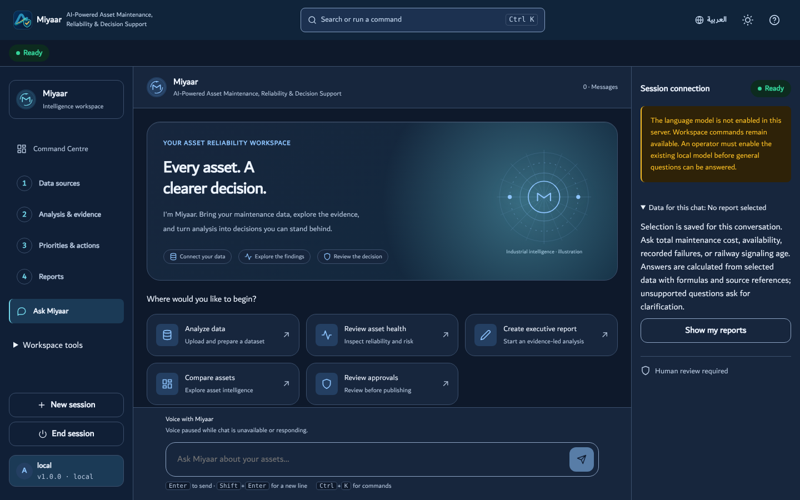
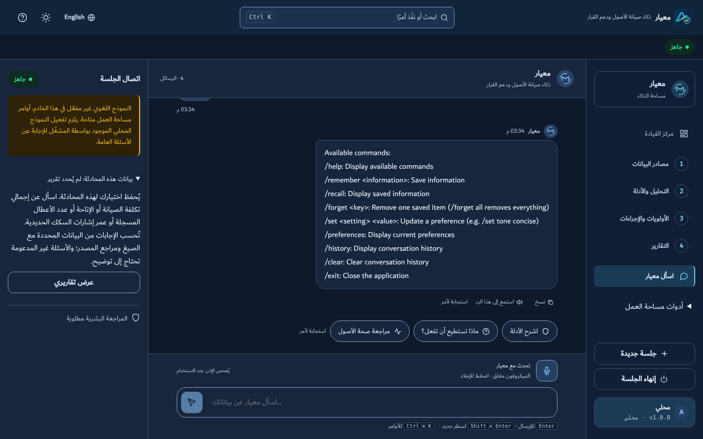
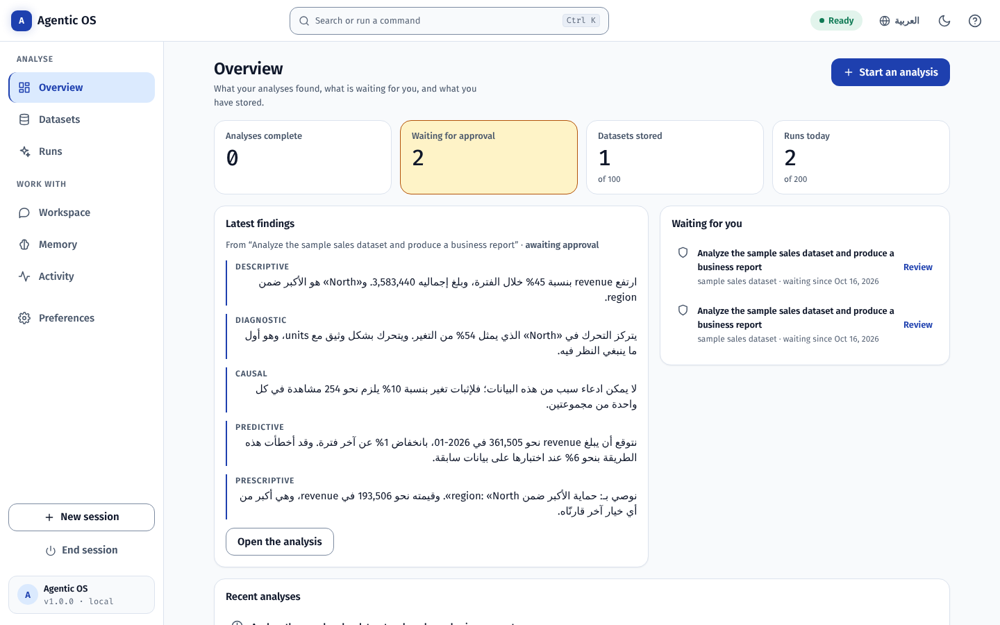

# AI-Driven Predictive Maintenance and Asset Reliability Decision-Support System SaaS Project

A maintenance and asset reliability decision-support product being developed
as software as a service, powered by **Agentic OS**, its governed analytics
engine. The web workspace supports data preparation, analysis, model evaluation,
dashboards and human approval of reports. The original command-line assistant
remains available.

The product name describes the development direction. Asset-specific prediction,
commercial service readiness and operational savings require separate evidence.
See the [project charter and delivery roadmap](docs/PROJECT_CHARTER.md) for the
current scope, reusable capabilities and remaining work.

**Maintenance UI preview:** run `npm --prefix frontend run dev` and open
`http://localhost:5173/?design=maintenance` for the interactive executive overview,
equipment, review, cost and model-evidence screens in English or Arabic. It uses
clearly labelled fictional data and requires no backend. See the
[maintenance design specification](docs/design/MAINTENANCE_UI_SPEC.md).

**Analyze your dataset:** start the Python server and open
`http://127.0.0.1:8000/#/runs?source=upload`, or use **Upload & analyze your data**
in the preview. Upload a tabular file, review its columns, then start the
agents and open the computed report/dashboard. See the
[upload guide](docs/DATASET_ANALYTICS.md) for setup, workbook sheets, supported
formats, limits and background processing.

In this project, "operating system" means an intelligent assistant
environment — not a replacement for Windows, macOS, or Linux.







[Editable Figma designs](https://www.figma.com/design/nLdKZ5cVOtRMTWEvhCJSEK) ·
[UI specification and API mapping](docs/design/AGENTIC_UI_SPEC.md) ·
[Current verification and platform scope](docs/design/VALIDATION.md)

## Main Features

- **Governed analysis workspace** — grouped specialist progress, findings and evidence,
  an exact-report approval inbox, server-confirmed publishing, addressable runs,
  recovered text drafts and installable PWA guidance for Windows, Android and iOS
- **Web workspace** — a responsive React application with a greeting hero,
  conversation view, centered command search and palette (Ctrl/⌘+K),
  activity timeline with session health, onboarding, and a token-based
  design system with dark, light, and system themes
- **Overview and Datasets** — the Overview shows the key figures, the
  latest findings in their report's language, what waits for approval and
  the newest analyses; the Datasets view lists every stored dataset and
  analyses one again by reference, without uploading it twice. The
  interface is planned in `docs/UI_PLAN.md` and its design system is
  generated with the vendored `ui-ux-pro-max` skill (ADR 0023)
- **Datasets in the formats business data comes in** — CSV and TSV, Excel
  workbooks, JSON and JSON Lines, up to 4 megabytes, read with the
  standard library into one canonical table (`POST /api/datasets`,
  ADR 0024). Excel dates, error cells and formulas are handled and
  reported; hostile workbooks (entity and decompression bombs, paths
  outside the archive) are refused; the same data in any format is stored
  once
- **Column mapping** — the owner says once what each column of a dataset
  is (measure, dimension, date or ignored), how dates are written and
  what to sum them by. The server suggests a role for each column with a
  reason, checks a mapping against every row, and explains a refusal
  field by field in English or Arabic. Runs follow the mapping and keep
  a copy of it; unmapped data is analysed exactly as before (ADR 0025)
- **Several datasets in one run** — up to four stored lookups joined onto
  the main dataset on declared keys, with a preview of the merge. A
  lookup whose key repeats is refused, a left join never changes a
  total, an inner join says what it left out, and every join reports how
  many rows found a match; the Validation Expert recounts the rows
  itself (ADR 0030)
- **The cleaned table, downloadable and queryable** — a run's cleaned
  and merged table downloads as CSV that is safe to open in a
  spreadsheet (`GET /api/runs/{id}/data.csv`), and can be described,
  totalled by group under filters, and read row by row
  (`/fields`, `/query`, `/records`). Rates are ratios of sums, and
  another owner's run is a 404 (ADR 0031)
- **Dashboards** — six pages over a run's cleaned table (overview,
  breakdown, trend, distribution, relationship, records) with filters
  that apply everywhere, totals or per-record reading, and a way from
  every group to the rows behind it. The page and filters live in the
  address, every chart has its numbers as a table, and axe checks every
  page in both languages (ADR 0032)
- **Consistent performance colors** — red for bad, blue for okay and green
  for good, with visible English/Arabic status words in dashboards and business
  reports. Per-analysis targets support higher/lower-is-better and nested
  ranges with a source reference, optimistic saves and durable history.
  Unassessed or unavailable measurements stay neutral; target edits do not
  approve or publish. See the [operating guide](docs/design/EXECUTIVE_DASHBOARD_HANDOFF.md)
  and [decision](docs/adr/2026-10-20-semantic-performance-colors.md).
- **Executive business reports** — prepare a scoped evidence brief, download
  standalone HTML or an editable Word `.docx`, or use **Print / Save as PDF**
  in the browser. English and Arabic RTL reports retain KPI definitions,
  missing readings, limitations and calculation references. A timestamp and
  content revision reject changed evidence until the brief is refreshed;
  exporting does not approve or publish a run (ADR 0059).
- **Models, each against a plain guess** — a run on the `models` profile
  adds a regression, a classification, a clustering and a seasonal
  forecast as governed stages. Each is tested on held-out data against
  the obvious baseline (the average, the most common class, last
  season), reports a weak model as weak, and shows a model card with the
  verdict first (ADR 0033)
- **Maintenance, under its own contract** — a run on the `maintenance`
  profile adds the governed diagnostics (what this dataset can and
  cannot support, as evidence that cites its own calculation) and the
  risk models, whose inputs are curated by the contract's record timing
  so an outcome column cannot flatter a score. Each target names the
  decision it supports and must beat an informative baseline by 5% and
  reach 0.55 in absolute terms to count as useful (ADRs 0039, 0040,
  0041). Both are opt-in: the default profile adds neither
- **Live data** — a live source is a saved `https://` address that
  snapshots into a dataset, now or every 15 minutes to a week. New
  content is analysed and stops at the approval gate; the same content
  starts nothing. Fetching is fenced against server-side request forgery
  (public addresses only, the checked address pinned, no redirects). Open
  pages follow `GET /api/events`, a server-sent event stream that resumes
  where it stopped, with a Live, Reconnecting or Offline badge (ADR 0034)
- **Command-line interface** — the original `python main.py` experience,
  fully preserved and dependency-free
- **One brain, two faces** — both interfaces drive the same tested Python
  `Agent` class; no logic is duplicated in the frontend
- **All four business-analytics types, one agent each** — Descriptive
  (*what happened?*), Diagnostic (*why?*), Predictive (*what will
  happen?*), Prescriptive (*what should I do?*), running as a maturity
  ladder where each consumes the one below it. **Each produces its own
  report**, plus a comprehensive report embedding all four. Every type
  opens with a headline in plain business language — "Revenue is up 45%
  over the period", not "the mean increased by 2.3 standard deviations" —
  and statistical jargon in a claim or headline **fails validation**
- **Association is never reported as cause** — a dedicated Experiment and
  Causal Inference agent decides whether the data is *entitled* to a
  causal claim. Where rows record assignment to a control and a treatment
  group it compares them, reports each difference as a **range** rather
  than a falsely precise number, widens that range when several groups are
  compared, and flags a split too lopsided to have been random. Where they
  do not — which is most business data — it refuses the causal claim and
  computes the experiment that would settle it: how many observations per
  group, and the smallest change the data already in hand could detect
- **A result that survives being looked at twice** — the range carrying
  the verdict is an *always-valid* one, so checking a running test on
  Tuesday and again on Thursday, and stopping when it looks good, does
  not break it. Simulated, an ordinary range checked that way calls a
  difference real in **31.5% of experiments where nothing is happening**;
  the always-valid range does it in 1.0%, while still finding a genuine
  effect every time. It is ~1.55× wider, the report says why, and the
  narrower reading is printed beside it for anyone who really did fix
  their sample size in advance (ADR 0016)
- **Every figure says what it measures and who owns that definition** —
  a metric glossary (`metrics.json`) gives each metric a definition, an
  owner, and optionally the arithmetic it must satisfy. The glossary
  decides which column a run analyses; where it says nothing, the run
  states plainly that its measure is undefined, and **validation fails a
  run that stays quiet about it**. Where a definition is arithmetic over
  columns present in the data — `revenue = unit_price × units` — every
  row is checked against it and the ones that disagree are named
- **Twenty-one governed specialists, orchestrated by Hermes** — planning,
  ingestion, data contract, profiling, quality scoring, privacy scanning,
  cleaning, metric governance, preparation, segment concentration, the
  four analytics agents, causal inference, anomaly detection, sensitivity
  testing, visualization, provenance, independent validation, and
  reporting, then an approval-gated publish. **Hermes sequences them and holds the gate; it
  analyses nothing itself**, which is what keeps "no stage approves its
  own work" structural. Every stage computes something no other stage
  computes (ADR 0009–0011). Runs are durable, bounded tasks: pause,
  cancel, restart recovery, truthful SVG charts, and a report where
  **every claim links to a calculation**. Forecast accuracy is measured by backtesting, and a
  forecast that could not be tested says so
- **Approval-gated publishing** — reports publish into an
  **Obsidian-compatible vault** (`vault/`) with provenance frontmatter and
  run-log backlinks, only after explicit approval bound to the exact
  artifact hash
- **Provider-neutral model gateway** — deterministic by default (tests and
  CI never need credentials); optional narration by a **local Ollama
  model**, **Claude**, or **Groq**, configured server-side. Local is
  preferred when set because nothing leaves the machine. The model only
  phrases already-verified facts: it never sees the dataset and never
  produces a number, and the report names which narrator wrote the summary
- **Pluggable model routing** — that priority order is a default, not a
  verdict. An optional router picks the narrator **per report** and the
  report prints **why that one** (ADR 0017). The contract is one method
  wide, so any [LLMRouter](https://github.com/ulab-uiuc/LLMRouter) router
  works, or four lines of your own. A choice this deployment cannot reach
  is refused and said to be refused, never quietly swapped
- **A chat that understands and acts** — “remember that the Q4 review is
  on Monday”, “what do you remember about coffee?”, “analyse the sample
  sales data”, “is it done?”, “why did revenue move?”, “be concise”,
  “reply in Arabic” — each becomes one of ten typed actions, by rules
  that work with no model, in English or Arabic. A configured model
  widens what is understood, never what can be done: it picks from the
  same actions, only its chat phrasing is shown, every confirmation is
  the agent's own true sentence, deletion is confirmed first, and it
  never sees a row or writes a number (ADR 0019). A run started from
  the chat opens in Runs and passes the same approval gate
- **Custom agents as plugins** — a domain stage is a file: a class with a
  role, a title, a place in the pipeline and a `run(ctx)`, registered by
  dotted path like the router. It runs on a copy of the context, before
  provenance, validation and reporting — there is no placement after
  them — so its claims are audited by the same validator, its figures
  appear in the same provenance chain, and its section in the same report
  the approval gate binds to. Profiles choose which stages a run includes
  (ADR 0020). `examples/stages/target_attainment.py` is a complete one
- **Frameworks on your terms** — the core is framework-free by decision,
  and three seams let you bring one: an optional *agent runtime* behind
  the chat (LangGraph and Pydantic AI examples, each a screen of code)
  that may call several tools for one sentence but never widen what a
  caller may do; an MCP server in the standard library, so any editor's
  agent can start a run and read its report; and a custom stage built as
  a LangGraph graph, audited like every other (ADR 0021)
- **Arabic and English** — the whole interface in either language,
  switched from the header in one click; right-to-left layout in Arabic
  through logical CSS properties rather than a second stylesheet; the
  agent's own replies, welcome message and command list follow the
  chosen language; the same WCAG 2.2 AA bar in both (ADR 0018)
- **Reports in Arabic or English** — a run is written in the language it
  was started in: headlines, claims, section reports and the full report.
  English stays the audited record and calculations are untouched; the
  validator rejects an Arabic claim that cites different figures from its
  English twin, so a translation cannot publish a number nobody
  calculated (ADR 0022)
- **Installable PWA** — manifest, icons, and a service worker make the
  mobile-first app installable on Android via "Add to Home screen"
- **Session restore** — refreshing the browser reconnects to the same
  conversation (sessions expire when the server restarts; saved memory
  does not)
- **Memory belongs to its owner** — in hosted mode each tenant's memory
  is scoped to them in the database, and the tests are written from the
  attacker's side of that boundary: a second authenticated user must not
  read, overwrite, or delete the first one's. Until ADR 0014 they could
  do all three
- **Persistent memory** in `data/memory.json` that survives restarts, with
  **categories and timestamps**, search, category filters, add, **in-place
  edit**, delete, and delete-all controls — destructive actions always
  require confirmation (old plain-text memory files load transparently)
- **Data controls** — export everything (memory, preferences, history,
  transcript) as JSON, clear history, or delete all memory from one place
- **Preferences** (tone, your name, language — English or Arabic — and
  history recording) applied to
  responses immediately, plus interface settings (theme, reduced motion)
- **Responsive by design** — sidebar navigation on desktop, a bottom tab
  bar on phones and tablets, verified from 320 px up
- **Production-quality states** — skeleton loading, empty, success, error,
  offline, and retry paths for every workflow, plus a filterable activity
  timeline (System / Memory / Preferences / Errors)
- **Continuous integration** — a GitHub Actions workflow runs the entire
  Python, unit, build, and end-to-end suite on every push
- **Accessibility** — WCAG 2.2 AA verified by automated axe scans plus
  keyboard review; full keyboard operation, focus-trapped dialogs,
  reduced-motion support (system setting and in-app switch)
- **Measured performance** — Lighthouse 13.4 against the self-hosted
  server, 16 October 2026: mobile emulation scored Performance 99,
  Accessibility 100, Best Practices 100 and SEO 100 in each of three runs
  (LCP 2.0 s, CLS 0, TBT 0–10 ms); desktop scored 100 in all four. The
  server compresses the interface and caches its hashed assets for a year,
  as Vercel does in production (ADR 0023, amendment)

## Architecture

```
Browser (React + TypeScript + Vite SPA — frontend/)
   │  JSON over HTTP (typed contracts, timeouts, central error handling)
   ▼
FastAPI adapter (server/app.py) — sessions, validation, safe errors,
CORS, static hosting of the built frontend
   │  direct in-process calls
   ▼
Agent class (agent.py) + utils.py + config.json + data/memory.json
   ▲
   └── Command-line interface (main.py) uses the same Agent directly
```

The adapter contains no business logic: every web operation maps onto the
Agent's tested command surface (`/remember`, `/forget`, `/set`, `/clear`)
and returns fresh state snapshots.

## Directory Structure

```text
├── main.py                # CLI entry point
├── agent.py               # The Agent class (commands, memory, preferences)
├── utils.py               # Config loading, JSON persistence, validation
├── server/                # FastAPI adapter, run engine, storage, auth,
│                          # backup/restore
├── scripts/               # serve.py · backup.py · restore.py · worker.py
│                          # · sbom.py · erase.py
├── config.json            # User-editable settings
├── metrics.example.json   # Metric glossary template (copy to metrics.json)
├── data/memory.json       # Persistent memory (starts empty)
├── tests/                 # Python unittest suite (agent, utils, API,
│                          # runs, analytics, metric glossary, auth,
│                          # quotas, backups, worker, failure injection,
│                          # tenancy, erasure, supply chain, model
│                          # gateway, launcher, docs)
├── frontend/
│   ├── src/
│   │   ├── app/           # Shell, store, theme
│   │   ├── features/      # chat, commands, memory, preferences,
│   │   │                  # activity, onboarding
│   │   ├── shared/        # api client, types, components, styles (tokens)
│   │   └── tests/         # Vitest unit tests
│   └── e2e/               # Playwright end-to-end + accessibility tests
├── docs/
│   ├── UI_UX_AUDIT.md     # Audit, plan, and acceptance criteria
│   ├── PLAYBOOK.md        # How the repository is operated
│   ├── adr/               # Decision records (database, auth, analytics…)
│   └── screenshots/       # Final interface captures
├── brain/                 # Second brain: linked notes, start at Home.md
├── .claude/               # Claude Code hooks, skills, commands, agents
├── CLAUDE.md · Memory.md · project-progress.md · session-logs.md
├── README.md · user_guide.md · requirements.txt · .env.example
```

## System Requirements

- Python 3.10+ (CLI alone needs only the standard library)
- Node.js 20.19+ or 22+ and npm (web interface only)
- No API keys, no external services, no credentials required. Optional
  narration by a local Ollama model (`OLLAMA_MODEL=qwen3:4b`, no key), Claude
  (`ANTHROPIC_API_KEY`), or Groq (`GROQ_API_KEY`) — all server-side, see
  `.env.example`

## Installation

```bash
# The repository's name is long; give the clone a short folder on Windows.
git clone https://github.com/ahmadzayan-hub/AI-Driven-Predictive-Maintenance-and-Asset-Reliability-Decision-Support-System-Project.git agentic-os
cd agentic-os

# Web interface dependencies
pip install --require-hashes -r requirements.txt
cd frontend && npm ci && npm run build && cd ..
```

`requirements.in` declares Python dependency ranges; `requirements.txt` locks
the full server dependency tree with platform markers and artifact hashes.
Use the generation command at its top for reviewed updates. Optional agent
and voice integrations remain separate. See the
[dependency decision](docs/adr/2026-10-20-python-dependencies-are-locked.md).

## Running the Application

**Web interface (recommended):**

```bash
python scripts/serve.py
```

Then open <http://localhost:8000>. The server hosts both the API and the
built frontend. The launcher also prints an address for **a phone on the
same Wi-Fi** (`http://192.168.x.x:8000`) — with the consequence stated,
because binding to the network is a real decision: local mode has no
login, so anyone on that network can read and change the saved memory.
Use `--local-only` on a network you do not trust, and `--port 9000` if
8000 is taken.

"Add to Home screen" needs HTTPS on most phones, so the *installable* app
comes from a deployment rather than from a laptop on the local network;
over plain HTTP the app still runs fine in the phone's browser.

`python -m uvicorn server.app:app --port 8000` remains equivalent — the
launcher only adds the address detection and the warning.

**Development mode** (hot reload, two terminals):

```bash
python scripts/serve.py --reload                        # terminal 1
cd frontend && npm run dev                              # terminal 2 → http://localhost:5173
```

**Command-line interface:**

```bash
python main.py
```

## Local AI runtime / تشغيل الذكاء الاصطناعي محليًا

The optional local profile adds Ollama chat and multilingual Whisper dictation.
On Windows, with the project virtual environment already created:

```powershell
.\.venv\Scripts\python.exe scripts/local_runtime.py install --voice --agents
.\.venv\Scripts\python.exe scripts/local_runtime.py doctor
.\.venv\Scripts\python.exe scripts/local_runtime.py start --worker
```

Open `http://localhost:8000`. The profile uses the local Qwen3 4B Instruct 2507 model and
Whisper small, preserves the existing governed workflows, and needs no cloud
key. Microphone text stays an editable draft. See the bilingual
[setup guide](docs/LOCAL_AI_SETUP.md) for prerequisites, installed skills,
hardware expectations, hosted configuration and acceptance limits.

## Testing

```bash
# Python: agent, utils, API, runs, analytics, sequential ranges,
# metrics, auth, tenancy, erasure, quotas, backups, worker, recovery,
# supply chain, launcher, routing, language, assistant, custom stages,
# agent runtimes, MCP, frameworks, report language, datasets, column
# mapping, joins, the cleaned-table queries, modelling stages, live sources and the event stream, uneven periods, docs, and the repository's operating system:
# brain checker, session hooks, the verify script, the motion skill, the
# agent team's tools, agent evaluation, the house style and the interface
# budget (measured counts and optional skips are in the dated validation below)
python -m unittest discover tests

# Frontend unit tests

cd frontend && npm test

# End-to-end + accessibility (across desktop and mobile,
# in English and Arabic;
# requires the production build: npm run build)
cd frontend && npx playwright test

# Type checking
cd frontend && npm run typecheck

# Server-dependency preflight, Python, brain, typecheck, frontend units,
# native contracts, build and budget. --quick skips build/budget;
# --e2e adds both the main and Miyaar Playwright suites.
python scripts/verify.py
```

### KPI register aligned with the Power BI report — 21 October 2026

MTTR, first-time fix and repeat repair now follow the report's Method page,
and four of its measures were added (18 in the register;
[decision](docs/adr/2026-10-21-kpi-register-aligned-with-power-bi.md)).
`REQUIRE_PG=1 python scripts/verify.py` against PostgreSQL 16: **1,499 Python
tests reported, 19 skipped** (optional extras only), **277 frontend tests
passed**, all 8 steps passed. Full Playwright, desktop and phone:
**127 passed, 5 skipped**.

### Held-out memo F — 21 October 2026

`python scripts/score_review.py --summary`: on memo F (blind, 9 new kinds of
method error, 3 controls, 11 decoys) the analytics reviewer with check 7
scored **100% lane recall, no false alarm in each of 5 runs** (3 as the
loaded subagent, 2 controlled); the v2 instructions **found 11 of 12 in
both of their 2 runs**, missing the same paragraph. The
figures auditor raised **one false alarm in each of its 2 runs** (the same
correct run-to-failure paragraph); team **100% recall, 92% precision**. Checker v6 (clock times and
longer numbers no longer count as found) leaves every benchmark score
unchanged. `REQUIRE_PG=1 python scripts/verify.py` against PostgreSQL 16:
**1,497 Python tests reported, 19 skipped** (optional extras only), **277
frontend tests passed**, all 8 steps passed.

### Reviewer check 7 and percentage points — 21 October 2026

`python scripts/score_review.py --summary`: repeat runs on memo E, analytics
reviewer **92% lane recall**, figures auditor the same **one false alarm**.
Controlled runs on E with the new maintenance-method check: **12 of 12**
planted paragraphs found (v2: 10 of 12), **8 of 9** `domain_method` in
category, **no false alarm**; A to D unchanged. Checker v5 reads percentage
points: memo D **83% → 100%**, A, B, C and E unchanged. E is now dev data
for the new check. `REQUIRE_PG=1 python scripts/verify.py` against
PostgreSQL 16: **1,496 Python tests reported, 19 skipped** (optional extras
only), **277 frontend tests passed**, all 8 steps passed.

### Checker fixes and maintenance-judgement benchmark E — 21 October 2026

`python scripts/score_review.py --summary`: on memo E (9 method errors, 3
controls, 11 decoys) the analytics reviewer scored **83% lane recall, 78% on
`domain_method`, no false alarm**; the figures auditor raised **one false
alarm** on a decoy outside its lane; team **83% recall, 92% precision**. The
figures checker (v4: a fall measured against the larger figure; any
currency read as money) keeps A to D unchanged or better, with memo D's
false alarm gone. `REQUIRE_PG=1 python scripts/verify.py` against PostgreSQL
16: **1,495 Python tests reported, 19 skipped** (optional extras only),
**277 frontend unit tests**, build and budget passed. The browser suite was
not re-run: no interface code changed.

### Reviewer benchmark D and full browser run — 21 October 2026

The full Playwright suite on the targets change passed **127, with 5
skipped**. Reviewer benchmark D (30 paragraphs, 14 planted defects, 10
decoys, written blind): figures auditor and analytics reviewer **100% lane
recall, 0 false alarms**; the Tier 0 checker **83% lane recall, 1 false
alarm** (`python scripts/score_review.py --summary`).

### Targets held when a measure is redefined — 21 October 2026

Behaviour change ([decision](docs/adr/2026-10-21-targets-held-when-a-measure-is-redefined.md)).
`REQUIRE_PG=1 python scripts/verify.py` against PostgreSQL 16: **1,493 Python
tests reported, 19 skipped** (optional extras only), brain check (45 notes),
type check, **277 frontend unit tests**, build and budget passed. Playwright
`executive`, `metric-colors` and `dashboard`: **20 passed** after the
`metric-colors` seed was stamped with availability's current definition. The
full browser suite was not re-run for this change.

### Full validation with PostgreSQL; CSS budget raised — 21 October 2026

[Budget decision](docs/adr/2026-10-21-css-budget-raised-and-exact.md).
`REQUIRE_PG=1 PG_TEST_URL=postgresql://dev@127.0.0.1:5432/agentic_test python scripts/verify.py`
against PostgreSQL 16.15: **1,490 Python tests reported, 19 skipped** (all
optional extras not installed here: langgraph 7, llmrouter 5, pydantic-ai 3,
voice decoder 2, private knowledge collection 2; no database test skipped),
brain check (45 notes), type check, **276 frontend unit tests**, build and
budget passed (CSS first load 10.0 of 10.5 KB, CSS total 23.5 of 25 KB, now
compared in exact bytes). The full Playwright suite passed **127, with 5
skipped**, desktop and phone, English and Arabic.

### Arabic population labels and digits — 21 October 2026

Behaviour change ([decision](docs/adr/2026-10-21-arabic-population-labels-and-digits.md)).
`python scripts/verify.py`: **1,489 Python tests reported, 153 skipped**,
brain check (45 notes), type check, **276 frontend unit tests**, build and
budget passed. Playwright `executive`, `metric-colors`, `dashboard`,
`arabic` and `a11y`: **32 passed**. The full suite and PostgreSQL were not run
for this change.

### Assets on a phone — 21 October 2026

Layout change ([addendum](docs/adr/2026-10-21-simplified-navigation-runs-and-assets.md#addendum-2026-10-21-assets-on-a-phone)).
`python scripts/verify.py`: **1,487 Python tests reported, 153 skipped**,
**275 frontend unit tests**, build and budget passed (CSS total 23,499 of
23,500 bytes). Playwright `overview`, `responsive`, `a11y` and `arabic`:
**22 passed, 4 skipped**. The full suite and PostgreSQL were not run for this
change.

### Datasets, Memory and Activity — 21 October 2026

Interface change ([decision](docs/adr/2026-10-21-datasets-memory-activity-treatment.md)).
`python scripts/verify.py`: **1,487 Python tests reported, 153 skipped**, brain
check (45 notes), type check, **275 frontend unit tests**, production build and
interface budget passed (JS total 183.2 of 185 KB; CSS total 23,493 of 23,500
bytes; CSS first load 9,984 of 10,000 bytes). The full Playwright suite passed
**127, with 5 skipped**, desktop and phone, English and Arabic. PostgreSQL was
not run.

### Simpler navigation, Runs and Assets — 21 October 2026

Interface change after a size audit ([decision](docs/adr/2026-10-21-simplified-navigation-runs-and-assets.md)).
`python scripts/verify.py`: **1,487 Python tests reported, 153 skipped**, brain
check (45 notes), type check, **273 frontend unit tests**, production build and
interface budget passed (JS total 183.6 of 185 KB; CSS total 23,449 of 23,500
bytes; CSS first load 9,989 of 10,000 bytes). The full Playwright suite passed
**127, with 5 skipped**, desktop and phone, English and Arabic; the new sidebar
test was confirmed on desktop separately. PostgreSQL was not run.

### Colourful KPI-first dashboard — 21 October 2026

Interface change ([decision](docs/adr/2026-10-21-colourful-kpi-first-dashboard.md),
[study](docs/design/2026-10-21-colourful-minimal-dashboard-study.md)).
`python scripts/verify.py`: **1,487 Python tests reported, 153 skipped**, brain
check (45 notes), type check, **271 frontend unit tests**, production build and
interface budget passed (CSS total 23.3 of 23.5 KB, JS total 184.8 of 185 KB).
The full Playwright suite passed **126, with 4 skipped**, desktop and phone,
English and Arabic, against a fresh build. PostgreSQL was not run.

### KPI register: availability and pooled reliability measures — 21 October 2026

Source-only change ([decision](docs/adr/2026-10-21-register-availability-and-pooled-reliability-measures.md)).
`python scripts/verify.py --quick` on this change: **1,485 Python tests reported,
153 skipped**, brain check (45 notes), type check, and **270 frontend unit tests**
passed. The two Playwright specs that pinned the old availability figure,
`executive` and `metric-colors`, passed **12 of 12** (desktop and phone, English
and Arabic) against a fresh production build. The full Playwright suite and
PostgreSQL were not run for this change. Checked outside the repository
against the private 5,000-row course dataset: the register reproduces the
corrected workbook and the Power BI report's printed figures.

### Commercial SaaS assessment — 21 October 2026

The [competitive assessment](docs/assessments/2026-10-21-saas-competitive-benchmark.md)
compares source baseline `4b193f0` with official product documentation and named
customer evidence. This session changes documentation only. Documentation checks
passed **11 / 11**; strict brain validation passed with **45 notes** and no broken
links, missing sources or other reported issues. The full application suites,
hosted acceptance, competitor hands-on tests and customer outcome measurements
were not run for this study. Prior software results below retain their dates
and scope; they do not establish commercial or predictive effectiveness.

### Local run timeout correction — 21 October 2026

The [decision](docs/adr/2026-10-21-run-request-timeout.md) fixes a ten-second
browser deadline cutting off a bounded sixty-second local model step. Run detail,
advance and controls now allow ninety seconds, while health retains its short
deadline. Failed POSTs are not automatically replayed.

- The new regressions reproduced **7 failures** before the fix; the focused API
  and scheduler suites then passed **26 / 26** tests.
- TypeScript checking and the production build passed. Bundle limits passed:
  initial JS **98.5 / 100 KB**, total JS **184.5 / 185 KB**, largest lazy JS
  **18.1 / 30 KB**, initial CSS **10.0 / 10 KB**, total CSS **22.7 / 23 KB**,
  fonts **119.4 / 120 KB**.
- Restarted the local Ollama-backed platform and resumed the interrupted Arabic
  sample to the approval gate. A fresh Arabic sample also reached that gate:
  **21 successful stages** each, with no timeout shown and no manual retry after
  the repair. Publication was left for the owner to approve.
- Documentation, verifier and release-policy checks passed **33 / 33**; strict
  brain validation and whitespace checks passed.
- The full Python, frontend and automated browser suites were not rerun for
  this transport-only change. No production deployment was performed.

### React animation technology study ? 21 October 2026

The [study](docs/design/REACT_AGENT_CONNECTIONS_STUDY.md) compares the existing
React/SVG approach with React Flow and Motion. Its isolated, reproducible
experiment completed **4 / 4 production-mode builds** and **4 / 4 desktop
Chromium smoke scenarios** at 1440?900, covering rendering, node selection,
synthetic handoffs, pause controls, reduced-motion CSS and absence of page errors.
Strict brain validation and **33 / 33** documentation/verifier/release-policy
checks passed. Local study links and the experiment lock checksum were checked.
Measured asset sizes, pinned dependencies and actual synthetic captures are in
[the experiment record](docs/design/experiments/README.md).

This is a study, not a shipped explorer. No production frontend source or
dependency changed. Full platform suites were not rerun for this documentation
and isolated-experiment change. Mobile/RTL, assistive-technology, large-graph and
integrated-load acceptance for a future React Flow view are **not tested**.

### Agent collaboration and restrained motion — 20 October 2026

The Runs workspace now presents **Agents working together**: Hermes, workflow
groups, observed handoffs, stage inspection, current evidence and recent activity.
Pause live view holds the panel while analysis continues. English/Arabic,
system/app reduced motion and keyboard controls are included. The
[study](docs/design/AGENT_COLLABORATION_MOTION.md) and
[decision](docs/adr/2026-10-20-observed-agent-collaboration.md) explain the
distinction between observed workflow connections and actual message transcripts.

- Complete local Python suite with required PostgreSQL: **1,418 run, 1,397 passed,
  21 skipped**. Both database adapters were included; the temporary test
  container was removed afterward.
- Complete local frontend unit suite: **262 / 262 across 34 files**.
  The focused subset also passed **21 / 21**; the final language-attribute
  follow-up passed **6 / 6** component checks. TypeScript,
  production build, strict brain check, **5 native contracts** and **33 Python
  documentation/verifier/release-policy tests** passed.
- Initial targeted browser run: **9 passed, 1 viewport-specific skip**, covering
  the new panel and the real pipeline's approval/evidence flow. Final targeted
  rerun: **4 / 4 passed**, including RTL count isolation in both the diagram and
  sidebar, expanded mobile inspection and the existing evidence dialog.
  Actual synthetic captures: [desktop](docs/screenshots/agent-collaboration-desktop-ar.png)
  and [320 px phone](docs/screenshots/agent-collaboration-mobile-ar.png).
- Complete local main browser run: **124 passed, 4 skipped, 2 failed**. Both
  failures were the same legacy partial `Pause` selector matching the new
  `Pause live view` control on desktop and phone. Exact run-control selectors
  repaired the ambiguity; the targeted desktop/phone rerun passed **6 / 6**,
  covering dataset reuse, pausing/cancelling analysis and independently pausing
  the live view. The complete suite was not repeated after this test-only fix.
  Miyaar's complete browser suite passed **12 / 12**.
  The main suite used local port 8133 because an unrelated service held 8123;
  auth remained on 8124. No assertion, deadline or application behavior changed.
  Failure traces and regenerated baseline captures were archived outside Git,
  and existing baseline images were restored.
- Final measured budget: initial JS **98.5 / 100 KB**, total JS **184.5 / 185 KB**,
  largest lazy chunk **18.1 / 30 KB**, initial CSS **10.0 / 10 KB**, total CSS
  **22.7 / 23 KB**, fonts **119.4 / 120 KB**. The dated decision increases only
  total CSS by 1 KB; no dependency or extra polling was introduced.
- Feature source `16d779b`, integrated at `4aaa295`, preserves incoming main
  through `b1e0c83`. [CI](https://github.com/ahmadzayan-hub/AI-Driven-Predictive-Maintenance-and-Asset-Reliability-Decision-Support-System-Project/actions/runs/39480501990)
  and [UI Budget Fast](https://github.com/ahmadzayan-hub/AI-Driven-Predictive-Maintenance-and-Asset-Reliability-Decision-Support-System-Project/actions/runs/39480501976)
  did **not start**: GitHub reported failed account payments or an insufficient
  spending limit. Both jobs have no test steps. This is an infrastructure block,
  not a passing CI result. Local checks above are independently measured;
  older CI results below do not verify this feature. Production was not deployed.

### Corrective project review — 20 October 2026

Implementation `1dd73ae`, integrated with the incoming chart tests at `390f4c6`.
The [assessment](docs/assessments/2026-10-20-project-review.md) records the
reproduced defects, corrections, limits and owner acceptance gates.

- **Final combined-source validation at `fadc18d`:**
  [Linux CI passed](https://github.com/ahmadzayan-hub/AI-Driven-Predictive-Maintenance-and-Asset-Reliability-Decision-Support-System-Project/actions/runs/39446235305),
  as did the [fast interface budget](https://github.com/ahmadzayan-hub/AI-Driven-Predictive-Maintenance-and-Asset-Reliability-Decision-Support-System-Project/actions/runs/39446235314).
  Python reported **1,413 tests: 1,390 passed, 23 skipped**, with PostgreSQL
  required. Frontend unit tests were **255 / 255 across 34 files**; native
  contracts **5 / 5**; main desktop/mobile browser and accessibility tests
  **122 passed, 4 skipped**; Miyaar **12 / 12**. No browser failures or retries
  were reported. The browser skips are viewport/project-specific cases exercised
  in the other project. Python skips cover optional integrations, the absent
  private knowledge collection, and two checks run before a frontend build
  exists; both build-dependent checks subsequently passed locally against the
  built application. TypeScript, production build, strict brain check,
  dependency audits, SBOM/license check and the existing interface ceilings
  passed. Linux SBOM: **305 components (277 npm, 28 Python)**. This supersedes
  the earlier combined-source failure below; it does not claim live provider,
  real-device or hosted-production acceptance.
- [Full Linux CI on the integrated source](https://github.com/ahmadzayan-hub/AI-Driven-Predictive-Maintenance-and-Asset-Reliability-Decision-Support-System-Project/actions/runs/39436782344)
  **passed**, including required PostgreSQL, the complete frontend unit suite,
  native contracts, strict brain check, build, main desktop/mobile browser and
  accessibility checks, Miyaar bilingual/voice checks, audits and license gate.
  [Fast UI budget](https://github.com/ahmadzayan-hub/AI-Driven-Predictive-Maintenance-and-Asset-Reliability-Decision-Support-System-Project/actions/runs/39436782305)
  also passed.
- Full local Python execution: **1,377 reported, 23 skipped, 1,354 passed**,
  with PostgreSQL 17 required and no failures. The separate atomic-admission,
  worker, quota and crash-recovery selection ran **78 tests with no skips**.
  Optional integrations remain conditional; this is not evidence that their
  live providers or devices were exercised.
- Windows validation used Python **3.11.16** and Node **24.22.0**. The initial
  concurrent frontend run reported **228 passed / 15 failed**. With one worker
  and the incoming chart tests, it reported **248 passed / 7 failed**:
  five deadline failures and two subsequent assertion failures. TypeScript,
  native contracts, strict brain checks, the production build and the budget
  passed. **No full Windows frontend success is claimed.** The main local
  browser sweep was interrupted after timeout failures in accessibility,
  Arabic, dashboard and join scenarios; the complete Linux browser suites
  passed. Original logs and traces were retained outside published source.
  A later four-file selection reported **34 passed / 5 failed**. Reducing the
  dashboard notice fixture from 1,000 returned groups to three, while checking
  the exact EN/AR notice and the true total, then passed **4 / 4** dashboard
  tests. Backend query tests retain responsibility for the actual row limit.
  That test-only follow-up at `a11fc98` left application source unchanged;
  later integration and corrections require their own combined-source checks.
- Measured budget: initial JS **98.5 / 100 KB**, total JS **180.3 / 185 KB**,
  largest chunk **18.1 / 30 KB**, initial CSS **10.0 / 10 KB**, total CSS
  **21.2 / 22 KB**, fonts **119.4 / 120 KB**. Existing ceilings are unchanged.
- Fresh dependency audits reported **zero vulnerabilities** across the npm
  tree and all **27 exact installed Python versions**, including FastAPI
  **0.152.0**. The separate unpinned-resolution audit also passed but resolved
  FastAPI **0.153.0**; it is not substituted for the installed-version check.
  The SBOM
  recorded **304 components** and the license gate found no shipped dependency
  with a strong-copyleft license. These are point-in-time checks.
- Synthetic agent evaluations met their existing floors. Intent holdout macro
  recall remains **72%**; the current causal cases are development-informed,
  and the separate adversarial probe remains a documented limitation.
- Vercel production remains on the older `42e53d00` deployment. Main-branch
  automatic deployment is disabled; no production release was performed.
  On the owner's subsequent approval, the repository became temporarily
  private; collaborator permissions and branch tips were preserved, and
  anonymous web/API requests returned 404. Historical remediation before
  re-publication, hosted acceptance, independent maintenance evidence and
  real-device acceptance remain open.
  The visibility follow-up passed **12 documentation/release-policy tests**,
  the strict brain check and patch hygiene. Application code, tests and
  deployment configuration remain unchanged from `fadc18d`; the full suite
  was not rerun locally for this settings/documentation action.

Follow-up source `ede59b1`, after preserving the incoming direction and
independent-reconciliation changes through `b402def`:

- Mapping and maintenance regressions: **114 passed**. Additional join,
  mapping, maintenance, governance and modelling checks: **183 reported,
  162 passed, 21 PostgreSQL skips**, with PostgreSQL deliberately disabled
  for that local selection. These selections overlap and are not added.
- Single-dataset request contract: **5 focused tests passed**, including
  existing joined and Arabic validation cases.
- Browser-policy/API/export checks: **50 passed**; the final bare `/api`
  static-policy correction passed its **1 focused regression**.
- Locked-dependency/SBOM/documentation checks: **39 passed**. A fresh
  hash-checked environment installed all **27 Windows server packages**,
  passed dependency consistency, and imported required server integrations.
  All **28 universal locked versions**, including Linux-only uvloop, reported
  **zero vulnerabilities**; the exact hashed-requirements CI audit command
  also passed. Optional voice/agent environments remain outside this lock.
- Production frontend build passed with the enforced browser policy.
  The local browser selection reported **14 passed / 10 failed**: all
  **6 new CSP checks passed** across desktop/mobile, two existing desktop
  sign-in checks timed out, and eight executive checks exposed old fixtures
  sending the newly rejected single-dataset option. Logs and traces are retained.
  These focused results do not establish a full Windows pass.
- The first combined [CI run on `ede59b1`](https://github.com/ahmadzayan-hub/AI-Driven-Predictive-Maintenance-and-Asset-Reliability-Decision-Support-System-Project/actions/runs/39444761573)
  reported **1,412 Python tests, 23 skips and 3 failures**. All failures were
  privacy fixtures assuming automatic grouping would retain personal labels.
  Fixtures now explicitly request that grouping, preserving the original
  human-report and blocked-model assertions; the **9 privacy tests pass**,
  including a new check of the safer automatic default.
- Executive and performance-color fixtures now upload and save their intended
  mapping. **4 exact-fixture API probes passed**, across both report languages;
  TypeScript passed. The **12 Miyaar browser checks passed** with the static
  CSP. The CSP suite also passed **8 tests**, and standard-library-only
  discovery correctly skipped those **8 optional API tests**.
  The corrected executive/performance-color browser rerun could not start:
  Playwright's configured web-server startup timed out before any test ran.
  That attempt supplies no browser pass or assertion result; its log is retained.

### Who chose the breakdown — 20 October 2026

Session `1eb4cedb`, continued after the parallel session's automatic-grouping
and breakdown-refusal work landed. One dated decision:
[the report says who chose the breakdown](docs/adr/2026-10-20-who-chose-the-breakdown.md).

Run here in the project venv:

- **The full Python suite on what shipped: 1,418 tests, 0 failures, 0 errors,
  142 skipped** for want of a local PostgreSQL and other absent services
  (`python -m unittest discover tests`, 202 s).
- The same suite ran earlier on this session's own breakdown implementation,
  before it was withdrawn: **1,403 tests, 0 failures, 144 skipped**, 186 s.
  Between the two runs this session's work was replaced by the parallel
  session's and the claim above was added. Either way these are the first
  completed full-suite runs on the merged tree, closing the gap the entry
  below had to leave open.
- After the integration: `tests.test_analytics` **89 tests**, 5 of them new,
  with `tests.test_report_language`, `tests.test_model_privacy_boundary` and
  `tests.test_breakdown_contract` — **128 together, all passing**.
  `scripts/brain_check.py --strict`: **27 notes, 0 broken links, 0 stale, 0
  orphans.**
- Each of the 5 new tests was watched failing against the unchanged tree
  first: 5 errors, because neither claim nor its calculation existed.
- The real stages over the capstone file (5,000 rows, 60 columns, unmapped,
  read from disk; nothing stored, approved or published): the breakdown is
  **`Asset_Class`, 5 groups**, where detection used to produce 5,000 groups of
  one row; `group_totals_reconcile` passes on the 5 recomputed group totals at
  `Σ(groups)=40,161.27 vs total=40,161.27`; and the report carries, in English
  and Arabic, that this product chose `Asset_Class` as the first of **14**
  candidate columns in the file's own column order, naming the other thirteen.

**Not run, so not claimed:** the frontend suite, type check and build — no
frontend file changed in this work; Playwright, the Miyaar suites, PostgreSQL
and `pip-audit`. The parallel session's combined-source Linux CI at `fadc18d`
is the authority for those.

### Measure-direction and reconciliation validation — 20 October 2026

Session `1eb4cedb`, commit `79501e9` merged with the parallel session's work at
`088e6f6`. Two dated decisions:
[which way is better is declared](docs/adr/2026-10-20-which-way-is-better-is-declared.md)
and
[rounding is not a reconciliation failure](docs/adr/2026-10-20-rounding-is-not-a-reconciliation-failure.md).

Run here in the project venv on the merged tree:

- **183 Python tests** across `tests.test_analytics` (78 of them),
  `tests.test_metrics` (32), `tests.test_stages`, `tests.test_maintenance` and
  `tests.test_docs`, **all passing**, 9 of them new; `tests.test_joins` **46
  passing with 10 skipped** for want of a local PostgreSQL.
- `scripts/brain_check.py --strict`: **27 notes, 0 broken links, 0 stale, 0
  duplicate candidates, 0 unlinked mentions, 0 orphans.**
- Live through the API against the 5,000-row maintenance dataset: the unmapped
  run that the validator used to reject now reaches `awaiting_approval` with 41
  claims, the reconciliation check reading
  `Σ(groups)=40,161.27 vs total=40,161.27; recomputed 5000 group total(s),
  largest difference from the published figure 0.0000`. The same dataset with a
  saved column mapping reaches `awaiting_approval` with 47 claims. Neither was
  approved or published, and the dataset was removed from the local runtime
  afterwards.

**Not run on the merged tree, so not claimed:** the full Python suite — one run
was stopped as redundant and the `scripts/verify.py` run that replaced it was
stopped by the harness when the machine ran short of memory; the frontend unit
suite, type check and build, which were measured before the merge and not after
it (**244 tests in 34 files, 241 passing**, the 3 failures the `findBy`
load flake recorded in `Memory.md`, all 3 passing when run alone; type check and
build clean; interface budget inside every ceiling); Playwright, the Miyaar
suites, PostgreSQL, `pip-audit` and anything hosted. CI on the merged commit is
the authority for what was not run here.

### Performance-color validation — 20 October 2026

Implementation `8fa3937`, schema/localization correction `6b52ebe` and final
numeric-direction/accessibility refinement `c11f3f7` provide red **Bad**, blue
**Okay** and green **Good**, with English/Arabic status words. Actual KPI
targets are explicitly configured per analysis with their source and units;
unassessed and unavailable measurements stay neutral. The
[dated decision](docs/adr/2026-10-20-semantic-performance-colors.md) and
[operating guide](docs/design/EXECUTIVE_DASHBOARD_HANDOFF.md) explain the rules.

- [Full Linux baseline CI on `6b52ebe`](https://github.com/ahmadzayan-hub/AI-Driven-Predictive-Maintenance-and-Asset-Reliability-Decision-Support-System-Project/actions/runs/39380783997)
  **passed**: **1,331 Python tests reported, 23 skipped**, with required
  PostgreSQL; **232 frontend tests in 33 files**; **5 native contracts**;
  **116 browser checks passed, 4 skipped**, and **12 Miyaar checks passed**.
  The actual PostgreSQL API/history/backup test, independent-connection
  compare-and-save race/lost-acknowledgment test and rollback-only bootstrap
  snapshot/RLS/revoke smoke all passed. The initial source run exposed missing
  snapshot DDL/protections; `6b52ebe` fixed them without changing a hosted database.
- [Final combined-source CI on `c11f3f7`](https://github.com/ahmadzayan-hub/AI-Driven-Predictive-Maintenance-and-Asset-Reliability-Decision-Support-System-Project/actions/runs/39381914052)
  **passed**: **1,334 Python tests reported, 23 skipped**, with required
  PostgreSQL; **232 frontend tests in 33 files**, **5 native contracts**,
  **116 browser checks passed, 4 skipped**, and **12 Miyaar checks passed**.
  All three actual PostgreSQL policy/schema cases listed above passed again;
  no browser retry/flaky marker was reported. TypeScript/build, brain and
  BOM/licence checks passed. [Final fast budget](https://github.com/ahmadzayan-hub/AI-Driven-Predictive-Maintenance-and-Asset-Reliability-Decision-Support-System-Project/actions/runs/39381913971)
  passed. Frontend audit reported zero vulnerabilities; the informational
  Python audit retains the existing setuptools `PYSEC-2026-3447` advisory
  (duplicated rows, suggested fix 83.0.0). This source preserves incoming
  motion verification through `901ea93`.
- Local final TypeScript/build/budget and **31 export/direction/documentation
  tests passed**. The target editor's **5 focused tests passed**, including
  focus on the validation error. Earlier new real-API color scenarios:
  **4 passed** across English/Arabic desktop and mobile, each checking both
  light and dark themes, contrast, labels, target saves, filters, real
  HTML/Word files, stale-policy rejection and unchanged approvals. Existing
  executive checks **8 passed**; Miyaar preview checks **12 passed**.
- Final measured budget: initial JS **98.4 / 100 KB**, total JS **179.7 / 185 KB**,
  largest chunk **17.9 / 30 KB**, initial CSS **10.0 / 10 KB**, total CSS
  **21.2 / 22 KB**, fonts **119.4 / 120 KB**. The dated decision explicitly
  allocates aggregate space for the lazy target editor; initial-load/chunk/font
  limits remain unchanged. No runtime dependency or font was added.
- Visual business-report review covered **86 rendered pages** across English/
  Arabic Word and HTML-to-PDF outputs before the final numeric-only refinement.
  The final Word negative-number fixture was then rendered and inspected:
  leading ASCII/Unicode minus, negative percentages, brackets and ranges retain
  their order. Representative positive Arabic scope and KPI pages retain
  right-aligned numeric columns. The numeric-specific HTML/PDF fixture was not
  visually checked because the browser rejected local-file navigation; the
  normal HTTP export/print workflow is covered by browser tests. QA files and
  tools stay private. The [light](docs/screenshots/semantic-performance-ar.png)
  and [dark](docs/screenshots/semantic-performance-ar-dark.png) dashboard captures
  use fictional data and explicitly fictional display targets.
- The attempted full Windows backend invocation did not complete; it is not
  reported as a pass. Full-suite evidence above comes from completed Linux CI.
  Source schema preparation is separate from a hosted database upgrade;
  production deployment and domain acceptance remain separate.
- Merged at `98f33c4` with parents `6c5170c` and `9077b1c`; the merge tree
  matches the feature tree. Incoming motion brand layout passed its separate
  **13 focused tests**. SaaS runtime/frontend code is identical to `c11f3f7`.
  Both checkouts select main; the clean Desktop checkout was fast-forwarded,
  rebuilt and its owned local runtime restarted at `http://localhost:8000`.
  Actual Arabic HTML/Word exports and EN/AR target-policy parity passed;
  unconfigured owner data has no invented performance verdicts. Run state,
  approvals and publication stayed unchanged.

### Executive business export validation — 19 October 2026

Implementation `c66e25a`, with numeric-column refinement `f47bbf7`, replaces the executive JSON handoff with HTML by
default and genuine Office Open XML `.docx` files. The separate PDF action
opens the browser print dialog; the user chooses **Save as PDF**, rather
than downloading a server-generated PDF. The [bilingual guide](docs/design/EXECUTIVE_DASHBOARD_HANDOFF.md)
and [ADR 0059](docs/adr/0059-executive-business-document-exports.md) describe
the formats and exact prepared-snapshot boundary.

- **13 focused export renderer/API tests passed** for authorization, readiness, genuine
  file structure, escaping, both text directions, summary/audit parity and
  stale revisions. A task result changed while `run.updated_at` stayed
  identical; the old SHA-256 content revision was correctly rejected with 409.
- Final frontend unit run: **213 passed** in **31 files**, using one threads
  worker on this Windows host. The initial concurrent run exhausted worker
  headroom; it was not counted as a passing verification.
- **8 executive browser scenarios passed** across desktop and 375 px mobile.
  Real HTML/Word downloads preserve the independent numerator/denominator,
  populations, exclusions, selected filters, evidence and unchanged approvals.
  Arabic print preview must actually call print after the real Blob document
  loads; the test intercepts only the native dialog. Stale failures create
  no misleading download.
- Initial JS **98.2 / 100 KB**, total JS **174.8 / 175 KB**, largest chunk
  **15.6 / 30 KB**, initial CSS **10.0 / 10 KB**, total CSS **20.7 / 21 KB**,
  fonts **119.4 / 120 KB**. TypeScript and the production build pass.
  No deployed runtime dependency or budget allowance was added.
- [Full Linux CI on final source `f47bbf7`](https://github.com/ahmadzayan-hub/AI-Driven-Predictive-Maintenance-and-Asset-Reliability-Decision-Support-System-Project/actions/runs/39301110432)
  **passed**: **1,303 Python tests, 23 skipped**, with required PostgreSQL;
  **213 frontend tests**, **5 snapshot contracts**, **112 browser checks passed,
  4 skipped**, and **12 Miyaar checks passed**. The informational Python audit
  retains the existing setuptools `PYSEC-2026-3447` advisory; frontend audit
  reported zero vulnerabilities.
- [Fast budget on `f47bbf7`](https://github.com/ahmadzayan-hub/AI-Driven-Predictive-Maintenance-and-Asset-Reliability-Decision-Support-System-Project/actions/runs/39301110425)
  passed with the same measurements. All eight executive business download,
  print and stale-response cases passed in the full suite. The earlier
  [base implementation CI](https://github.com/ahmadzayan-hub/AI-Driven-Predictive-Maintenance-and-Asset-Reliability-Decision-Support-System-Project/actions/runs/39300474498)
  also passed. No production deployment was performed in this session.
- English/Arabic HTML-to-PDF and Word page renders were visually reviewed
  across every page. Explicit LTR/RTL layout, repeated headers, formula/ID
  wrapping and full-precision numeric columns pass. Served HTML/Word bytes
  exactly match the reviewed fictional samples. LibreOffice and Poppler are
  private local QA tools, not deployed server requirements.
- Merged at `c74cb0e`, preserving incoming `0841416` tracking work and both
  parents. The Desktop checkout was fast-forwarded, built and restarted on
  `http://localhost:8000`; real Arabic HTML/Word exports succeeded there with
  run state, approvals and publication unchanged. Code is identical to
  `f47bbf7`; documentation/operating-system checks and strict brain check pass.
- The [current Arabic business export controls](docs/screenshots/executive-business-ar.png)
  show fictional verification data. Production acceptance remains separate.

### Earlier executive dashboard validation — 19 October 2026

The [Arabic/English operating handoff](docs/design/EXECUTIVE_DASHBOARD_HANDOFF.md)
explains the redesigned overview, read-only executive agent, controlled KPI
populations, evidence navigation and filter-preserving drilldowns. The business
formats above supersede this implementation's original JSON download.
[Integration research](docs/design/EXECUTIVE_DASHBOARD_RESEARCH.md) distinguishes
the installed project `/dashboards` skill and `dashboard-analyst` instructions
from conditional hosted Claude Artifacts. ADR 0058 records the behavior and
explicit total-bundle allowance. Implementation commits are `dccb156` and
`f1c894d`, with browser-state repair `18536de`; no production deployment or
hosted Artifact was performed.

- Final Windows `python scripts/verify.py`: **all six steps passed** —
  **1,289 Python tests reported, 131 skipped**, strict brain check, TypeScript,
  **196 frontend unit tests**, production build and interface budget.
  PostgreSQL is not configured in this local run; conditional skips do not
  establish every optional backend or hosted configuration.
- New executive browser scenarios: **6 passed** across desktop and 375 px
  mobile, using the real API and fictional CSV records. All six pass together
  after the helper waits for the URL-controlled checkbox state to settle. The
  numeric assertion uses an IEEE floating-point tolerance; exact
  numerator/denominator/population, displayed precision, exported JSON equality,
  unchanged approvals, axe accessibility and overflow assertions remain checked.
  Existing dashboard and model-card browser regressions: **12 passed**.
- [Full Linux CI on main `18536de`](https://github.com/ahmadzayan-hub/AI-Driven-Predictive-Maintenance-and-Asset-Reliability-Decision-Support-System-Project/actions/runs/39293549816)
  **passed**: **1,289 Python tests reported, 23 skipped**, with the required
  PostgreSQL service; **196 frontend tests**; **110 browser/accessibility checks
  passed, 4 skipped**; and **12 Miyaar bilingual/voice/accessibility checks passed**.
  All six executive cases passed, including the checked-state, exact URL filter,
  population, evidence and export assertions. Contracts, production build,
  BOM/licence and interface budget passed. [Fast budget](https://github.com/ahmadzayan-hub/AI-Driven-Predictive-Maintenance-and-Asset-Reliability-Decision-Support-System-Project/actions/runs/39293549812)
  also passed. The informational Python audit still reports the existing
  setuptools advisory `PYSEC-2026-3447` (suggested version 83.0.0); it is not a
  failing test. Frontend dependency audit reported zero vulnerabilities.
- Fresh budget: initial JS **97.9 / 100 KB**, total JS **172.8 / 175 KB**,
  largest chunk **13.9 / 30 KB**, initial CSS **10.0 / 10 KB**, total CSS
  **20.6 / 21 KB**, fonts **119.4 / 120 KB** (gzip level 9 except fonts).
  No new runtime dependency, external font or CDN was added.
- Manual browser review confirmed Arabic RTL light mode at desktop and phone
  widths, English dark mode, response-owned snapshot date/time and a prepared
  executive brief. These [Arabic brief](docs/screenshots/executive-ar-brief.png)
  and [phone](docs/screenshots/executive-ar-mobile.png) captures show fictional
  verification data, not live customer telemetry. Domain terminology, real
  predictive targets and production acceptance remain open as documented.

### Miyaar redesign and local runtime validation — 19 October 2026

The redesign handoff is in
[MIYAAR_UI_HANDOFF.md](docs/design/MIYAAR_UI_HANDOFF.md), in Arabic and English.
The source branch is `feature/miyaar-ui-redesign`. The owner authorized the
merge and [PR #15](https://github.com/ahmadzayan-hub/AI-Driven-Predictive-Maintenance-and-Asset-Reliability-Decision-Support-System-Project/pull/15)
landed on `main` at `893986d`, with the same tree as verified head `ed1834d`.

- [Full Linux PR CI](https://github.com/ahmadzayan-hub/AI-Driven-Predictive-Maintenance-and-Asset-Reliability-Decision-Support-System-Project/actions/runs/39201419168)
  on `ed1834d` passed: **1,242 Python tests reported, 21 skipped**, with the
  required PostgreSQL service; **180 frontend tests**; **104 browser and
  accessibility checks passed, 4 skipped**; and **12 Miyaar checks passed**.
  Brain/contracts, production build, frontend dependency audit and interface
  budgets passed. The matching push CI and both fast budget runs also passed.
  The informational Python audit reported a setuptools advisory
  (`PYSEC-2026-3447`); it is not a failing test and the audit remains advisory.

- Frontend unit tests: **180 passed**, no errors, with one worker under supported Node **24.22.0** after the final client change. TypeScript and the fresh production build pass.
  This includes delayed and failed chat requests, session changes, microphone
  event ordering, interim/final speech, playback ownership and bilingual packs.
- Native run/snapshot contracts: **5 passed**. Post-merge documentation,
  verifier and operating-system checks: **57 passed**. The strict brain check passes.
- Full local Python verification with optional SDKs: **1,209 tests, 129 skipped,
  no errors or assertion failures**. The earlier Windows SQLite cleanup locks
  are fixed through explicit fixture connection cleanup. The affected backup,
  custom-stage and tenancy suites also pass separately (**61 tests, 13 skipped**).
  PostgreSQL is not configured locally; conditional skips are not a claim that
  every optional backend or hosted configuration was verified.
- After the final intent schema, launcher and timeout changes, the changed-backend
  regression group passes **263 tests**, with no errors, failures or skips:
  assistant, agent runtime, local launcher, gateway, speech, API, authentication,
  authorization, documentation and verifier. This includes the local proxy,
  configured hosted-database, worker-configuration and Windows worker-cleanup
  guards. A real benign venv process-tree exit probe also passed. The broader
  full Python run above predates this last intent optimization and Node helper;
  full Linux CI is recorded above. Doctor selects supported Node **24.22.0**
  with npm **11.19.1** without replacing the system installation.
- Miyaar visual/browser suite: **12 passed**, covering English/Arabic, 375/768/1024/1440 px, light theme, command dialog, accessibility, reduced motion, two-turn chat, failures, voice preview and a pending-request session switch.
- Fresh production budget passes: initial JS **97.8 / 100 KB**, total JS **167.2 / 170 KB**, largest chunk **13.1 / 30 KB**, initial CSS **10.0 / 10 KB**, total CSS **19.6 / 20 KB**, fonts **119.4 / 120 KB** (gzip level 9 except fonts). Initial ceilings are unchanged; ADRs 0054 and 0055 record the explicit feature allowances.
- Actual local-model acceptance passed with `qwen3:4b-instruct-2507-q4_K_M`:
  English checklist and equipment-context follow-up took **8.03 / 3.44 seconds**;
  Arabic equivalents took **12.66 / 9.08 seconds**. All responses reported
  `source=model`, `provider=ollama`, `action=chat`, with no fallback. This bounded
  scenario verifies routing and conversation context; the Arabic checklist used
  imprecise technical terms and is not an approved maintenance procedure.
  The unchanged smoke was repeated after a host interruption and passed in
  **43.67 seconds**, including actual English/Arabic Whisper HTTP requests
  (**6.55 / 3.42 seconds**), no transcription-to-chat mutation and session cleanup.
- Real Whisper CPU/int8 inference passed on public English and Arabic speech
  fixtures. English recognition took **13.83 seconds**; the Arabic FLEURS
  fixture took **7.67 seconds** and contained word/name errors. These are two
  actual probes, not a general accuracy benchmark or a microphone-device test.
  Actual Chrome `MediaRecorder` capture from a fake JFK microphone file also
  passed: **100,313 bytes** of WebM/Opus reached real Whisper, returned HTTP
  **200**, and filled an editable draft without sending or appending a chat
  message. An installed Arabic browser voice was enumerated; physical
  microphone recording and audible playback were not tested.
- Initial full FastAPI browser run: **95 passed, 9 failed, 4 skipped**. The failures covered stale welcome assertions, offline retry, phone help access and Windows report-path separators; all were corrected. The focused final journey/accessibility suite passed **20 checks with 1 viewport-only skip**; one additional latency-injection timeout exposed a service-worker routing race. After blocking service workers only in route-controlled tests, **8 repeated desktop/phone recovery and latency checks passed**. The ordinary application service worker is unchanged. The final full Linux browser run passed as recorded above.

The isolated Miyaar suite runs with
`npx playwright test --config=playwright.miyaar.config.ts` after building.
Its API responses and speech events are synthetic test fixtures. These checks
do not prove a real microphone, installed Arabic voice or production LLM
provider. CI runs this suite alongside the existing FastAPI browser suite.

The same suite runs automatically in CI (`.github/workflows/ci.yml`) on
every push, including the run-engine and backup suites against a real
PostgreSQL 16 service. Earlier engine verification, before the maintenance
identity and UI additions: 1025 Python tests (1006 run in CI;
the 11 that need an optional agent framework or the MCP SDK, the 5 that
need LLMRouter, the 1 that cross-checks workbooks with openpyxl, and the
2 that need the frontend build, which CI makes after the Python step,
skip there),
106 frontend unit tests, and 104 end-to-end checks (100 executed; 4
skipped by design, because each covers one viewport only). In environments with a pre-installed
browser, point Playwright at it:
`PLAYWRIGHT_EXECUTABLE_PATH=/path/to/chromium npx playwright test`.

Maintenance UI and dataset intake validation on 17 October 2026: the current
frontend unit suite passes all 120 tests. Type checking, the production build,
brain check and interface budgets pass.
All 4 isolated preview browser tests pass, covering interactions, exports,
English/Arabic, both themes, accessibility and desktop/phone layouts.
The isolated design browser suite runs with
`npm --prefix frontend run e2e -- --config playwright.preview.config.ts` after
building. It uses synthetic fixtures and is separate from backend validation.
The declared server dependencies are now installed in the local virtual
environment, and the normal browser test servers start on Windows. All 4 new
intake browser checks pass against the real API, including English/Arabic,
CSV/JSON, calculated reports, a computed dashboard, accessibility and the
approval gate. The 10 existing dataset/model checks also passed in the focused
run; the complete 108-check backend browser suite was not rerun. The focused
dataset Python suite reports 55 tests, 9 skipped, OK.

Local verification on 18 October 2026, on this Windows workspace, after the
work through ADR 0047: `python scripts/verify.py --quick` reports **1 of 4
steps failed: Python tests**. The Python suite discovers **1,177 tests** and
reports **0 failures, 123 errors and 140 skipped**. Every error block was
classified by parsing the output: all 123 end in a Windows file-lock cleanup
exception (`PermissionError [WinError 32]`), none in an assertion. The two
CRLF assertion failures the 17 October review reported are fixed — the
serving tests now write their stand-in build with `newline=""`, and all 6
pass. That error count has been 259, 243, 124 and 123 across runs of the
same code, which is what a cleanup race looks like rather than a defect. A
run taken while the frontend was rebuilding added 2 more, from `dist`
vanishing mid-test; both pass on their own. This is still not a green suite,
and it is not a substitute for CI.

Type checking, the production build, the strict brain check and the interface
budget pass. Budget: JS first load 93.6 of 100 KB, total 150.0 of 160 KB,
largest chunk 13.1 of 30 KB; CSS first load 9.4 of 10 KB, total 14.5 of
16 KB; fonts 119.4 of 120 KB. Every agent evaluation meets its floor
(`scripts/evaluate_agents.py --check`, exit 0); blind-holdout recall is
weakest for causal wording at 69%. The focused maintenance, detector and
governance suites pass 69 tests, and the new work adds 8 KPI
missing-value tests, 4 shipped-registry tests and 1 threshold-leakage test.

The frontend unit suite **ran and passed on this workspace on 18 October**:
`120 passed (120)`, in the same verifier run. An earlier note here said it
could not start its workers; that is no longer true and the figure is no
longer carried from older evidence. The strict brain check passes over 27
notes with no broken links, and type checking passes. PostgreSQL was not
configured and the 108-check backend browser suite was not rerun. These
results do not establish production readiness.

**CI, on Linux, is the stronger evidence** and it is external to this
workspace. Run 39155171309 on 18 October executed the full Python suite,
the frontend unit tests, the type check, the production build, the brain
and snapshot contracts, Playwright's end-to-end and accessibility checks,
and the interface budget. Exactly one step failed: the interface budget,
which was over at the time. Everything else passed — which also settles
the 123 Windows errors above: they do not occur there, so they are an
artefact of this machine's file locking rather than a defect. Two
workflows assert the budget, `ci.yml` since 17 October and the faster
`ui-budget-fast.yml` added on the 18th; both were green on that revision.

Five of the 1025 load real LLMRouter routers and **skip unless LLMRouter
is installed**, which in CI it is not. With the eleven framework tests,
the openpyxl cross-check and the two tests that read the frontend build
(the static files and the interface budget), CI is expected to report
`OK (skipped=19)`. It reported 18 (CI run 49) before the budget test
joined them. That is the expected result, not a gap. The other 22 routing tests
never import it and always run. Both readings were verified: with the
library and the optional frameworks (ADR 0021) installed, nothing
skipped (checked at 584 tests; the 32 that ADR 0022 added and the 30
operating-system tests need neither and run everywhere). Of the 53
dataset tests (ADR 0024), one needs openpyxl, which is not a dependency.

## Background worker (optional)

Runs advance while the Runs view is open. To advance them with no browser
open, run a worker:

```bash
python scripts/worker.py          # poll for work until Ctrl-C
python scripts/worker.py --once   # advance one run and refresh one due source, then exit
```

The same worker refreshes live sources whose refresh is due (ADR 0034),
under the same kind of lease, so two workers never fetch one source.

The worker claims a run with a database lease, advances it one task at a
time, and releases the lease when the run needs a human or ends. It never
decides an approval — it stops at the gate like any other caller. A
worker that crashes stops renewing its lease, and the next worker (or an
open browser) picks the run up from its durable state — including the
stage the crash interrupted, which is re-run rather than skipped. Details
and trade-offs: `docs/adr/0006-durable-execution.md`.

## Choosing the narrator (optional)

Without configuration the gateway narrates by a fixed priority: local
Ollama if set, else Claude, else Groq, else the deterministic template.
A **router** replaces that one guess with a decision made per report, and
the report prints the reason.

```bash
export AGENTIC_OS_ROUTER=llmrouter.models.smallest_llm.router.SmallestLLM
export AGENTIC_OS_ROUTER_CONFIG=router.yaml
python scripts/serve.py
```

The contract is one method: `route_single({"query": ...})` returning a
`model_name`. Every [LLMRouter](https://github.com/ulab-uiuc/LLMRouter)
router satisfies it, and so does this:

```python
class PreferLocal:
    def route_single(self, query):
        return {"model_name": "qwen3:4b"}
```

**LLMRouter is optional and is not in `requirements.txt`** — it brings
torch, transformers and CUDA wheels totalling 5.3 GB measured here, which
a CLI that otherwise needs only the standard library should not require.
Install it separately if you want it:

```bash
pip install -e /path/to/LLMRouter     # only if you want LLMRouter's routers
```

What the router is given is the narration prompt — the goal and the
verified facts — and **never the dataset**; that rule does not relax
because the router runs locally. What it chooses is mapped to a provider
this deployment can actually reach, and a choice that maps to nothing is
**refused and reported as refused**, because silently narrating with a
different model would make the report's "narrated by" line untrue:

```
*(Narrative source: deterministic, after LargestLLM's choice was not used —
The router chose "claude-sonnet-4-5", which this deployment cannot reach, so
the gateway's own priority order applied; every figure in this report is
deterministically calculated.)*
```

A router that fails to load leaves the application exactly as it was and
says so in `/api/health` under `router_problem`. Details and trade-offs:
`docs/adr/0017-choosing-the-narrator.md`.

## Custom agents (optional)

The built-in pipeline is a closed roster. To add a stage for your own
domain, write a file and register it — nothing in `analytics.py` changes:

```json
{
  "stages": [
    {"path": "examples.stages.target_attainment.TargetAttainment",
     "options": {"target": 3000000}}
  ],
  "profiles": {"default": [], "with-target": ["target_attainment"]}
}
```

A stage is a class with `role`, `title`, `after` (the built-in stage it
follows), an optional `question` (set, it gets its own report tab), and
`run(ctx)` returning the shape every built-in stage returns —
`status · summary · claims · calculations · quality_checks · output`.
That shape is checked before anything is recorded, and ids must carry
the role (`target_attainment.c_gap`) so a plugin can never be mistaken
for a built-in calculation.

What being admitted means: the stage runs before provenance, validation
and reporting, so a claim without evidence or in statistical jargon is
rejected by the same validator that rejects a built-in one; its figures
sit in the same provenance chain and key-metrics table; its section is
embedded in the same report. It sees a copy of the context and cannot
change what the built-in stages found. Its failure is its own — the run
continues and the report says the stage failed — unless it declares
`can_fail_run`. `AGENTIC_OS_STAGES` registers stages without options;
`stages_path` makes a plain folder importable; `/api/pipelines` lists
what loaded and why anything did not. A plugin is trusted Python, not a
sandbox. Details: `docs/adr/0020-custom-agents-as-plugins.md`.

## Agent runtimes and MCP (optional)

The chat's rules turn one sentence into one action with no model. A
sentence that asks for several things needs a loop — decide, call a
tool, read the result, decide again — and that loop is what agent
frameworks are for. Rather than pick one, the assistant takes one
(ADR 0021):

```bash
pip install langgraph        # optional; measured at 72 megabytes with its dependencies
AGENTIC_OS_AGENT_RUNTIME=examples.runtimes.langgraph_runtime.LangGraphRuntime
```

A runtime is one method, `run(message, tools, context) -> str | None`. It
gets the sentences the rules cannot place — an exact sentence stays an
exact action — may decline one by returning `None`, and calls tools only
through one tool box: the assistant's
catalogue minus `chat` and minus every deletion, arguments checked, eight
calls per message at most. What the person sees is every tool's own text
verbatim, then the runtime's closing line, labelled *run by LangGraph ·
2 tool calls*. `examples/runtimes/` has the LangGraph example (the model
is the deployment's own gateway; a thread per session) and a Pydantic AI
one (the framework's native loop; its own providers).

The same catalogue is served over the Model Context Protocol by
`scripts/mcp_server.py` — standard library only, stdio, local mode —
so an editor's agent can start an analysis and read its status while
publishing still waits for your approval in Runs. Copy
`.mcp.json.example` to `.mcp.json`, or:

```bash
claude mcp add agentic-os -- python /path/to/scripts/mcp_server.py
```

And a framework may live *inside* a stage: `examples/stages/graph_stage.py`
is a custom stage built as a three-node LangGraph graph, with no model in
any node, audited exactly like the rest.

## Failure injection

`tests/test_recovery.py` breaks things on purpose and asserts the run
still reaches the approval gate: the database connection is closed
underneath a lease claim, the server hangs up mid-heartbeat
(`pg_terminate_backend`), a real worker process is killed with SIGKILL
mid-stage, and the engine is thrown away and rebuilt mid-run. It runs in
CI against PostgreSQL like the rest.

These drills found three defects that reasoning had not: the lease
statements never reconnected, the reconnect caught only one of the two
ways a connection dies, and a crash *during* a stage left that stage
marked running forever — so the run continued without it and failed later
with an unrelated error. A full database outage
(`pg_ctl stop -m immediate`) was executed by hand with measured recovery
times, because CI's database is a service container a test cannot stop.
Findings and numbers: `docs/adr/0012-business-continuity.md`.

## Erasing one owner

```bash
python scripts/erase.py --owner alice@example.com          # survey only
python scripts/erase.py --owner alice@example.com --yes    # delete
```

Removes that owner's sessions, runs, tasks, approvals, artifacts,
datasets, vault notes and memory — **and the published markdown files on
disk**, because a report exists in two places and deleting only the
database row turns "erased" into a false statement. The survey is the
default: the operation is irreversible and the owner identifier is a
string somebody typed.

Every report ends with what the command could **not** reach — backups
first, since they still contain the rows and restoring one restores
them. That list prints whether or not anything was found, because
"nothing here" and "nothing anywhere" are different answers. Details:
`docs/adr/0015-per-owner-erasure.md`.

## Supply chain

```bash
python scripts/sbom.py            # → sbom.json (CycloneDX), plus a summary
python scripts/sbom.py --check    # also fail on a shipped copyleft licence
```

Every third-party GitHub Action is pinned to a **commit SHA**, never a
tag: `actions/checkout@v4` before and after a compromise of that
repository are the same line of YAML running different code, with a token
that can write here. The release is named in a comment so an upgrade
stays a readable diff, and a test fails the build if a pin reverts to a
tag or loses its comment.

The bill of materials is generated on every CI run and kept as an
artifact. It covers both ecosystems — npm from the lock file with
integrity hashes, Python from the installed closure `requirements.in` actually
reaches — and needs no network, because an SBOM you cannot read during an
incident is not worth having. The current measured composition is recorded
under [Testing](#testing). The shipped `psycopg2-binary` package carries LGPL
with exceptions and is named in the build output. Audit tooling uses a separate
environment; server installs consume the hash-checked `requirements.txt` lock.
Details:
`docs/adr/0013-supply-chain.md`.

## Backup and restore

```bash
python scripts/backup.py                      # → backups/agentic-<utc>.json
python scripts/restore.py <file> --dry-run    # inspect without writing
python scripts/restore.py <file> --yes        # replace the database
```

Both honour `DATABASE_URL` (hosted PostgreSQL) and fall back to the local
SQLite database. A backup is one dialect-neutral JSON document, so a
local backup restores into hosted PostgreSQL — which is also the
supported way to move an existing install to a server. Restore replaces
the database rather than merging into it, and refuses an unreadable or
unknown-version file before deleting anything.

`tests/test_backup.py` is a genuine drill, not a file check: it destroys
the database and rebuilds it through these scripts, then asserts the runs,
evidence, approval decisions, published notes, sessions, and datasets
survived — and that a restored run can still be advanced to completion.
It runs against both SQLite and PostgreSQL on every push. Measured times
and the RPO/RTO position are in `docs/adr/0005-backup-and-restore.md`;
in local mode remember that `data/memory.json` sits outside the database
and needs backing up alongside it.

## Basic Usage Example (web)

1. Open the app — a short onboarding explains the basics.
2. Type `Hello there` and press Enter, or pick a suggested action.
3. Press <kbd>Ctrl</kbd>+<kbd>K</kbd>, choose `/remember`, and save a fact.
4. Open **Memory** to search, edit, delete, or export what's saved — the
   **Data controls** card also clears history or deletes all memory, always
   with a confirmation step.
5. Open **Preferences**, switch the tone to *Concise* (replies change
   immediately), and set your name for a personal greeting.
6. Check **Activity** for the event timeline and session health, and use
   **End session** in the sidebar to close gracefully.

The same commands work in the CLI:

```text
Welcome to Agentic OS (version 1.0.0). Enter /help to view available commands.
You: /set tone concise
Agent: Preference updated: tone = concise.
You: /remember My preferred language is English.
Agent: Information saved.
You: /history
Agent: /set tone concise
       /remember My preferred language is English.
```

See `user_guide.md` for the full command reference.

## Security and Privacy

- Memory is stored as plain text in `data/memory.json` on your own
  computer; nothing is sent to any external service. Remove entries from
  the Memory panel, with `/forget`, or by deleting the file.
- The repository contains no secrets; `.env.example` documents the few
  optional environment variables (all with safe defaults).
- The API validates input lengths and shapes, restricts CORS, hides stack
  traces, and requires confirmation in the UI before destructive actions.

## Known Limitations

- Free text is understood by a rules-based vocabulary of ten actions in
  both languages; a sentence outside it gets an honest "not understood"
  in the chosen tone. With no model configured the rules decide, and the
  reply says so (ADR 0019).
- Preference changes apply to the current session; permanent defaults are
  edited in `config.json`.
- Sessions survive both a browser refresh and a server restart: the
  conversation, its preferences, and its history are stored durably
  (SQLite locally, PostgreSQL when `DATABASE_URL` is set).
- Local mode runs single-user with no login. Hosted mode verifies a
  managed provider's tokens with server-side roles and per-owner
  isolation; the live provider round-trip has never been executed here.
- Nothing schedules backups: `scripts/backup.py` runs when someone runs
  it. See `docs/KNOWN_LIMITATIONS.md` for the full list.

## Future Improvements

- Persist preference changes back to `config.json` on request
- Streamed responses and a pluggable AI-model backend
- A scheduled off-site backup job (see ADR 0005 for why it is not a
  workflow in the project repository)
- Named memory keys (e.g. `/remember birthday = 1 May`)

## Working on it with Claude Code

The repository carries its own operating system for Claude Code sessions,
described in [docs/PLAYBOOK.md](docs/PLAYBOOK.md):

- **Working memory:** [CLAUDE.md](CLAUDE.md) holds the instructions,
  [Memory.md](Memory.md) the durable facts,
  [project-progress.md](project-progress.md) the board, with the
  analytics-OS milestones and a code-grounded gap analysis, and
  [session-logs.md](session-logs.md) one entry per session.
- **A second brain:** [brain/](brain/Home.md) is an Obsidian vault of
  linked notes, with `User`, `Identity` and `Soul` at its core.
  `python scripts/brain_check.py` finds broken links, stale notes,
  duplicates and unlinked mentions.
- **Hooks and skills:** the [.claude/](.claude/README.md) folder holds
  them. A SessionStart hook briefs each session. The session-start,
  session-end and brain-maintenance skills keep the files above current.
  A Stop hook makes sure a session that committed work also logs it.
- **An agent team:** [docs/AGENT_TEAM.md](docs/AGENT_TEAM.md) describes it.
  - **Reviewers:** five read-only reviewer subagents (figures, brief,
    analytics method, security and privacy, accessibility and Arabic).
  - **Makers:** a dashboard analyst and a motion designer.
  - **The review loop:** it scores a deliverable's gates with
    `scripts/review_gate.py` and sends the reviewers in parallel until
    every gate passes, or it reports what is left and whose it is.
  - **Cost:** each job goes to the cheapest tier that can do it right.
    Deterministic scripts and free local models (`scripts/consult.py`)
    come before Claude.

## Contributing

Team members start with [CONTRIBUTING.md](CONTRIBUTING.md). It covers
getting access, ways to help without writing code, local setup, the
branch and pull-request flow, and the repository's continuing rules: no
secrets, no personal data, no force-push. The repository is temporarily private
under the [20 October containment decision](docs/adr/2026-10-20-temporary-private-containment.md);
the owner must approve access for any additional team member or instructor.

## Project Information

- Author: Ahmad Zayan
- Product: AI-Driven Predictive Maintenance and Asset Reliability Decision-Support System SaaS Project
- Engine: Agentic OS
- Version: 1.0.0
