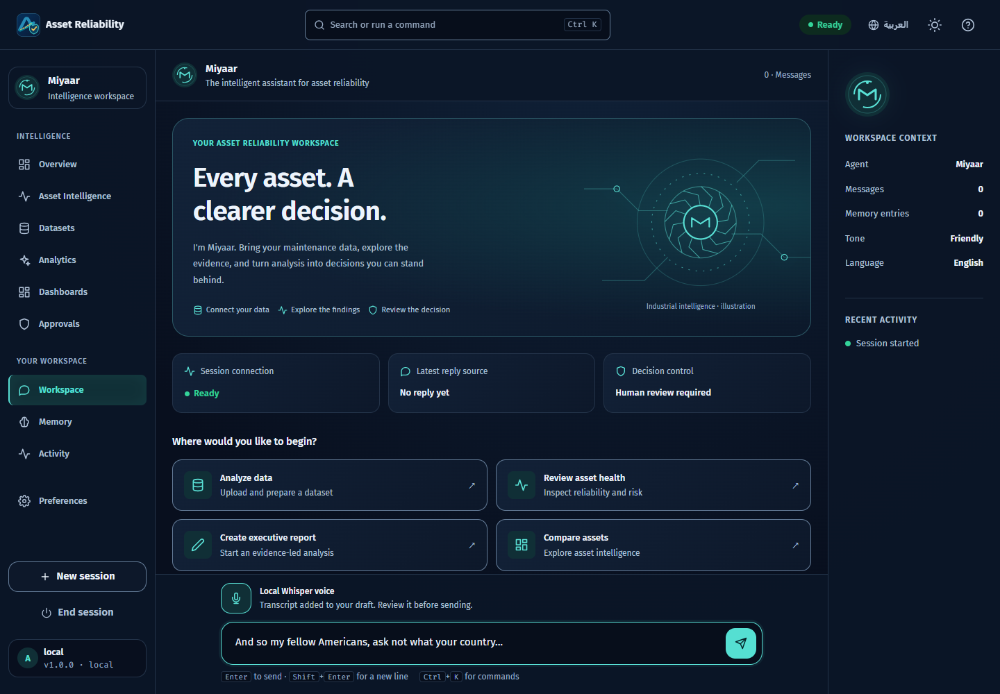

# Local Miyaar setup / تشغيل معيار محليًا

This profile runs the workspace, analytics worker, local model and optional Whisper transcription on this Windows computer. Installation is one part of acceptance: it does not establish production readiness or guarantee every feature will succeed.

<div dir="rtl">

يشغّل هذا الإعداد مساحة العمل وعامل التحليلات والنموذج المحلي وتفريغ الصوت الاختياري عبر Whisper على جهاز Windows هذا. التثبيت جزء من التحقق؛ لا يثبت الجاهزية للإنتاج ولا يضمن نجاح كل ميزة.

</div>

## Start / البدء

Open PowerShell in the repository root. Use the project virtual environment; A supported Node.js and npm must be available for installation/build: Node 24.15+ within the 24 LTS line, or Node 22.22.2+ within the 22 line (Node 26+ is also supported). This workspace uses verified official Node 24.22.0 side by side under `private/tools`; the local launcher selects it for its own process without replacing system Node. On a fresh clone, use the installed `uv` tool to create the project environment first (the repository pins Python 3.12; the existing Windows environment was also verified on Python 3.11).

<div dir="rtl">

افتح PowerShell في جذر المستودع. استخدم بيئة Python الخاصة بالمشروع، واستخدم إصدار Node مدعومًا مع npm للتثبيت والبناء: 24.15 أو أحدث ضمن سلسلة LTS 24، أو 22.22.2 أو أحدث ضمن السلسلة 22. يستخدم هذا المشروع نسخة Node 24.22.0 محلية داخل `private/tools` يختارها المشغّل دون استبدال نسخة النظام.

</div>

```powershell
$env:PYTHONUTF8 = '1'
# Fresh clone only; preserve an existing environment:
if (-not (Test-Path '.venv/Scripts/python.exe')) {
    uv venv --python 3.12 .venv
}
.\.venv\Scripts\python.exe scripts/local_runtime.py doctor
# Reproduce dependencies, download pinned voice weights, and build the frontend:
.\.venv\Scripts\python.exe scripts/local_runtime.py install --voice --agents
# Start the local server and its scheduled connector worker:
.\.venv\Scripts\python.exe scripts/local_runtime.py start --worker --port 8000
```

Open <http://localhost:8000>. Keep this terminal open; `Ctrl+C` stops the workspace and its worker. The server binds to `127.0.0.1`, for this computer only. Installation requires internet access; the installed local voice route loads its model without downloading files during requests. `--model-dir` can select another absolute voice-model directory for all three commands.

<div dir="rtl">

افتح <http://localhost:8000> واترك الطرفية مفتوحة. يوقف `Ctrl+C` مساحة العمل والعامل. يستمع الخادم على `127.0.0.1` لهذا الجهاز فقط. يحتاج التثبيت إلى الإنترنت؛ أما مسار الصوت المحلي فيحمّل النموذج المثبّت دون تنزيل ملفات أثناء الطلبات. يمكن اختيار مجلد مطلق آخر للنموذج باستخدام `--model-dir` مع الأوامر الثلاثة.

</div>

For manual `npm` commands, select the same portable runtime in this PowerShell terminal only (run from the repository root). / لاستخدام أوامر `npm` مباشرة، اختر النسخة نفسها لهذه الطرفية فقط من جذر المشروع:

```powershell
$projectNode = Join-Path $PWD 'private/tools/node-v24.22.0-win-x64'
if (Test-Path (Join-Path $projectNode 'node.exe')) {
    $env:PATH = "$projectNode;$env:PATH"
}
node --version
npm --version
```

Use a local SQLite configuration and a shell without hosted `DATABASE_URL` or `AGENTIC_OS_ENV=production` settings. The local launcher also refuses `database_url` inside the selected configuration. `AGENTIC_OS_CONFIG` selects another local configuration; the API and worker use the same file. The launcher does not rewrite hosted settings on disk.

<div dir="rtl">

استخدم إعداد SQLite محليًا وطرفية دون متغيرات قاعدة البيانات المستضافة أو وضع الإنتاج. يرفض المشغّل المحلي أيضًا `database_url` داخل ملف الإعداد المختار. يختار `AGENTIC_OS_CONFIG` ملفًا محليًا آخر ويستخدمه الخادم والعامل معًا، دون تعديل إعدادات الاستضافة المحفوظة. في نسخة جديدة فقط، ينشئ الأمر `uv venv` بيئة المشروع بإصدار Python المثبّت في المستودع.

</div>

## Installed components / المكونات المثبتة

| Component / المكوّن | Status / الحالة |
| --- | --- |
| Python web dependencies / اعتماديات خادم Python | Installed in `.venv`; dependency consistency check passed. / مثبّتة في `.venv`، واجتازت فحص توافق الاعتماديات. |
| Node / npm | Verified project-local Node `24.22.0`, npm `11.19.1`; official ZIP SHA256 checked. / نسخة محلية للمشروع، مع التحقق من بصمة الأرشيف الرسمي. |
| Ollama and local chat / المحادثة المحلية | `qwen3:4b-instruct-2507-q4_K_M`: installed; real English/Arabic chat and equipment-context follow-ups passed. / ثُبّتت نسخة Qwen3 المخصّصة للتعليمات، ونجحت المحادثة الفعلية باللغتين مع تذكّر نوع المعدة في سؤال المتابعة. |
| Local voice / الصوت المحلي | `faster-whisper==1.2.1`, multilingual `small`, CPU INT8. / نموذج `small` متعدد اللغات، يعمل على المعالج بدقة INT8. |
| Optional agent examples / أمثلة الوكلاء الاختيارية | `langgraph==1.2.16`, `pydantic-ai-slim==2.57.0`, `mcp==2.3.0` installed. Installation alone does not select a runtime; the core does not require these frameworks. / مثبّتة؛ لا يفعّل التثبيت وحده مسار وكيل، ولا يتطلبها المحرك الأساسي. |

The selected instruction-only [Qwen3 4B Instruct 2507](https://huggingface.co/Qwen/Qwen3-4B-Instruct-2507) weights use Apache 2.0. This is a different model from the older thinking `qwen3:4b` tag. The local profile uses one inference model, a 4096-token context and six CPU threads. Startup prewarms it before accepting requests; inference allows up to 60 seconds. Actual English and Arabic checklist conversations and equipment-context follow-ups passed with model responses rather than fallback text. The Arabic checklist used imprecise technical wording; this bounded scenario does not validate a maintenance procedure or establish general model accuracy. Earlier CPU probes approached the timeout. Validate model quality for actual maintenance tasks before production.

The voice installer pins `Systran/faster-whisper-small` to revision `536b0662742c02347bc0e980a01041f333bce120`. Its default directory is `~/.cache/miyaar/models/faster-whisper-small`, outside the repository. Public English and Arabic speech samples transcribed through the actual CPU adapter; the Arabic output contained word/name errors. Physical microphone capture and actual audible playback still need device acceptance. Results and test counts have one source: [README — Testing](../README.md#testing).

<div dir="rtl">

تستخدم أوزان Qwen3 المخصّصة للتعليمات ترخيص Apache 2.0. وهي نموذج مختلف عن الوسم القديم `qwen3:4b` الذي يعتمد التفكير. يستخدم الإعداد المحلي نموذج استدلال واحدًا وسياقًا من 4096 رمزًا وستة خيوط للمعالج. يُحمّل النموذج قبل قبول الطلبات، وتصل مهلة الاستدلال إلى 60 ثانية. نجحت محادثة قائمة الفحص وسؤال المتابعة عن نوع المعدة باللغتين بردود فعلية من النموذج، دون احتساب النص البديل كنجاح. احتوت القائمة العربية على تعبيرات فنية غير دقيقة؛ نجاح هذا السيناريو المحدود لا يعتمد إجراء صيانة ولا يثبت دقة النموذج عمومًا. اقتربت اختبارات سابقة على المعالج من المهلة؛ تحقّق من الجودة على مهام الصيانة الفعلية قبل الإنتاج.

يثبّت مُثبّت الصوت مراجعة النموذج المحددة أعلاه في `~/.cache/miyaar/models/faster-whisper-small` خارج المستودع. نجح تفريغ عينتين صوتيتين فعليتين بالعربية والإنجليزية عبر المعالج، مع أخطاء في كلمات وأسماء عربية. ما زال تسجيل الميكروفون الحقيقي وسماع القراءة الصوتية يحتاجان اختبارًا على الجهاز. النتائج وأعداد الاختبارات موثقة في [قسم الاختبارات في README](../README.md#testing).

</div>

The official `SYSTRAN/faster-whisper` source was cloned at release `v1.2.1` into the ignored local vendor directory; the application imports the pinned Python package. Existing Docker and standalone FFmpeg installations are optional for this profile. Whisper uses PyAV's bundled decoding libraries. No NVIDIA/CUDA hardware was detected, so this profile uses CPU inference. LLMRouter and its large Torch/CUDA dependency stack were not installed.

<div dir="rtl">

استُنسخ المصدر الرسمي لـ `SYSTRAN/faster-whisper` عند الإصدار `v1.2.1` إلى مجلد محلي مستبعد من Git، ويستخدم التطبيق حزمة Python المثبّتة. لا يتطلب هذا الإعداد تثبيتات Docker أو FFmpeg المستقلة الموجودة على الجهاز؛ يستخدم Whisper مكتبات فك الصوت المضمنة مع PyAV. لم يُكتشف عتاد NVIDIA/CUDA، لذلك يعمل الاستدلال على المعالج. لم تُثبّت حزمة LLMRouter واعتماديات Torch/CUDA الكبيرة.

</div>

## Voice operation and limits / استخدام الصوت وحدوده

- The UI uses local Whisper when the server reports it available; otherwise browser speech controls remain available where supported. Allow microphone access in a supported browser on localhost or HTTPS. Browser speech may use the browser vendor's service; it has a separate consent notice.
- Local recording stops after 29 seconds to remain below the server's 30-second limit. The maximum upload is 2,000,000 bytes. One transcription runs at a time per server process; another request receives a busy response.
- Audio and transcription output are not persisted by the transcription route. The recording is sent to this Miyaar server. Recognized text goes into an editable draft and is never sent as a chat message automatically; sending it creates the normal conversation record.
- Cancel closes capture and ignores a late result. It does not interrupt a CPU transcription already running on the server. Read-aloud uses the browser's installed voices; Arabic voice quality depends on the device.

<div dir="rtl">

- تستخدم الواجهة Whisper المحلي عندما يعلن الخادم توفره، وإلا تظهر أدوات صوت المتصفح عند دعمها. اسمح بالميكروفون في متصفح مدعوم على localhost أو HTTPS. قد يستخدم صوت المتصفح خدمة المورّد، وله إشعار موافقة مستقل.
- يتوقف التسجيل المحلي بعد 29 ثانية للبقاء دون حد الخادم البالغ 30 ثانية. حد الرفع 2,000,000 بايت. يعالج كل خادم عملية تفريغ واحدة في الوقت نفسه ويعيد حالة «مشغول» للطلب الآخر.
- لا يحفظ مسار التفريغ الصوت أو النص الناتج. يُرسل التسجيل إلى خادم معيار هذا، ويُضاف النص إلى مسودة قابلة للتعديل دون إرسال تلقائي. عند إرسال المسودة تُحفظ ضمن سجل المحادثة المعتاد.
- يوقف الإلغاء التسجيل ويتجاهل النتيجة المتأخرة، لكنه لا يقطع عملية التفريغ التي بدأت على معالج الخادم. تستخدم القراءة الصوتية أصوات المتصفح المتاحة، وتعتمد جودة العربية على الجهاز.

</div>

Actual Chrome recording from a public test-audio fixture reached local Whisper and filled this editable draft without sending a chat message. This capture uses a fake audio source, not a physical microphone. / وصل تسجيل Chrome من ملف صوت اختبار عام إلى Whisper المحلي وظهر في مسودة قابلة للتعديل دون إرسال رسالة؛ مصدر الصوت ملف اختبار، وليس ميكروفونًا حقيقيًا.



## Workspace agent activation / تفعيل وكيل مساحة العمل

The model and an agent framework are separate settings. A configured local
model can answer open conversation on its own. To test the optional LangGraph
loop, add this to a private local configuration selected by `AGENTIC_OS_CONFIG`:

```json
"agent_runtime": {
  "path": "examples.runtimes.langgraph_runtime.LangGraphRuntime",
  "options": {"max_steps": 3, "max_tokens": 220}
}
```

Keep the existing data paths and other configuration fields. Use one planner
for a message. Pydantic AI remains an alternative, not a second planner running
alongside LangGraph. The same tools, privacy checks and human approval gates
apply. Exact help/status shortcuts answer without model latency. Check the
reply's actual source, not just the configured provider in health.

Keep only the selected inference model loaded on a memory-constrained machine.
The installation checks found that smaller weights were faster to load but
failed bilingual reply/tool-selection quality. Loading several models together
caused memory pressure and timeouts. README records measured results, including
failed probes; there is no guaranteed fast-response service level.

<div dir="rtl">

إعداد النموذج منفصل عن إطار الوكيل؛ يستطيع النموذج المحلي الرد على المحادثة
المفتوحة مباشرة. يمكن اختبار LangGraph بإضافة الإعداد أعلاه إلى ملف محلي خاص،
مع الحفاظ على مسارات البيانات الحالية. استخدم مخططًا واحدًا لكل رسالة؛ يبقى
Pydantic AI بديلًا. تبقى الأدوات وضوابط الخصوصية والموافقات البشرية كما هي.
تجيب اختصارات المساعدة وحالة التحليل مباشرة. تحقّق من مصدر الرد الفعلي، لا من
وجود اسم النموذج في فحص الصحة فقط. أبقِ النموذج المختار وحده محمّلًا عند محدودية
الذاكرة؛ لا يضمن تثبيت نموذج أصغر جودة ردوده أو سرعة جميع الطلبات.

</div>

## Cloud setup and acceptance / إعداد السحابة والتحقق

`doctor` reports installed packages and model presence; it is not a successful conversation or speech test. Check a real English and Arabic conversation, microphone recording, editable transcript, denied permission, retry, upload-to-report flow, approval, and restart before accepting the installation. Keep the model's actual failure/fallback status visible.

Hosted Supabase identity and PostgreSQL require protected server configuration and a real deployment check; local installation does not create cloud accounts, organizations, subscriptions or billing. Follow [.env.example](../.env.example) and [known limitations](KNOWN_LIMITATIONS.md). Supply secrets through protected environment settings, never API-key messages in chat or tracked files. A model listening on this computer is not reachable from a hosted server automatically.

Existing GitHub and Supabase connectors were usable in this session. The optional OpenAI Developers plugin was offered in the installation UI and is not installed; it requires completing that UI action. It is not required for this local runtime.

The installed Codex skills `gh-fix-ci`, `gh-address-comments`, `transcribe`, `speech`, `security-best-practices`, and `security-threat-model` become available on your next Codex turn. They assist development; they are not SaaS runtime features or subscriptions.

<div dir="rtl">

يعرض `doctor` الحزم المثبّتة ووجود النموذج؛ لا يثبت نجاح المحادثة أو الصوت. قبل قبول التثبيت، اختبر محادثة فعلية باللغتين، وتسجيل الميكروفون، وتعديل النص، ورفض الإذن، وإعادة المحاولة، ومسار رفع البيانات إلى التقرير والموافقة وإعادة التشغيل. أبقِ حالة فشل النموذج أو الانتقال للرد البديل واضحة.

تحتاج هوية Supabase وقاعدة PostgreSQL المستضافتان إعدادًا محميًا للخادم واختبار نشر فعليًا. لا ينشئ التثبيت المحلي حسابات السحابة أو المؤسسات أو الاشتراكات أو الفوترة. اتبع ملف الإعداد النموذجي والقيود المعروفة المرتبطين أعلاه، وضع الأسرار في إعدادات البيئة المحمية، ولا ترسل مفاتيح API في المحادثة أو تحفظها في ملفات متتبعة. لا يستطيع الخادم المستضاف الوصول تلقائيًا إلى نموذج يعمل على هذا الجهاز.

أمكن استخدام موصّلي GitHub وSupabase في هذه الجلسة. عُرضت إضافة OpenAI Developers الاختيارية في واجهة التثبيت ولم تُثبّت؛ تحتاج إكمال الخطوة من تلك الواجهة، ولا يتطلبها التشغيل المحلي.

تتوفر مهارات Codex المذكورة أعلاه في رسالتك التالية إلى Codex. تساعد في التطوير ولا تمثل ميزات تشغيلية أو اشتراكات داخل المنصة.

</div>

Upstream references / المصادر الأصلية: [faster-whisper](https://github.com/SYSTRAN/faster-whisper), [Ollama Qwen3 Instruct](https://ollama.com/library/qwen3:4b-instruct-2507-q4_K_M), [structured output schemas](https://docs.ollama.com/capabilities/structured-outputs), [Node 24.22 LTS](https://nodejs.org/en/blog/release/v24.22.0).
