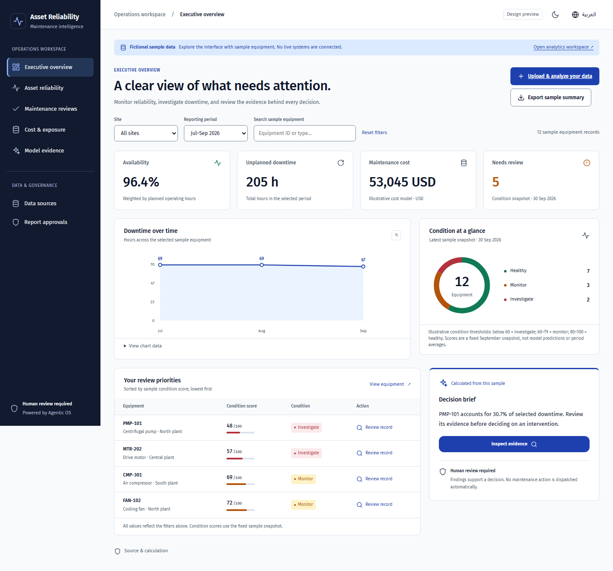
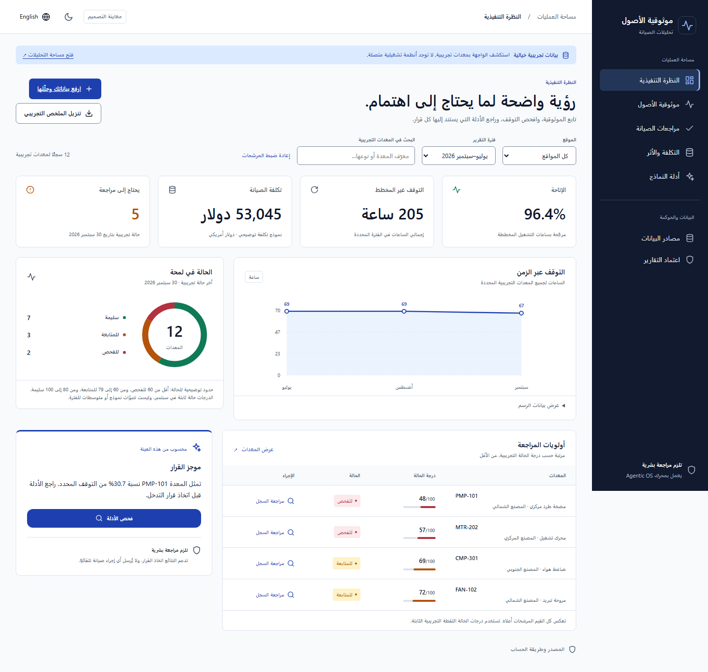

# Maintenance SaaS interface

Interactive design for **AI-Driven Predictive Maintenance and Asset Reliability
Decision-Support System SaaS Project**. Starting screen selected by the owner:
**Executive overview**. Compact product name: **Asset Reliability / موثوقية الأصول**.

## Open the design

From the repository root:

```powershell
npm.cmd --prefix frontend run dev -- --host 127.0.0.1 --port 5173
```

Open `http://127.0.0.1:5173/?design=maintenance`. On Linux/macOS use `npm`.
The design uses fictional fixtures and works without a backend. The separate
analytics workspace links require the normal application server and managed
authentication when configured. This is a local design preview, not a deployment.

## Screen map

| Screen | User decision | Implemented interaction |
| --- | --- | --- |
| Executive overview | Where should I look first? | Availability, downtime, cost, condition count, trend, condition mix, priority records and a calculated decision brief |
| Asset reliability | What evidence explains this equipment's condition? | Searchable equipment table, condition labels and evidence dialog |
| Maintenance reviews | What remains to be examined? | Local review queue; mark reviewed; clear distinction from work orders and report approval |
| Cost & exposure | Where is the sample maintenance spend concentrated? | Site bars, exact values and calculation disclosure |
| Model evidence | Is a prediction supported by an evaluation? | Unavailable model state; target, feature timing and baseline prerequisites; link to governed analyses |

Data sources and report approvals link to the existing workspace. A tenant
selector, subscription management, dispatch system and predictive risk model
are future product work, not simulated working controls.

## Visual direction

The persistent navy rail separates navigation from a light operational canvas.
Blue indicates selection and primary actions; condition labels accompany green,
amber and red status colors. Headline figures lead, supporting evidence follows.
The decision brief cites a calculation rather than presenting generated advice
as an autonomous maintenance instruction.

Use the shared tokens in `frontend/src/shared/styles/tokens.css`, including the
new `--nav-*` family. The existing Fira Sans/Fira Code fonts remain bundled;
Arabic uses the existing system font stack. Dark mode reuses the same semantic
tokens. Styles and strings live with the preview chunk.

Desktop uses a side rail, four metric cards, a trend/condition row and a
table/decision-brief row. The rail becomes a navigation strip on tablets. Phone
layouts stack content, retain two metric columns, wrap filters and allow only
the equipment table to scroll horizontally. Arabic mirrors the shell and text
alignment; numeric equipment identifiers use directional isolation. Chart time
axes retain chronological order, with localized month names and numeric tables.

## Review flow

1. Choose a site and period, then optionally search by equipment ID or localized
   type. Cards, charts, tables, the decision brief and the export share this scope.
2. Open a record from the priority table or decision brief. Inspect condition,
   selected-period downtime/cost, source, formulas and thresholds.
3. Mark it reviewed in the preview. The review queue updates locally. Reloading
   clears reviews; nothing is sent to the server or dispatched to equipment.
4. For actual reports, leave the preview through Report approvals and use the
   existing exact-artifact approval workflow.

The dialog traps focus and closes with Escape, Close evidence or the scrim.
Focus returns to the opener; if a reviewed row disappeared, it moves to the
page heading. Navigation, filters and actions have visible keyboard focus.

## Data and evidence contract

`frontend/src/features/maintenance/sample.ts` contains original fictional fixtures:
twelve equipment records, three fictional plants, April–September 2026. It has
no dependency on the private workbook or any real asset register.

| Display | Calculation / interpretation |
| --- | --- |
| Availability | `(sum planned hours − sum downtime) / sum planned hours × 100`; 160 planned hours per equipment-month in the fixture |
| Downtime | Sum of sample downtime hours in the selected period and equipment scope |
| Maintenance cost | 420 USD per equipment-month + 185 USD per downtime hour; illustrative, not observed expenditure |
| Condition score | Fixed 30 September sample snapshot; not a model prediction or period average |
| Condition labels | Below 60: investigate; 60–79: monitor; 80–100: healthy; illustrative thresholds |
| Needs review | Count of selected records with a snapshot score below 80; local review marks do not change the score |
| Decision brief | Highest contributor's downtime / filtered downtime; no causal or savings claim |
| Export | One aggregate row with fixture source, site, period, record count, availability, downtime and cost |

The sample-data banner is always visible. Zero matching records produce a
recoverable empty state; missing availability is not shown as zero. No model
accuracy, confidence, failure probability or operational saving is invented.

## Interface states

| State | Current design |
| --- | --- |
| Loading or failed view chunk | Existing bilingual loading skeleton and reload error boundary |
| Empty filter scope | No matching equipment message and Reset filters action |
| Empty review queue | Explicit no-remaining-records message |
| Reviewed record | Local status, disabled repeat action and queue removal |
| Unavailable model | Evidence requirements and link to governed model analyses |
| Real data loading, stale source, failed query, permission denied | Use the production workspace's server-backed states during integration; no fictional live connection indicator |

## Validation and handoff

```powershell
npm.cmd --prefix frontend test
npm.cmd --prefix frontend run build
npm.cmd --prefix frontend run e2e -- --config playwright.preview.config.ts
```

The preview browser suite runs independently of the API suite and writes real
captures under `docs/screenshots/maintenance/`. It checks both English and Arabic,
both themes, desktop and phone, accessibility rules, document overflow, keyboard
focus, sample exports and the absence of preview API calls. It is not evidence of
production authentication, backend integration, real-device behavior or a human
accessibility audit. The session log records the actual execution outcome.

Local validation on 17 October 2026 passed the preview browser suite, frontend
unit suite, TypeScript check, production build, interface budgets and focused
documentation checks. No axe violations were reported in the tested page,
language and theme combinations. Additional 320-pixel checks found no document
overflow or clipped metric/legend content. Full backend verification remains
unsuccessful in this environment; current counts and limitations are in the
[README](../../README.md#testing) and session log.





Before replacing the normal application entry, bind these views to the maintenance
contract's server-side aggregates and approved model cards. Keep source freshness,
run IDs, definitions, periods, denominators and evidence references with each
measure; retain authentication, tenant isolation and explicit human approval.

Implementation decision: [ADR 0037](../adr/0037-maintenance-design-preview.md).
