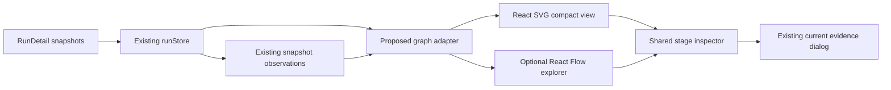
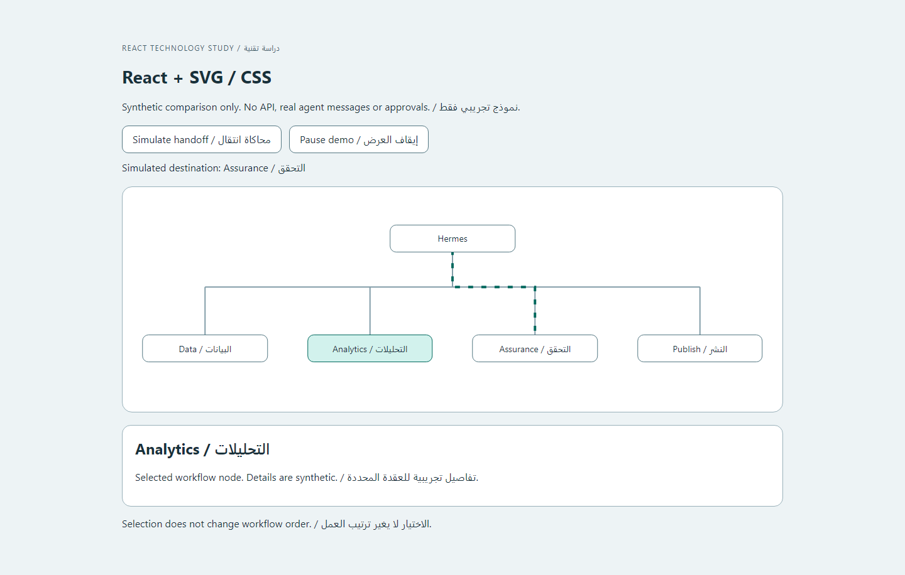
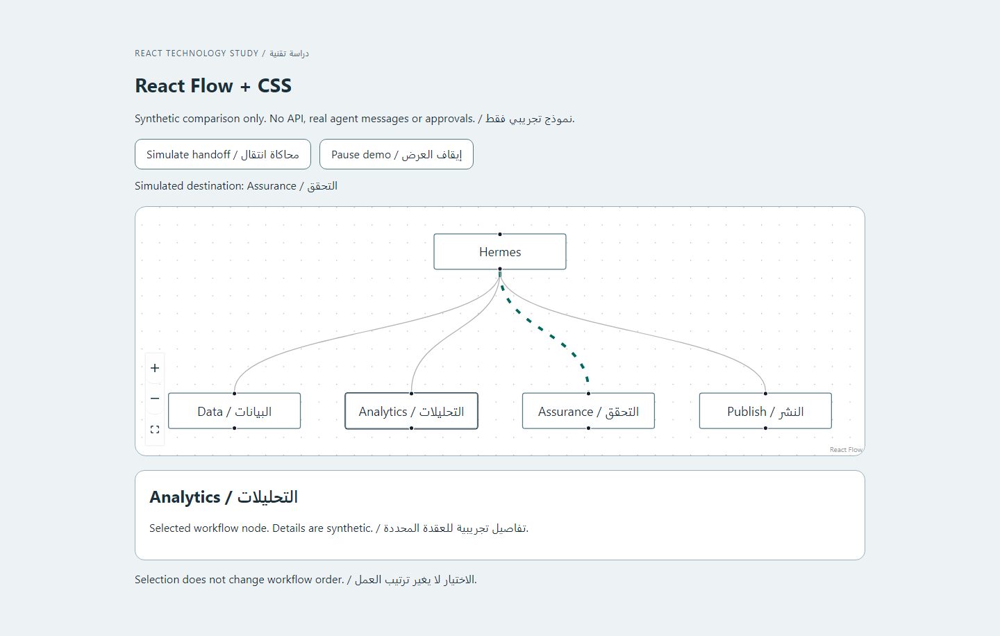

# React animations and agent connections

Date: 21 October 2026. Reviewed platform source: `827a584` on main, including the existing collaboration work from `16d779b` and its follow-ups. Status: researched recommendation and isolated experiments, not a new production feature or an accepted dependency decision.

## Recommendation

Keep **React + SVG + CSS** for the everyday Runs workspace. Build an optional **React Flow explorer** when users need pan, zoom, larger graphs and richer connection inspection. Do not add Motion merely to animate a handoff or open a panel: the current implementation already does those jobs without an animation dependency.

React is the platform's framework; React Flow is a graph component built for React. Motion is an animation library that can accompany either approach. They solve different problems. The platform already uses React 19, TypeScript and Vite, so no framework migration is needed.

The owner selected professional, restrained motion: visible handoffs, clear statuses and expandable details. The existing design master specifies CSS transitions and state-driven keyframes. This study preserves that direction and identifies when a more capable graph engine would earn its cost.

## What exists today

- `AgentCollaboration.tsx` presents Hermes, four workflow groups, stage selection, previous/current/next order, checks, claims, current evidence and recent observations. `RunsView.tsx` loads it lazily.
- `runStore.ts` owns the shared run scheduler. A new visualization should subscribe to it, not create another polling loop or advance runs independently.
- `runEvents.ts` derives observations from server snapshots. `RunDetail.tasks` supplies stage order and states. These are not durable messages between agents, and polling can omit transitions.
- The current handoff highlight is finite. The application already handles view pause, analysis pause, interruption, document visibility, system/app reduced motion and Arabic RTL.
- The Obsidian brain contains curated knowledge topics. Its links and nodes must remain distinguishable from runtime agents, execution dependencies and exchanged messages.

The [existing motion study](AGENT_COLLABORATION_MOTION.md) documents shipped behavior. This document studies the next connection-view architecture.

## Comparison

| Approach | Best use here | What we must provide | Recommendation |
| --- | --- | --- | --- |
| React + SVG/CSS | Compact workflow, status changes, focused handoff paths, responsive stage list | Layout, selection, relation labels and accessibility semantics | Default for the existing platform |
| React Flow + CSS | An explorer with pan/zoom, selectable nodes and edges, fit-to-view and collapsible groups | Verified topology, stable layout, read-only configuration, translated accessibility text and restrained edge animation | Optional future explorer |
| React SVG + Motion mini | Imperative, cancellable animation sequences when native CSS becomes awkward | Explicit pause/reduced-motion policy and lifecycle cleanup | Add only for a demonstrated interaction need |
| React SVG + LazyMotion | Richer component transitions and animation orchestration | Feature loading, motion policy and a justified payload allowance | Excess capability for today's brief handoffs |

React Flow supports custom edge animation, but a moving edge is only a visual effect; it supplies no evidence that a message was sent. Its keyboard support and configurable accessibility labels are useful building blocks, with implementation checks still required. Automatic graph layout is a separate concern; React Flow documents integrations with layout libraries rather than providing an automatic layout engine itself. Start with deterministic positions from verified stage order before considering another dependency. Sources: [edge animation](https://reactflow.dev/examples/edges/animating-edges), [accessibility](https://reactflow.dev/learn/advanced-use/accessibility), [layout options](https://reactflow.dev/learn/layouting/layouting).

Motion offers smaller entry points and deferred features. Its `reducedMotion="user"` option disables transform/layout motion but can retain opacity and color animation; matching this platform's stronger pause/reduced-motion behavior requires an explicit policy. Sources: [bundle guidance](https://motion.dev/docs/react-reduce-bundle-size), [accessibility behavior](https://motion.dev/docs/react-accessibility).

## Measured build cost

Four isolated client builds used React/React DOM 19.2.8, React Flow 12.12.0, Motion 14.4.0, Vite 8.2.1 and Node 24.22.0 on Windows. Each renders the same five synthetic workflow nodes and an inspector. The React Flow variant also imports its Controls, Background and default stylesheet. Motion variants add an inspector opacity transition. Results sum individually gzipped assets at level 9, in decimal KB.

| Build | Total JS | Additional JS versus native | Total CSS |
| --- | ---: | ---: | ---: |
| React SVG/CSS baseline | 60.17 KB | — | 0.77 KB |
| React Flow + CSS | 116.48 KB | **56.31 KB** | 3.08 KB |
| React SVG + Motion mini | 63.28 KB | **3.11 KB** | 0.77 KB |
| React SVG + LazyMotion with `domAnimation` | 89.31 KB | **29.14 KB** | 0.77 KB |

These are measured differences between small standalone builds, not projected production totals, FPS measurements or proof that the implementations have identical features. React Flow includes canvas capabilities absent from the native fixture. The LazyMotion example imports `domAnimation` eagerly; it measures total shipped code, not the best achievable initial-load split. A real integration can share or remove code differently.

The existing platform build measures **184.5 KB of total JavaScript against its 185 KB ceiling**, with initial JS at 98.5/100 KB and total CSS at 22.7/23 KB. The current frontend source and lockfile are unchanged by the incoming backend work at the reviewed commit. Even the smallest measured library increment is larger than the remaining total-JS allowance. An integration must recover space or record a justified budget change. Lazy loading can protect initial load, but does not remove the aggregate cost. React's [lazy API](https://react.dev/reference/react/lazy) defers component loading until first render.

Exact results, pinned experiment dependencies, the lockfile and reproduction steps are in [experiments](experiments/README.md). Platform verification counts remain in [README Testing](../../README.md#testing).

## Connection-view design

Provide two levels of detail using the same run data and selection state:

1. **Compact workflow, default:** Hermes and the four groups remain readable at a glance. Expanding a group reveals its real stages in returned order. Selection opens the existing inspector and current evidence. Phone layouts use a vertical sequence or list rather than shrinking an entire graph.
2. **Connection explorer, optional:** a separate, lazily loaded view adds fit, zoom, category filters and selection of a relation. Initially keep node positions stable and editing disabled. Selecting a node never runs an agent, publishes a report or changes its workflow.

Use explicit relation types:

| Relation | Source | Display rule |
| --- | --- | --- |
| Workflow order | Returned stage order / declared pipeline configuration | Label as order or dependency; do not imply a message was exchanged |
| Observed state change | Retained `RunEvent` snapshot observation | Briefly emphasize the affected stage/connection; label its time as observed |
| Evidence reference | Existing stage checks and claims | Open the governed evidence viewer; preserve scope and current-versus-held wording |
| Knowledge relationship | Curated note wikilinks | Separate knowledge mode; no running indicators or runtime message counts |
| Agent message | Future authorized durable event contract | Unavailable until the backend provides actual sender/recipient and payload evidence |

A coordinator fan-out must not imply that all specialist stages run simultaneously. The selected stage's ordered context should remain visible alongside the graph.

The proposed adapter should be a pure function: stable run/task IDs, stage states, declared order, selected ID and observation IDs in; nodes, typed relations and accessible labels out. Keep geometry and selection separate from server state. Memoize custom graph components and callbacks, and avoid subscribing every inspector field to every canvas movement; see React Flow's [performance guidance](https://reactflow.dev/learn/advanced-use/performance).

For a read-only React Flow explorer, begin with `nodesDraggable={false}`, `nodesConnectable={false}`, `edgesReconnectable={false}` and `deleteKeyCode={null}`. Keep keyboard focus/selection enabled, translate `ariaLabelConfig`, and provide a readable list alternative. Do not expose an edit mode until a separate server-side workflow-editing contract exists. The [component API](https://reactflow.dev/api-reference/react-flow) documents these interaction controls.

## Platform motion specification

| Interaction | Proposed behavior | Evidence / accessibility condition |
| --- | --- | --- |
| Button, selection or focus response | Existing 140 ms token; visible focus stays immediate | No movement on static information cards |
| Stage inspector changes | Existing 220 ms token for a small opacity transition where helpful | Stable reading/focus order; immediate content when motion is reduced |
| Newly observed handoff | Preserve the existing single 900 ms connection emphasis | New observation ID only; no invented replay on initial load |
| Run or group state | Update text and semantic color together | Failed/cancelled/awaiting approval retain their real meaning |
| Dashboard refresh | Mark the new scope/revision and replace values coherently | Do not animate intermediate KPI numbers as though they were measurements |
| Loading / reconnecting | Clear pending or reconnecting state | No fabricated completion percentage or circulating message particles |
| Human approval | Change state after server confirmation | Animation never signals approval before it is recorded |
| View pause / hidden tab / reduced motion | Hold or suppress visual motion as appropriate | Keep analysis controls and current evidence semantics distinct |

Retain English/Arabic parity, isolated mixed numerals, logical CSS properties and stable technical identifiers. Reverse layout deliberately for RTL; do not silently reverse chronology or graph meaning. Respect both the app setting and the operating-system setting. Native CSS is sufficient for this catalogue; the browser [Web Animations API](https://developer.mozilla.org/en-US/docs/Web/API/Web_Animations_API) is a possible dependency-free tool if imperative timing later becomes necessary.

## Delivery sequence and acceptance

| Increment | Concrete work | Acceptance before integration |
| --- | --- | --- |
| A — richer native connections | Pure graph adapter, typed relation inspector, expanded per-stage sequence and phone list | Stable IDs/order; no extra API polling; truthful observation labels; preserved evidence scope; keyboard, EN/AR, reduced motion and size budgets |
| B — optional React Flow explorer | Separate lazy route/component, deterministic layout, fit/zoom/filter, read-only node/edge inspection | Same adapter and authorization; native/list fallback; no run mutations from canvas actions; measured integrated payload and representative device traces |
| C — real communication history | Tenant-scoped event IDs, sequence/cursor, actual timestamps, sender/recipient, event type and approved redacted payloads | Authorization, reconnect, deduplication, bounded retention and replay tested on the server before displaying transcripts |

No calendar estimate is asserted: the explorer's topology and target device workload need to be fixed first. Actual message history is backend work, not something an animation library can generate truthfully. The newly integrated agent scorecard tool is a separate measurement source; its presence does not establish a browser event feed or permission to expose every scorecard field.

## Review findings and evidence

| ID / priority | Location and observation | User consequence | Proposed action and check | Result |
| --- | --- | --- | --- | --- |
| R-01 / high | Build budget and isolated library results | A default graph library would consume materially more payload than the remaining allowance | Keep compact native view; measure an optional integration before changing its budget | Size experiment executed; production integration not tested |
| R-02 / high | `runEvents.ts`: snapshot-derived observations | A moving connector could be mistaken for a real message | Typed relation labels; future durable contract for actual messages | Source inspected; future event contract not implemented |
| R-03 / high | Existing independent view pause and current-evidence action | Freezing the view must not hide the analysis's continuing state | Preserve separate controls and explicit current evidence | Existing behavior documented; no new production regression run in this study |
| R-04 / medium | React Flow built-in interaction and accessibility controls | Editing gestures or untranslated instructions could misrepresent authority or exclude users | Read-only configuration, localized guidance, list alternative and keyboard checks | Desktop fixture rendered/selected; full keyboard/RTL/mobile acceptance not tested |
| R-05 / medium | Motion's reduced-motion defaults retain some animation | Library defaults alone do not implement the platform's full motion policy | Centralize system/app/pause/visibility decisions; cancel finite effects on change | CSS suppression smoke-checked; complete JS-policy acceptance not tested |

The experiment was browser-smoke-checked in Chromium at 1440×900 with synthetic bilingual labels. Native and React Flow captures were visually inspected. This is not a screen-reader audit, full RTL/mobile review, large-graph performance test or production certification. The fixture's simple styling is for comparison and does not replace the platform's tokens or branding.

| React/SVG experiment | React Flow experiment |
| --- | --- |
|  |  |

## Outcome

Use the existing React stack now. Keep ordinary platform animations in CSS/SVG, and reserve React Flow for a distinct graph-exploration need. Motion remains optional for future animation complexity. This delivers clear agent connections without confusing visual effects with evidence of communication.
